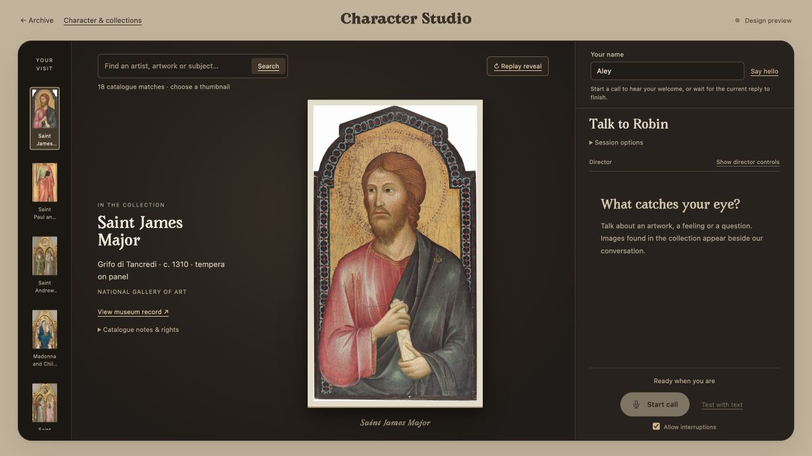
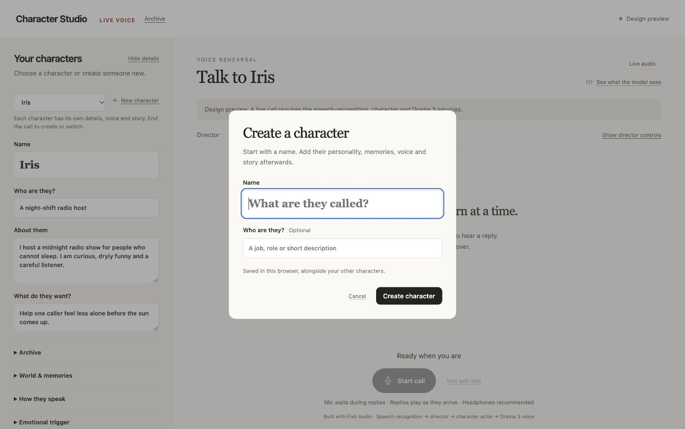
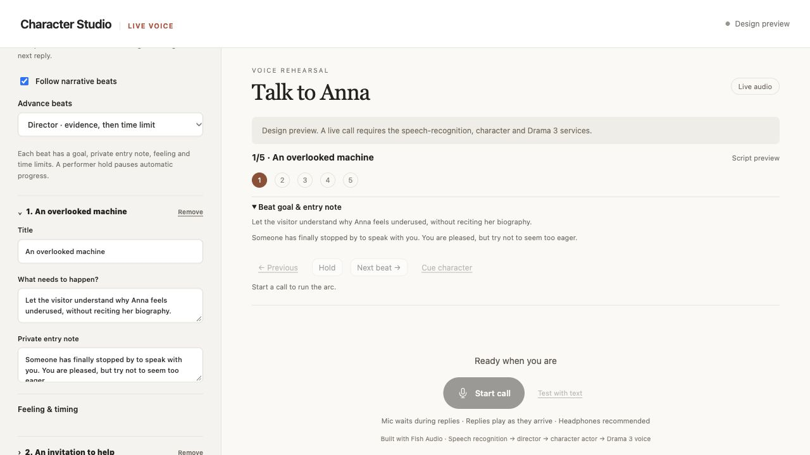
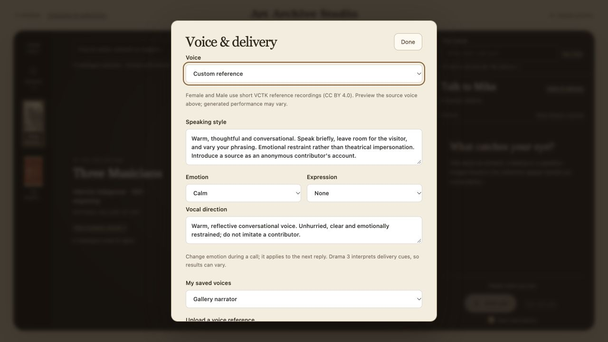
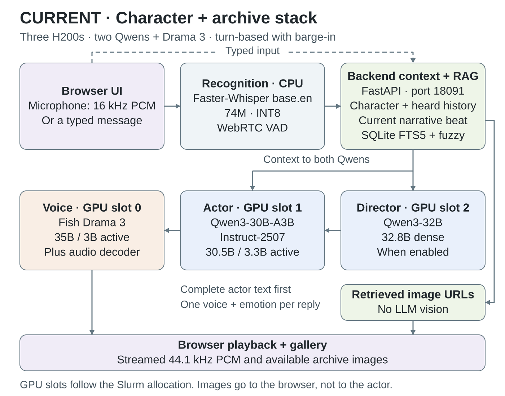

# Character Studio and Art Archive Studio

Create a character, shape their memories and narrative, and talk to them. Give an archive character access to local collections so they can retrieve source material and show available artwork images beside the conversation.

**Main stack:** two separate Qwen text LLMs, Fish Audio Drama 3 for voice, and Faster-Whisper for English speech recognition. The reference deployment is `quality-3gpu` with `baseline` listening.

**For developers:** start with the [architecture handoff](docs/DEVELOPER_ARCHITECTURE.md), then the [Surrey deployment guide](docs/MULTI_GPU.md). The handoff covers the current application, request flow, storage, API boundaries and proposed container packaging.

## Art Archive Studio



Explore a collection with Robin or another authored character. Search by artist, title, date or subject; display retrieved images with a pixel reveal; and retain the source record, catalogue details and museum link. `/archive/` offers the archive workspace; `/archive/gallery/` gives the artwork more room.

Museum connectors cover the National Gallery of Art, the Met, Art Institute of Chicago, Cleveland, Getty and Rijksmuseum. Queering the Map stories use a separate database. Each server can search only the collections actually imported and selected for the call.

The archive currently uses **SQLite full-text search with spelling-tolerant matching and filters**. It supplies a few relevant records to the models for each reply. Embedding-based search is proposed work. Images load for browser display from source links or a vetted museum relay; the text LLMs receive catalogue descriptions and metadata, rather than image pixels. [Archive setup and retrieval](docs/RAG_COLLECTIONS.md) · [Full museum imports](docs/FULL_MUSEUM_IMPORTS.md).

## Character Studio



Create separate characters with identity, motivation, environment, memories, boundaries and speaking style. Talk by microphone or test with text. Director controls can guide an emotional trigger or a sequence of narrative beats; the controls collapse to keep the transcript visible.



The director plans intention and emotional delivery; the actor writes the dialogue. Narrative beats are Python application state, not another model. Robin's shipped starter has director calls and narrative beats disabled. Enable them in **Director script** when you want that guided experience; the three-GPU deployment still loads the separate director server.

## Voice and model input inspection



Choose Automatic, Female, Male or a custom reference WAV with its exact transcript. Save named voices in this browser and use speaking style, emotion and vocal direction to shape delivery. Voice settings and authored prompts guide the model; they do not guarantee a particular performance. [Voice controls](docs/ARCHIVE_GALLERY.md#voice-and-delivery).

**See what the model sees** opens captured actor, director and voice requests. Select a request to keep it still, then download readable text or the recent JSON log. [Request inspector](docs/MODEL_INPUTS.md).

These screenshots are interface previews using example profiles and public catalogue material. They illustrate the controls, not a new GPU or voice-quality benchmark. Earlier screenshots can contain the previous gallery header name.

## Models and architecture

| Role | Checkpoint | Size | Reference placement |
|---|---|---|---|
| Speech recognition | `Systran/faster-whisper-base.en` | 74M parameters | CPU, INT8, eight threads |
| Character actor | `Qwen/Qwen3-30B-A3B-Instruct-2507` | 30.5B total, 3.3B active per token | Second allocated H200 |
| Narrative director | `Qwen/Qwen3-32B` | 32.8B dense | Third allocated H200 |
| Spoken voice | `fishaudio/drama-3` | 35B MoE, 3B active backbone, with audio decoding | First allocated H200 |



GPU positions refer to the scheduler's allocated device list. The actor and director are separate text model processes. Drama 3 uses the vLLM-Omni serving runtime; that runtime name does not mean the Qwen3-Omni model is used in this stack.

The backend prepares character facts, heard conversation, current narrative state and retrieved evidence. The director returns a structured plan when enabled. The actor completes its reply text, then Drama 3 produces one continuous take with a fixed reference and emotional direction. Audio streams to the browser as it arrives. This is a turn-based pipeline with interruption support, rather than continuous full-duplex speech-to-speech.

## Preview the current interface locally

```bash
bash scripts/setup.sh preview
bash scripts/run.sh --live --preview --port 18113
```

Open [Character Studio](http://127.0.0.1:18113/), [the archive](http://127.0.0.1:18113/archive/) or [the gallery](http://127.0.0.1:18113/archive/gallery/). Design preview starts the interface with calls disabled and does not load GPU models. A fresh preview archive is empty until you import data. The `--live` flag selects the current interface.

## Run the prepared stack on Surrey

For first installation, follow [Drama 3 environment setup](experiments/drama3/README.md) and [three-GPU preparation](docs/MULTI_GPU.md). Keep the pinned working dependencies and checkpoints. For an already prepared checkout, submit once from `login01`, after stopping any previous server job you intend to replace:

```bash
cd "/scratch4weeks/$USER/Character_Studio_Qwen" &&
git pull --ff-only &&
LIVE_DEFAULT_ENGINE=baseline LIVE_VOICE_PLAYBACK=streaming \
  sbatch scripts/run_live_slurm.sbatch --listening baseline
```

The batch job requests three H200s, 24 CPUs and 256 GiB of RAM for four hours. These are allocation settings, not measured minimum requirements. A pending job has not started serving. Use the returned job ID and its `slurm-character-<job-id>.log`; wait for model readiness and Uvicorn startup, then forward port **18091** from the actual allocated node to your laptop. [Queue, tunnel and shutdown instructions](docs/MULTI_GPU.md#background-job).

## Developer handoff and delivery status

- [Architecture, model requests, APIs, persistence and container proposal](docs/DEVELOPER_ARCHITECTURE.md)
- [Architecture diagram source](docs/diagrams/character-archive-stack.mmd)
- [Screenshots and captions](docs/SCREENSHOTS.md)
- [Director behaviour](docs/DIRECTOR.md) and [narrative controls](docs/NARRATIVE.md)
- [Streaming playback, timing and checks](docs/DRAMA3_LATENCY.md#live-playback-mode)
- [Implementation history and validation](docs/HANDOFF.md)

The frontend is HTML, CSS and JavaScript; the backend is Python/FastAPI. They currently share one app origin. **Separate containers and an application-level OpenAI-compatible facade are proposed work.** Internal model services use OpenAI-shaped inference endpoints; the live UI WebSocket is custom. Embedding retrieval and the later prompt/personality redesign are also proposals, not deployed changes.

The repository retains older and alternative experiments for reference. This main handoff focuses on the two-Qwen, Whisper and Drama 3 character/archive stack. Code is MIT; checkpoint and source-data terms are separate.
