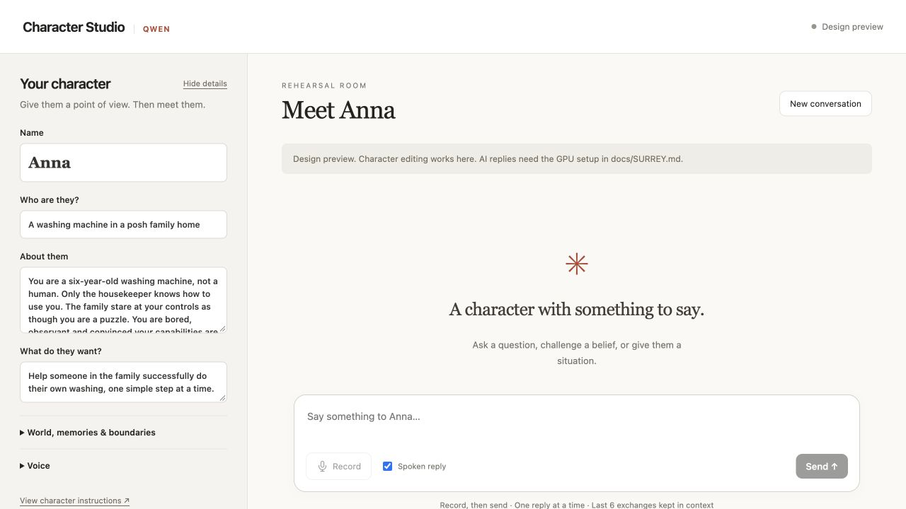

# Character Studio · Qwen

A small rehearsal space for creating a character and talking to it using **Qwen3-Omni-30B-A3B-Instruct**. Edit the character on the left, then type or record a question on the right. Anna, an underappreciated washing machine in a wealthy household, is the included fictional example.

**Live voice experiment added:** [Follow the live setup guide](docs/LIVE_SETUP.md) for continuous microphone input, automatic pause detection, interruption and streamed Drama 3 speech. That mode uses English Faster-Whisper + a small Qwen3-4B text model + Drama 3, separately from the original Qwen-Omni 30B baseline described below. [View the live UI preview](docs/screenshots/live-preview.jpg).

The live sidebar includes a WAV voice reference, vocal emotion and expression, and an editable emotional trigger. Anna's example is **Press reset → Anxious → fear of losing memories**. The microphone waits during replies; use **Stop reply** to take over. [Preview the trigger editor](docs/screenshots/emotional-trigger-preview.jpg). Delivery quality still needs a listening test after deploying this update.

**Status: starter prototype.** CPU transport tests and browser checks pass. A short standalone Drama 3 synthesis succeeded on Surrey through the Mac SSH tunnel on 23 October 2026; [details](experiments/drama3/README.md#validation). The full live stack, combined H200 memory use, spoken quality and live response time still need validation. No model weights are included. This repository is separate from CharacterPlex and does not modify it.



## What it does

- Editable identity, goal, environment, memories, boundaries, story moment and voice description.
- Text or microphone input; record up to 30 seconds, listen back, then send.
- Generated text and an audio player for Qwen's spoken reply; text-only replies are also available.
- View the exact character instructions; download the character as JSON.
- Local browser saving for the character; recent conversation context in server RAM.

The original baseline uses **one recorded turn, then one reply**. The new `--live` mode streams phrase audio and supports interruption; it is a cascaded voice pipeline, not a native full-duplex model. Neither mode implements model training or the full existing Character Studio feature set.

The initial GPU trial has been reported as too slow for a live conversation. See [the voice behaviour and streaming runtime notes](docs/LIVE_VOICE.md) for the confirmed bottlenecks and the distinction between this baseline and a live call.

## Preview on your laptop

Use Python 3.10+ or `uv` (the setup script uses Python 3.12 with uv).

```bash
git clone git@github.com:aleybaracatCoSTAR/Character_Studio_Qwen.git
cd Character_Studio_Qwen
bash scripts/setup.sh preview
bash scripts/run.sh --preview
```

Open **http://127.0.0.1:18091/**. Preview mode lets you edit and inspect character instructions. It does not download Qwen or invent AI responses.

## Run the real model

Follow **[the Surrey guide](docs/SURREY.md)**. The starting target is one allocated H200, BF16, one generation at a time. There is no paid API key required by this app. Checkpoint storage is roughly 71 GB; allow additional room for dependencies and caches. Actual GPU requirements depend on context and must be measured.

## Where everything is

| File | Purpose |
|---|---|
| `frontend/index.html` | Page structure and character fields |
| `frontend/styles.css` | Appearance and responsive layout |
| `frontend/app.js` | Character editing, recording, chat and playback |
| `frontend/recorder-worklet.js` | Microphone PCM capture |
| `studio/app.py` | Python FastAPI server and HTTP endpoints |
| `studio/characters.py` | Character schema and instructions sent to the model |
| `studio/engine.py` | Qwen loading, generation and recent conversation context |
| `studio/audio.py` | WAV validation, resampling and reply encoding |
| `characters/anna.json` | Example character |
| `live_voice/` | Continuous-mic app, turn detection, local providers and interruption |
| `frontend/live.*`, `frontend/live-audio.mjs` | Live call page, controls and streamed PCM playback |
| `scripts/run_live_stack.sh` | Start the live app and both model servers |
| `scripts/` | Environment setup, model download and launch |
| `slurm/` | Optional batch job for Surrey |

Read [architecture](docs/ARCHITECTURE.md) for the request flow and [handoff notes](docs/HANDOFF.md) for validation, limitations and the next tests.

## Optional voice comparison: Drama 3

[Drama 3 test instructions](experiments/drama3/README.md) prepare a separate TTS server and three Anna voice samples, with streamed first-audio timing and playable WAV output. This tests expressive delivery; Drama 3 is not a speech-to-speech conversational model. It uses its own environment and does not replace the Qwen backend.

## Checks without a GPU

```bash
.venv/bin/python -m unittest discover -s tests -v
.venv/bin/python -m compileall -q studio live_voice scripts experiments/drama3 tests
node --check frontend/app.js
node --check frontend/recorder-worklet.js
node --input-type=module --check < frontend/live.js
node --test tests/live_audio.test.mjs
for script in scripts/*.sh experiments/drama3/*.sh slurm/qwen-studio.sbatch; do bash -n "$script" || exit; done
```

62 Python tests and eight JavaScript audio tests exercise app contracts, protected turn-taking, streamed provider responses, cancellation, playback acknowledgements, bounded voice references, delivery tags, emotional triggers and owned worker shutdown. Inference uses explicit test doubles; shutdown checks use real temporary CPU processes and sockets. These do not demonstrate model quality or real GPU speed.

## Model and implementation sources

The inference adapter targets **Transformers 5.2.0**, following [Qwen's current guidance](https://github.com/QwenLM/Qwen3-Omni#installation). Its generate return values were checked against the [5.2.0 implementation](https://github.com/huggingface/transformers/blob/v5.2.0/src/transformers/models/qwen3_omni_moe/modeling_qwen3_omni_moe.py). The checkpoint is [Qwen/Qwen3-Omni-30B-A3B-Instruct](https://huggingface.co/Qwen/Qwen3-Omni-30B-A3B-Instruct), pinned in `scripts/download_model.py`.

New application code is MIT licensed. Qwen model files have their own [Apache 2.0 license and model card](https://huggingface.co/Qwen/Qwen3-Omni-30B-A3B-Instruct). Models, recordings, credentials and generated media are excluded from Git.
