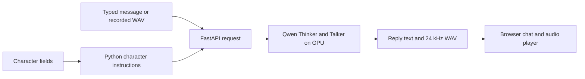

# How it fits together

## Languages and important files

The page is plain HTML, CSS and JavaScript, with no build process or framework. Python runs the HTTP server, character prompt and model inference. Bash scripts set up the isolated environment and launch it. The `.sbatch` file is a Bash script with Slurm resource requests at the top.

- Change labels and fields in `frontend/index.html`.
- Change colours, spacing and layout in `frontend/styles.css`.
- Change recording, chat state and browser interactions in `frontend/app.js`.
- Change the shared character schema and prompt in `studio/characters.py`. Update matching form names if adding fields.
- Change model loading and generation options in `studio/engine.py`.
- Change the included example in `characters/anna.json`.

## One request

The browser sends a multipart `POST /api/chat` containing JSON character details, optional text and an optional PCM WAV file. The server validates the fields and audio, converts the recording to mono 16 kHz, and builds Qwen chat-template inputs. Qwen generates reply text and, when requested, speech. Audio returns as base64 WAV at 24 kHz. This is an app-specific API, not an OpenAI-compatible endpoint.

The model and processor load from the explicit local checkpoint directory with `local_files_only=True`. No remote Python model code is executed. Text-only input still uses the same Qwen model. There is no separate cloud LLM, STT or TTS provider in this app.

## Character context and memory

Character fields become a system prompt on every request. This is **inference-time character direction**, not training or a LoRA. “Memories” are authored facts included in that prompt. Changing the sheet starts a new browser conversation and the server rejects changes to an existing session's character fingerprint.

The server retains the last six successful user/assistant exchanges, including recorded user audio, in RAM. It trims older complete exchanges to fit the configured input limit of 8,192 tokens. Up to eight sessions are retained; inactive sessions expire after 30 minutes and are pruned on the next request. A server restart forgets them. The model recomputes context for each request; there is no persistent cross-request KV cache or database.

The character sheet is saved in this browser's local storage. Chat messages are not saved there. Browser recordings and replies use temporary object URLs; the application does not write them to disk. They are nevertheless transmitted to the GPU host and retained temporarily in its process memory. Use fictional test material for early trials.

## Boundaries of this first version

One model instance accepts one generation at a time. Concurrent requests receive HTTP 409; there is no queue. Recordings are limited to 30 seconds, 6 MB, and 16-bit PCM WAV. Replies are capped by generation token limits. The frontend encodes WAV locally, so FFmpeg is not required for this path.

There is no partial audio streaming, barge-in, automatic conversation listening, multi-character orchestration, long-term memory, story scheduler, file ingestion or model training pipeline. Qwen has broader multimodal capabilities, but this app only exposes text and recorded audio. The voice selector uses the checkpoint's stock Chelsie, Ethan and Aiden speakers; it does not clone a voice.

The server binds only to `127.0.0.1`. It has no user authentication and is intended for a private SSH tunnel. Cross-origin POSTs are rejected, but this is not a public service security boundary. Public multi-user hosting needs authentication, quotas, request limiting, TLS and a storage policy before deployment.
