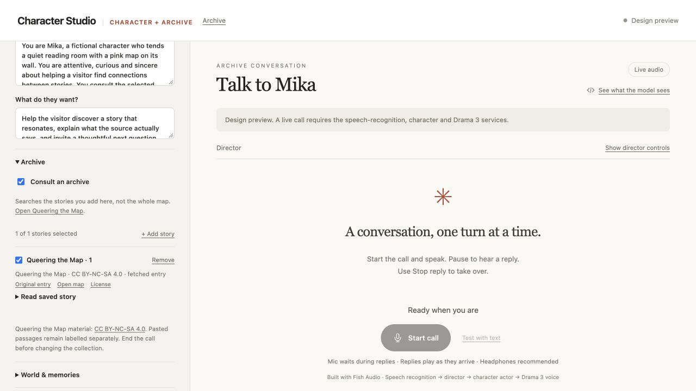

# Character + archive · Queering the Map

Open **`/archive/`** on the existing live server, for example `http://127.0.0.1:18091/archive/`. This is still the character interface: name, identity, goals, voice, environment, memories and optional director controls remain editable. The included **Mika** character is a fictional archive keeper, not a contributor or official representative of Queering the Map. You can rename or rewrite it.

The archive view has its own browser character-library key. Opening it does not replace the main view's active Karim/KADEN character or its legacy saved fields. Both views can use the local selected-story collection, but each character saves only its own enabled flag and selected entry IDs. Source text is not written to browser localStorage.

## First test

1. Pull the latest code and restart your existing live stack. No model installation or new weights are needed.
2. Open `/archive/`. **Mika** is selected on the first visit; **Consult an archive** is on.
3. Under **Archive**, choose **Add story**. Import one numeric story ID or an individual JSON entry URL such as `https://www.queeringthemap.com/moment/1`. This route reads one entry; it does not open a pin on the map.
4. Alternatively, open the map, select a story, and use **Or paste a story**. The optional source link can be the homepage or an individual entry URL. Pasted passages stay marked as user-provided and unverified, even when a source link was supplied.
5. Check the stories this character may consult. **Start call** uses your microphone; **Test with text** keeps the existing text-to-voice test.
6. Ask about a subject present in those stories, then try “Tell me more about that story.” **Sources for this reply** shows the retrieved excerpts and original links. These are the passages supplied to the models, not a claim that every generated word is a verified quotation.
7. Open **See what the model sees** to inspect or download the actual director/actor request, including its reference context.

End the call before adding, removing or selecting stories. Each call uses an immutable snapshot of its selected entries. Reference data never replaces the character's biography or becomes its own lived memories. The one-emotion, whole-reply Drama 3 voice path and existing Retry voice flow are retained.

## Scope and connection

This prototype searches **up to 50 explicitly selected stories**, with 300,000 total text characters. It does not search, copy or claim knowledge of the whole map. Its small local lexical index ranks at most three relevant passages per turn, with up to 6,000 reference characters. A vague follow-up can reuse the previous question's topic; unrelated earlier questions are not accumulated into a global search query. It may miss synonyms, translations or location queries when a place is not named in the story text. No embedding model or fine-tuning is used.

The current [official frontend](https://github.com/radical-data/queering-the-map/blob/main/src/lib/Map.svelte) reads individual stories from [`GET /moment/{id}`](https://github.com/radical-data/queering-the-map/blob/main/src/routes/moment/%5Bid%5D/%2Bserver.ts). It returns `short_id` and `description`. This is the site's own unversioned read endpoint, not a promised external service. No full-text search route was found in the reviewed source. The connector makes one bounded request for the ID you select, follows no redirects and sends no conversation or character data to the site. Imported HTML is displayed as plain text with scripts/styles removed.

The next step for a whole-archive experience is an agreed structured export or supported search integration with the project. That would support a larger index and location/theme search without pretending the current selected-story prototype has corpus-wide access.

## Storage and API

`LIVE_ARCHIVE_DIR` can select a dedicated data directory. Otherwise the manifest is at `$LIVE_VOICE_STORE/archive/selected-stories.json`, or `~/.local/share/character-studio/archive/selected-stories.json` when no store is configured. Writes are atomic. Imported stories, microphone recordings and call transcripts are not committed to this repository; the archive stores only the selected story text and provenance metadata. Calls and heard dialogue retain the existing RAM-only conversation memory.

| Endpoint | Purpose |
|---|---|
| `GET /api/archive/entries` | Read the local selected collection |
| `POST /api/archive/entries` | Import one numeric `entry_id`, or save pasted `title`, `text`, `source_url` |
| `DELETE /api/archive/entries/{id}` | Remove a selected local entry |
| WebSocket start `archive` | `{enabled,entry_ids}`; freezes a snapshot for this call |

Writes require the studio's own browser origin and are refused during a call. Imported entries are marked `fetched`; manually provided passages are marked `pasted`. A matching numeric source URL alone never makes a pasted text verified. Removing a story changes only this local collection, not Queering the Map.

## Attribution and validation

The project’s [official FAQ](https://github.com/radical-data/queering-the-map/blob/main/src/lib/content/faqs.yaml) identifies the contributions as **CC BY-NC-SA 4.0**. The UI credits Queering the Map and links each supplied source and the [license](https://creativecommons.org/licenses/by-nc-sa/4.0/). This is a noncommercial test of selected passages; source text, plain-text conversion and AI interpretation remain distinguishable. See the project's terms for wider reuse and contact the team for a full-archive collaboration.

CPU tests cover selection isolation, retrieval relevance, follow-ups, no-match reference context, source/provenance framing, exact inspected requests, storage bounds, write races, URL validation and voice retry. Browser checks confirmed one real entry import, persistence across refresh and preservation of the main test character. The public `/moment/1` connection was checked on 29 October 2026. No real actor/director/TTS calls were made for the archive update; instruction tests do not establish factual accuracy or acted voice quality.
