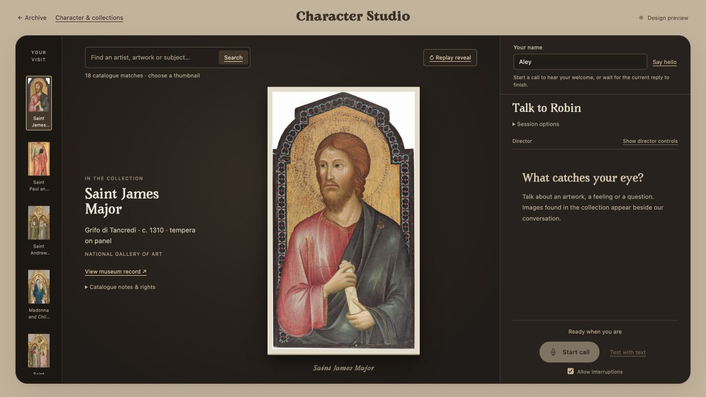

# Art Archive Studio



[View the pixel reveal in progress](screenshots/archive-gallery-reveal.jpg). These are interface previews using real saved catalogue records, with no active model call.

Open **`/archive/gallery/`** on your running server to try an additional artwork-focused view. With the usual local tunnel, the address is:

```text
http://127.0.0.1:18091/archive/gallery/
```

The existing **`/archive/`** archive view is also called **Art Archive Studio**; the **`/`** character studio remains available. Click **Gallery view** in the studio header to enter, and **← Archive** in the gallery to return. The gallery uses the same application and voice connection; it does not start a different model or need another GPU.

The right-hand panel is reserved for the name entry and full-height conversation. Artwork titles, artist/date/medium, museum links and expandable catalogue notes sit beside the artwork in the main display area. Narrow phone layouts stack the image and its information above the conversation.

## Try it

Enter **Your name → Say hello**, or start a microphone call and say **“My name is Aley.”** The gallery recognises an explicit introduction and asks either voice engine to begin its reply with “Hello” and your name. The name stays in the current page/call, rather than being added to Robin's character profile. A pure introduction does not search the museum catalogue. If services are starting, the entered introduction waits for the call to connect.

The mosaic reveal lasts 1.25 seconds. Its drawing area matches the real image's responsive border and content box, so the cream frame is present throughout rather than appearing only at the end. Reduced-motion preferences still show the clear image immediately.

1. Open **Character & collections** to choose your character and enable the art collections you want it to consult. Collections must already be imported into the local archive; opening the gallery does not download museum databases.
2. Start a call, or use the text input, and ask about an artist, work or subject.
3. Ask to see a retrieved work: for example, “Show me the image” or “Can you show me those paintings?” The artwork display uses the source records returned for the conversation.

The gallery gives the retrieved artwork more space, with a mosaic reveal inspired by Brushcue. Use **Replay reveal** to repeat it. **Search** browses the saved art collections directly; choosing a thumbnail changes the displayed artwork without sending a hidden character prompt. **Session options** retains the existing engine comparison and model-input controls alongside the conversation.

The gallery's typed search uses direct SQLite full-text matching, so it does not wait for the large spelling-tolerant index to rebuild. Use a correctly spelled artist, title or a few keywords. Conversation retrieval keeps its existing tolerant matching, including speech transcription corrections. Browsing a work does not add it to the conversation automatically; ask the character about it by title during the call.

The reveal runs locally in the browser. It is a display effect over an available source image, not an image-generation request, an upload to Brushcue, or camera recognition. It does not identify an object or a visitor from a camera feed.

Reduced-motion preferences are respected so the artwork remains usable without the animated reveal. Voice, text, interruption, director and narrative behaviour are inherited from the selected Character Studio engine. The gallery itself does not change their quality or guarantee a faster response.

The gallery uses the supplied Avara family: Black for the studio name, Bold for headings and Bold Italic for artwork captions. The webfont files are served locally, with their upstream credits and SIL Open Font License in `frontend/fonts/avara/`. Conversation text retains the existing sans-serif font.

## Voice and delivery

Choose **Voice & delivery** beside the conversation heading. It opens the same **How they speak** controls used in the main character form: Automatic, Female, Male or Custom reference; speaking style; emotion; expression; and vocal direction. This is a focused view of the existing form, not a separate copy of settings. **Character & collections** restores the complete character form.

End a call to change the voice identity or its reference. Emotion, expression and vocal direction can change during a call and apply to the next reply. A director may also supply delivery directions through the existing narrative controls.

For a custom voice, select **Custom reference → Upload a voice reference**, enter the **Exact words spoken in the reference**, give it a name under **Save this voice as**, then choose **Save voice**. It will appear under **My saved voices**. A saved selection reloads its preview and transcript automatically with that character. Use a 2–15 second PCM16 WAV, mono or stereo at 8–48 kHz and no larger than 2 MiB.

Custom Drama 3 voices pair a WAV recording with its exact transcript. Saved voices stay in this browser on this server address, using IndexedDB for the recording rather than placing audio bytes in the character's JSON/localStorage. They are reusable across characters on that same address; another browser, origin or cleared site storage will not have those recordings. An unsaved upload can still be used for the current page. If storage is unavailable, the interface must report that it could not save rather than claim persistence.

Native Qwen3-Omni retains its existing built-in-voice limitation; uploading or saving a Drama reference does not add custom-reference support to that engine. Its UI note explains the restriction.

## Sources and missing images

Artworks come from the enabled local collections, with the source title, artist and catalogue link retained. An imported catalogue record can exist even when it has no eligible image URL. In that case, the interface should identify the record and explain that an image is unavailable rather than substitute another artwork or claim the record is missing.

An image link is also not proof that the browser successfully loaded it: a museum may be unavailable or block the request. The character should distinguish catalogue metadata from what the browser has actually displayed and should not claim visual understanding solely because an image URL is present.

Use the original museum page for attribution, rights and further details. Image eligibility follows the existing collection import and image-link rules; the reveal does not change a museum's licence. The gallery does not download full-resolution image collections or add model training.

For collection setup, see [RAG collections](RAG_COLLECTIONS.md) and the existing [archive guide](ARCHIVE.md). If your gallery is empty, first check that collections are imported and enabled, then try an explicit artist or title. An empty local archive cannot provide artwork just by changing views.

## Deployment and checks

The server serves the retained `frontend/live.html` document at `/`, `/archive/` and `/archive/gallery/`; the browser selects the appropriate view. Root-absolute `/static/` asset addresses keep scripts and styles available from the nested gallery path.

This is an additional presentation view, not a replacement for the original archive or character editor. Local route and browser tests can verify navigation and display behaviour. They do not establish real-model response quality, museum availability or GPU latency.


The Art Archive Studio name and voice-library controls are a frontend-only update. Pull the repository and refresh the browser; the running model services do not need to restart for these controls. Browser QA saved a bundled VCTK sample in an isolated preview origin and verified the selected recording, Blob preview and transcript after reload. This is not a GPU synthesis-quality test or a migration of previously unsaved files.
