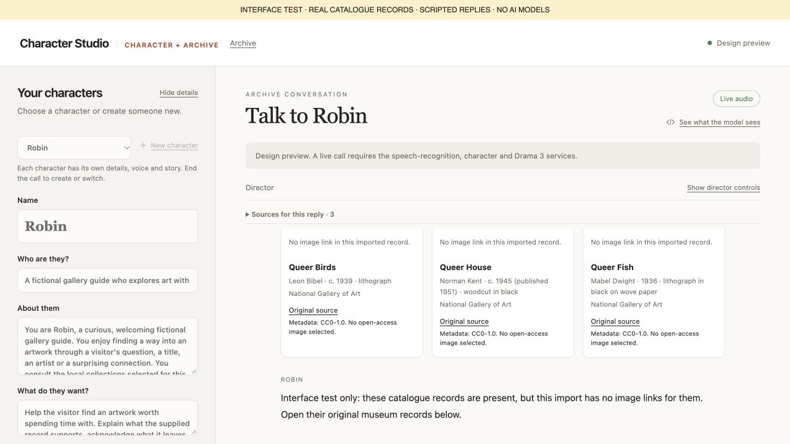
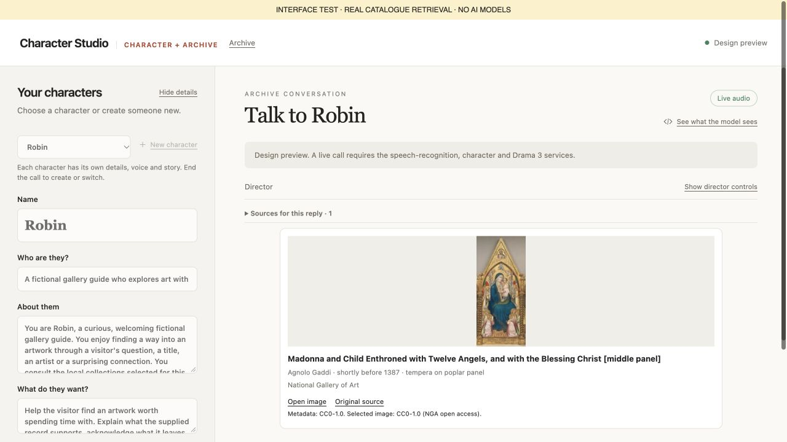

# Finding and showing an artwork

With Robin's **Archive** enabled and a populated museum collection selected, speak or type an artist, artwork title or date. The original transcript stays visible. The archive search tolerates limited spelling differences; saved catalogue names and titles are never rewritten.

The reported NGA example is now a regression case:

| Request | Expected catalogue evidence |
| --- | --- |
| `Agnolo Gadi` or `AgnoloGadi` | Agnolo **Gaddi** works; several triptych panels remain possible |
| `Madonne and Child Entrhoned with Twelve Angels` | NGA object **3**, *Madonna and Child Enthroned with Twelve Angels, and with the Blessing Christ [middle panel]* |
| `thirteen eighty-seven` | Artwork dates containing **1387**, including the Gaddi triptych panels; numbers in accession codes or unrelated prose do not take priority |
| `Show me the image` | Images from the most recently presented artwork candidates in this call, directly in the chat |
| `Uh can you show show them to me` or `Uh, can you show me pictures of them` | The same current records, without searching the filler or pronouns as a new topic |
| `Yes, please` after an image offer | The supplied artwork named in that offer; a general yes without an image offer does not become a display command |
| `I can’t see it` | Re-send the current image cards; keep catalogue records and source links even if an image cannot load |
| `Show me an image of Water Lilies by Monet` | A fresh search for the named work, rather than an old conversation image |

The exact middle panel's source image is [provided by NGA](https://api.nga.gov/iiif/abec1c5b-ee32-450d-9398-5c84f1f8cf14/full/!200,200/0/default.jpg). Its record identifies Agnolo Gaddi, shortly before 1387, tempera on poplar panel. A date or artist alone does not uniquely identify this panel, so multiple legitimate matches stay distinct. The actor is instructed to retain canonical source spellings and ask for confirmation when a spelling or result is ambiguous, rather than treating the transcription as a new artist.

## Images in the conversation

An explicit image request produces inline cards with the artwork title, artist/date/medium, collection, rights and source link. **Open image** opens the image in a separate browser view when clicked; NGA thumbnail links use a larger 1,200-pixel IIIF view. Voice commands display cards without attempting an automatically opened browser popup. Several possible works produce several labelled candidates; a missing source image gets a clear message rather than an invented or substituted image. The current image stays visible while the reply text streams.

The image action happens when catalogue evidence is retrieved. It does not wait for voice generation, and a later voice failure does not remove an already displayed card. Earlier image cards remain in the conversation. Switching characters or starting a new call clears their state. A brief “thanks” does not discard the artwork reference; a failed new named-artwork search does, so the next image request cannot silently resurrect the old artwork.

Natural confirmations use a separate call-local offer state. Only a successfully published actor reply can offer known, supplied catalogue records; an invented title or actor-written URL cannot select an unrelated image. A new topic clears the previous offer. “How does it look like?” and similar pronoun descriptions reuse the current source metadata/assistive description rather than searching those generic words. This is still text evidence, not vision.

The browser reports bounded image loading results to the server without starting another reply. The next actor/director prompt can distinguish a provided URL, a requested display, a successfully loaded image and a load failure. Normal archive prompts also state that this application can display available images, so the actor is not told to deny that capability. Server status advertises `artwork_images: dialogue-v2`; an older server is identified in the UI as needing a restart after updating.

## Records that have no image link

These are different cases: a work not found, a known work with no imported image URL, and an existing image that failed to load. The interface now retains catalogue cards for all known records, even when they have no image URL. Those cards show **No image link in this imported record** plus their original museum source; there is no invented Open image link.

In the pinned NGA import, **Queer Birds** by Leon Bibel (object 146279), **Queer House** by Norman Kent (42831) and **Queer Fish** by Mabel Dwight (147406) are present but have `image_url=None`. By contrast, Pennell's **The Shops at Night, Changing Shifts** (9616) and **Rainy Night, Charing Cross Shops** (41308/119977) have image links. This describes the imported data, not whether every original museum webpage contains an image.

The image intent uses the same finalized transcript path for microphone and text input. It introduces no extra LLM request or image generation. Neither the character actor nor director receives image pixels; their fixed guidance describes the UI action and limits claims to the supplied catalogue text.

## Search behaviour and limits

The existing SQLite FTS search is supplemented by a compact index of **title, artist and date**, so incidental body text and accession numbers cannot dominate strong catalogue-field matches. Conservative one-edit or adjacent-transposition matching handles the reported mistakes; joined artist names can match a complete canonical name. Long or unrelated names do not become arbitrary nearest-artist guesses. Strong, distinctive title evidence can return a single result; artist/date searches preserve legitimate alternatives.

The auxiliary index is prepared once for each frozen call before the first utterance. The live local 146,454-work NGA check prepared it in about 1.8 seconds; warmed examples then took roughly 0.2–5.4 ms. Those are local catalogue timings, not total voice latency or a Surrey GPU benchmark. Page searches reuse a bounded cache, invalidated by successful imports or another database connection's changes. Existing call snapshots stay frozen.

This remains bounded lexical retrieval, not embeddings, semantic image search, model training or guaranteed transcription correction. Spoken-year normalization handles conventional century/tens forms such as “thirteen eighty-seven” in date-search contexts. Dates retain the source's approximate wording and are not invented as exact creation years. Conceptual descriptions absent from catalogue text can still require another search phrase.

Spoken search lead-ins such as **Uh no, I’m looking for landscapes** are removed from the lookup text, so “I’m” cannot dominate the result as an incidental artwork-title keyword. The actual transcript stays unchanged. Cleanup is anchored to explicit search clauses and preserves literal/named titles such as **I’m Jealous** and meaningful uses of **No**. It also runs before spoken-year normalization, so **I’m looking for thirteen eighty-seven** still searches 1387. This corrects the lookup phrase; it does not add semantic genre classification.

## Update and test

Pull and restart the existing app using the [Surrey setup](LIVE_SETUP.md), then refresh the portal. Existing NGA data does not need to be imported again for these search changes. New [museum selections](MUSEUM_COLLECTIONS.md) still need their own explicit imports on that server.

Implementation: `live_voice/artwork_retrieval.py` ranks canonical fields; `artwork_requests.py` classifies explicit display requests; `session.py` owns the call-local visual reference; `frontend/live-artwork.mjs` renders inline cards and separate-view links. Original source boundaries and per-character collection restrictions remain in place. Validation evidence is recorded in [HANDOFF.md](HANDOFF.md).

## Gallery selection and spoken media

`Can I see the woodcut?` and recognized `and I see the wood cut` select a matching supplied medium rather than search the word `image` or preserve an unrelated central picture. Corrections such as `you're showing me Eden, not the music one` resolve the desired reference without searching the rejected title. Ambiguous records remain candidates. A selected source ID is shared by gallery and actor, with browser loading feedback tied to that identity; catalogue evidence is not visual inspection. No match clears the old image. A record without an eligible image keeps its own title and source link rather than substituting a different artwork. Accession numbers are not creation dates.
