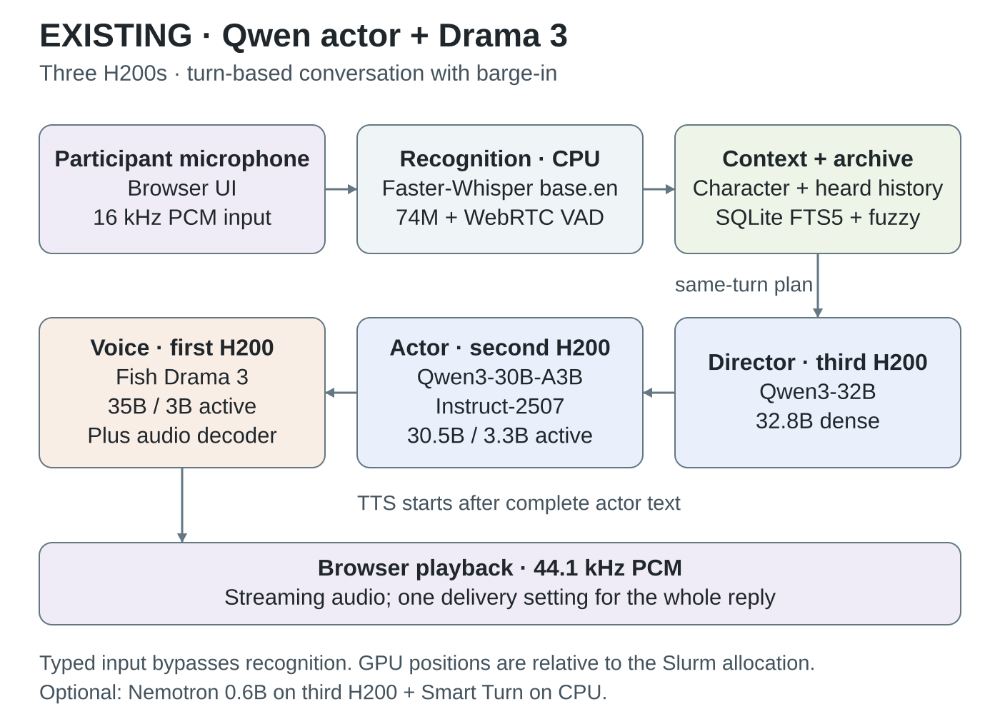
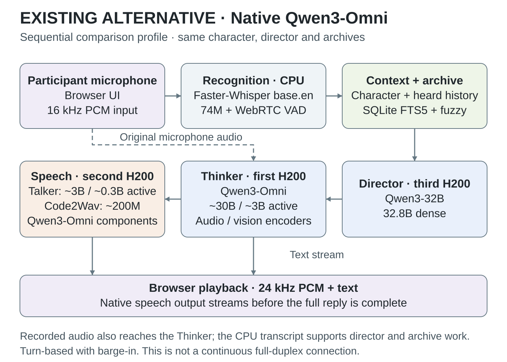
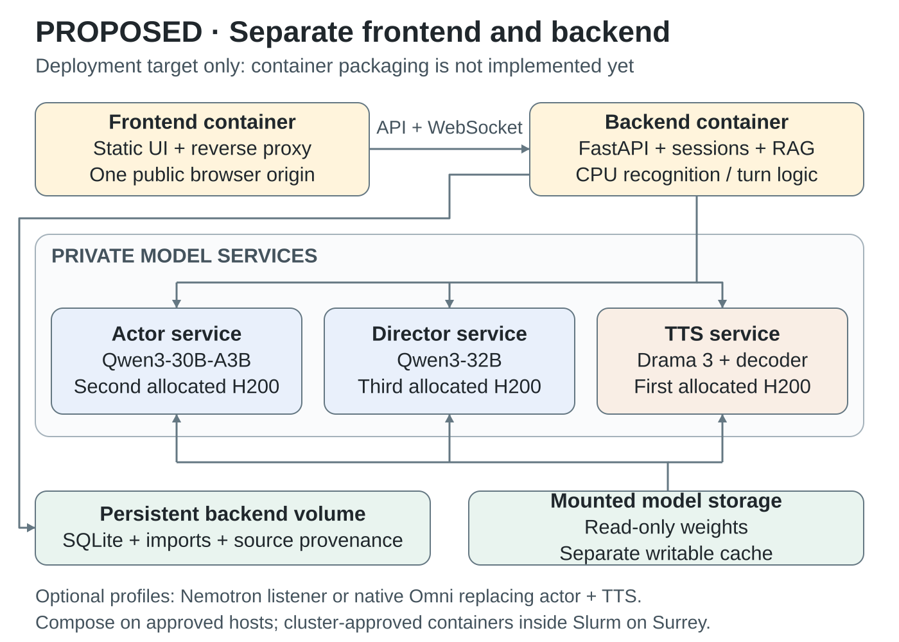

# Character Studio and Art Archive Studio developer handoff

**Prepared 9 November 2026.** This document describes the current repository and a proposed container deployment. It is intended for a developer joining without the conversation history.

**Implementation status:** the live application, model adapters, gallery, retrieval and Slurm launchers exist. The next delivery is separate frontend/backend containers, packaged model services and a documented OpenAI-compatible application API. Dockerfiles, Compose files and that application API do **not** exist yet. A running service must be inspected independently of repository files or a previous job ID.

## 1 What we are building

The project is a voice interface for authored characters. A creator supplies identity, motivation, memories, environment, behaviour rules and a director script with narrative beats. A participant can talk to the character, interrupt a reply, or test it using typed input. The director can change the character's intention and delivery as a scene progresses.

The same application supports **Art Archive Studio**. Robin is an example guide with access to selected local collections. Retrieval supplies relevant catalogue records or attributed archive passages. The browser can display available museum images alongside the conversation, with an optional pixel reveal. It can also search the imported catalogues directly.

Import connectors cover Queering the Map, the National Gallery of Art, the Metropolitan Museum of Art, the Art Institute of Chicago, Cleveland Museum of Art, the J. Paul Getty Museum and Rijksmuseum. A connector's presence does not establish that a complete collection is imported on a particular server. Local database counts and import manifests show the actual holdings.

The target is to preserve these experiences while separating presentation from orchestration and packaging the dependencies reproducibly. The interfaces between models should be portable where they genuinely match an OpenAI API; application-specific voice, narrative and archive events must remain clearly documented.

This is inference with pretrained checkpoints. Character-sheet edits, director notes and retrieval **do not train the model, create a LoRA, or modify its weights**. Retrieval currently uses SQLite full-text matching and additional normalization/fuzzy matching. There is no vector database, embedding service or trained retrieval model in this path.

## 2 Current architecture and model placement

The main reference profile is `quality-3gpu`, configured in [`config/live_profiles.json`](../config/live_profiles.json). All three GPUs belong to one Slurm allocation on one node. “GPU 0/1/2” below means the first, second and third positions in `CUDA_VISIBLE_DEVICES`; it does not override the scheduler's physical device assignment.

| Component | Exact checkpoint or implementation | Size | Placement in the reference profile |
|---|---|---|---|
| Speech recognition | `Systran/faster-whisper-base.en`, running Whisper base English via Faster-Whisper | About 74 million parameters | CPU by default |
| Speech activity and pause detection | Backend WebRTC VAD plus application turn logic; separate browser echo/energy interruption checks | Not an LLM | CPU |
| Character actor | `Qwen/Qwen3-30B-A3B-Instruct-2507` | 30.5B total; 3.3B active per token, MoE | Second H200, slot 1 |
| Director | `Qwen/Qwen3-32B` | 32.8B, dense | Third H200, slot 2 |
| Voice generation | `fishaudio/drama-3` | Advertised 35B MoE; 3B active backbone, plus audio decoding | First H200, slot 0; both serving stages share it |
| Archive/catalogue retrieval | SQLite FTS5 and application search code | No neural model | CPU and persistent storage |

The actor and director use BF16 in these profiles. They are separate model processes; the actor is not split over the three GPUs. GPU budgets in configuration reserve capacity and are not measured minimum VRAM requirements. More GPUs let us load separate, larger models; they do not improve an unchanged checkpoint's knowledge automatically.

There are also a compact `shared` profile using `Qwen/Qwen3-4B-Instruct-2507` and a two-GPU profile using the larger actor but sharing its server for director requests. The three-GPU batch launcher deliberately chooses `quality-3gpu`.

**Optional listening experiment:** `--listening nemotron-smart-turn` replaces inbound recognition with `nvidia/nemotron-speech-streaming-en-0.6b` on the director's GPU and `smart-turn-v3.2-cpu.onnx` on CPU. The director's GPU budget is reduced to make space. CPU Faster-Whisper still loads because it also checks generated Drama speech. This does not request a fourth GPU and is not the default. See [`docs/LISTENING_EXPERIMENT.md`](LISTENING_EXPERIMENT.md).

The diagram source is [`docs/diagrams/current-architecture.mmd`](diagrams/current-architecture.mmd). It includes the alternative native speech route described below.

## 3 One conversation turn with Qwen and Drama 3

1. The browser sends 16 kHz mono PCM16 audio over the WebSocket. Recognition can start during a pause; only the final accepted utterance enters context. Typed input bypasses recognition.
2. The backend retrieves up to three bounded source excerpts, when enabled. It combines these with the character sheet, heard conversation and current narrative state.
3. The separate director is **awaited on the current turn** for guidance on intention, emotion, delivery, triggers and beats. Additional between-turn story checks also exist.
4. The actor streams reply text into chat. After its **complete reply text** is available, Drama 3 synthesizes the whole reply using one delivery cue and one frozen voice reference.
5. Streaming mode forwards valid PCM deltas immediately, with a 120 ms browser reserve and a complete final drain. Spoken-word checking finishes later. A failed take is reported without automatically replaying an already heard prefix.

`LIVE_VOICE_PLAYBACK=streaming` removes the complete-take playback gate. `checked` retains checking before playback. Neither mode yet feeds partial actor text into TTS. Recognition, retrieval, direction and actor generation still contribute to the delay. Measure microphone-to-first-sound separately from model first-byte time; streaming alone does not guarantee complete or correct generated speech.

## 4 Native streaming Qwen3 Omni alternative

[`experiments/qwen_stream/`](../experiments/qwen_stream/) preserves the same character, director and archive experience but replaces the separate text actor plus Drama 3 with `Qwen/Qwen3-Omni-30B-A3B-Instruct`.

| Allocated GPU position | Native profile component |
|---|---|
| First | Thinker: approximately 30B total / 3B active, with multimodal encoders |
| Second | Talker: approximately 3B total / 0.3B active, its prediction components, and Code2Wav, approximately 200M |
| Third | Separate `Qwen/Qwen3-32B` director |

The component counts differ from the text actor's size. Stage placement is defined in `experiments/qwen_stream/deploy_overrides.json` and `runtime.py`.

CPU recognition provides the director/retrieval transcript. Original recorded audio also reaches Omni, which produces text and 24 kHz audio directly. Native built-in voices replace Drama reference WAVs.

Run **one three-GPU stack at a time**. The UI selector chooses an available engine; it does not launch services. Compare the same character, listening mode, archive scope and prompts.

Both routes are turn-based with **barge-in**. Sustained new speech can cancel a reply and start another turn. They do not continuously generate while listening as a full-duplex system would. Browser echo rejection still needs microphone/speaker testing. See [`interruptions`](INTERRUPTIONS.md).

## 5 Implemented process and API boundaries

The frontend is plain HTML, CSS and JavaScript modules. The live Python FastAPI/Uvicorn process currently serves both static assets and application APIs from the same origin. `/`, `/archive/` and `/archive/gallery/` share that backend. The older recorded-turn prototype also remains in the repository; its `/api/chat` behaviour is not the live protocol described here.

| Boundary | Current default | Compatibility and responsibility |
|---|---|---|
| Browser to app | HTTP and `/api/live` WebSocket, port 18091 | Custom application API: character setup, narrative, sources, image status, audio, interruption, inspection and playback acknowledgements |
| App to actor | `POST /v1/chat/completions`, port 18092 | OpenAI-shaped text chat; streamed deltas; local alias `live-character` |
| App to director | `POST /v1/chat/completions`, port 18094 | OpenAI-shaped chat with structured JSON guidance; alias `live-director` |
| App to Drama 3 | `POST /v1/audio/speech`, port 18093 | OpenAI-shaped route with runtime-specific `ref_audio`, `ref_text`, sampling and SSE completion extensions |
| App to native Omni | `POST /v1/chat/completions`, port 18097 | Runtime-specific multimodal SSE content and audio metadata; requires the existing Omni adapter |
| App to optional listener | HTTP plus WebSocket, port 18095 | Custom private recognition/turn-detection service |

`/api/live` is **not OpenAI Realtime**. An OpenAI client cannot point at this WebSocket unchanged. The backend currently provides orchestration, not an application-level `/v1/chat/completions` facade for a complete character conversation.

### Live wire contract to preserve

The client opens `/api/live` from the exact application origin and sends a `start` JSON message containing character, engine and applicable voice, archive, director and narrative settings. The server returns `ready`, including input/output sample rates. The app permits one active call per backend process; a second call is rejected, not queued.

Client binary messages contain raw little-endian mono PCM16 at 16 kHz, with no WAV header, at most 8,192 bytes per message. Server binary messages contain an **8-byte big-endian header**—unsigned turn ID and sequence ID—followed by raw little-endian mono PCM16. Output is 44,100 Hz for Drama 3 or 24,000 Hz for native Omni. JSON events carry text, sources, narrative state, errors and phrase boundaries.

`played` acknowledges a phrase only after its samples actually play; `playback_done` follows the complete drain. These acknowledgements govern heard-history retention and microphone release. A Unity or other client must implement them, along with turn IDs, native-rate playback, buffering and cancellation. Receiving bytes alone is not equivalent to hearing a reply.

## 6 Proposed container deployment

The target diagram is [`docs/diagrams/target-containers.mmd`](diagrams/target-containers.mmd). Everything in this section is proposed work, not an existing Compose configuration.

**Frontend container:** serve versioned static assets and act as the public reverse proxy. Proxy `/api/` and the WebSocket to the backend without buffering upgraded traffic. Keep one browser origin so current Origin checks and relative URLs remain meaningful. Forward the intended public host/protocol through a deliberately trusted proxy configuration; do not remove Origin validation to make deployment work.

**Backend container:** run the existing orchestration and archive APIs independently from the static server. Use one worker initially to preserve the one-call lock, in-memory turn state and resource limits. Model endpoint URLs become private service URLs such as `http://actor:18092`; the exact names are deployment configuration, not hardcoded promises. Add distinct liveness and model-readiness reporting.

**Model service containers:** isolate actor, director and Drama 3 runtimes and their pinned CUDA/Python dependencies. Mount downloaded checkpoints read-only, then give writable caches and logs their own locations. Reproduce the currently working vLLM/vLLM-Omni revisions and sampling repair; do not replace them with unpinned latest dependencies during packaging. Optional listener and native Omni services belong to explicit deployment profiles. The native profile replaces actor/TTS rather than loading every GPU model by default.

### Packaging and network interfaces

**Networking and GPU ownership:** only the frontend entry point should be public. Model and database-related ports stay on an internal network. Current scripts bind services to loopback; cross-container deployment needs controlled internal binds and URL/configuration changes. The listening client currently validates loopback URLs, so supporting a listener service name requires an explicit private-endpoint policy and tests, not merely a Compose variable. Map the same allocated devices into the intended roles and preserve single-sequence serving limits initially.

Docker Compose is a sensible development target on an approved GPU host. **Do not assume Docker or a Docker daemon is permitted on Surrey.** A cluster-approved Apptainer/Singularity approach may be appropriate, launched inside Slurm with the GPU allocation exposed, but support, image distribution and network/storage policy must be confirmed with the cluster team. Containerization must not bypass Slurm or start GPU workloads on a login node.

### Proposed portable API facade

Retain the existing UI WebSocket initially. Add a separate, versioned OpenAI-compatible **text** facade for external clients: standard messages and streaming text deltas map to an explicitly selected character/session. Define how clients select narrative and archive settings, how source attribution is returned, which features require custom extensions, and how cancellation works. Publish contract tests and an OpenAPI description.

For speech, distinguish a standard `/v1/audio/speech` capability from voice-cloning or streamed-PCM extensions. A standard-client fallback could return a completed WAV from a service adapter, while the UI retains its lower-latency custom stream. Do not claim OpenAI Realtime compatibility unless its session, event, audio and interruption contracts are actually implemented and tested. Model swapping needs capability negotiation; an OpenAI-shaped URL alone does not standardize voice references, director JSON support or Omni's native SSE format.

The facade should specify `GET /v1/models`, chat request/response and SSE schemas, error bodies, bearer authentication, cancellation and a documented method of selecting a character/session. These are proposed contracts to implement and test with an ordinary OpenAI SDK pointed at the application's base URL. Current exact-Origin checks are not authentication; the prototype has no public account/access-control layer.

### Container delivery files

The implementation should supply a frontend Dockerfile, backend Dockerfile, pinned model-runtime build definitions, a Compose deployment with explicit baseline/native profiles, and a versioned configuration example containing no secrets. Include an approved cluster launch recipe, health/readiness checks, database migration/import commands and backup/restore instructions. Each image must have a reproducible dependency lock and build reference. Model downloads belong in a preparation step and mounted storage, rather than image layers. The proposed deployment diagram does not imply these files have already been created.

## 7 Persistence archives and backups

| Data | Implemented location/lifetime | Container target |
|---|---|---|
| Authored character profiles and settings | Browser localStorage, scoped to origin | Preserve browser export/import first; cross-device/account storage is a separate API/schema task |
| Saved custom voice WAVs and exact transcripts | Browser IndexedDB; character JSON stores only the voice ID | Preserve or migrate clips when the public origin changes; server storage needs an authenticated design |
| Call context, heard history, current name and delivery | Backend RAM for the call | Keep session-owned; no implied persistent conversation memory |
| Queering the Map collection | `archive.sqlite3` | Durable writable archive volume; retain source attribution/provenance |
| Museum catalogues/search indexes | `collections.sqlite3` | Same managed archive volume with bounded imports |
| Source downloads and import state | Archive import directories | Preserve downloads, hashes, dates, cursors and import state |
| Model weights | Explicit model-store directories outside Git | Read-only checkpoint mounts; separate writable runtime caches |

The archive directory resolves from `LIVE_ARCHIVE_DIR`, otherwise `$LIVE_VOICE_STORE/archive`, otherwise `~/.local/share/character-studio/archive`. Surrey examples use `/scratch4weeks/$USER/live-voice-store/archive`; scratch storage is not a durable backup. Keep corpus files, generated databases, caches and voices out of Git and container image layers.

Persistent SQLite currently uses rollback journalling. Queering the Map calls copy the database into RAM. Museum calls copy the whole catalogue database to a temporary disk snapshot, then build a scoped search index. Persistent storage, temporary disk and RAM must therefore be sized separately; a call does not copy only its three retrieved records. Do not change to WAL or allow multiple independent import writers on shared cluster storage without validating locking behaviour. One backend/container owns writes initially; optional import workers must coordinate with that owner.

Back up with a documented SQLite-consistent procedure, preferably while imports and the app are stopped, or using SQLite's backup API. Include both databases, provenance manifests, selected configuration and resumable import state. Store an independent copy outside temporary scratch. Restore into an isolated directory and verify collection counts, sample searches, image/source links and a new call before declaring the backup valid. Record source removal/update handling; imports are not automatically full deletion synchronization.

Museum images generally remain source URLs. Records can lack images, and image hosts can fail independently. Browser load status, the selected work and per-call browsing constraints enter model context. The browsing update retains the subject and medium through follow-ups, filters for image links before ranking, and excludes failed selections. CPU fixtures cover these flows; they do not establish real-model consistency or image-host reliability.

## 8 Repository map and handoff order

| Start here | Purpose |
|---|---|
| `frontend/live.html`, `live.js`, `live.css` | Live form, chat, state and session controls |
| `frontend/live-gallery.mjs`, `gallery.css`, `pixelate-reveal.mjs` | Gallery selection, artwork display and reveal |
| `frontend/live-audio.mjs`, `live-voices.mjs`, `live-characters.mjs` | PCM playback/acknowledgements and browser persistence |
| `studio/characters.py` and `characters/` | Character schema, prompt construction and example profiles |
| `live_voice/app.py`, `session.py`, `turns.py` | API entry points, orchestration, heard-history lifecycle |
| `live_voice/providers.py`, `voice.py`, `playback_policy.py` | Text/TTS adapters, stable delivery and playback policy |
| `live_voice/director.py`, `narrative.py`, `reactions.py` | Structured director plans, narrative beats and triggers |
| `live_voice/collections.py`, `archive_database.py`, `artwork_requests.py` | Search, persistence, visual references and source grounding |
| `config/live_profiles.json`, `live_voice/deployment.py` | Pinned text checkpoints, budgets and allocated-device mapping |
| `scripts/run_live_stack.sh`, `run_live_slurm.sbatch`, `run_live_tts.py` | Current single-node launch, cleanup and speech-stage configuration |
| `experiments/drama3/`, `experiments/qwen_stream/`, `listening_runtime/` | Isolated model runtimes and alternative listening/native speech paths |
| `tests/` and `docs/` | CPU/transport/browser regression coverage and deployment notes |

### Implementation and acceptance

1. Record the working commit, checkpoint revisions, package pins and current status response. Rehearse a short baseline conversation and save the complete latency breakdown.
2. Build frontend/backend separation with a same-origin proxy. Preserve the live protocol, image events, prompt-inspection downloads and playback acknowledgements before changing models.
3. Package each runtime with explicit GPU mapping, mounted checkpoints, private networking, orderly shutdown and visible readiness. Keep baseline/native profiles mutually exclusive initially.
4. Add durable storage/backup procedures and a versioned configuration example. Keep credentials in runtime secret injection or an approved secret store; never bake tokens or private keys into images.
5. Define and implement the text compatibility facade and speech adapters, with standard-client smoke tests and documented extensions. Defer multi-user serving and cross-device profile storage until they have their own persistence/concurrency design.

Acceptance checks should cover clean startup with an existing checkpoint cache; no hidden model download; GPU allocation isolation; stop/restart without orphan processes or occupied ports; reverse-proxied Origin/WebSocket operation; both output sample rates; speech interruptions and heard-history correctness; image selection/load failure; database import, restart, backup and restore; and identical prompt/voice comparison across engines. CPU fixtures establish application behaviour, not H200 latency or perceptual voice quality. Measure microphone-to-first-sound, first model audio, completion, retries, skipped words and voice consistency on the real GPU deployment.

## 9 Primary references and existing guides

Model sizes and architectural labels follow [Qwen3-30B-A3B-Instruct-2507](https://huggingface.co/Qwen/Qwen3-30B-A3B-Instruct-2507), [Qwen3-32B](https://huggingface.co/Qwen/Qwen3-32B), [Fish Audio Drama 3](https://huggingface.co/fishaudio/drama-3), and the [vLLM-Omni architecture overview](https://docs.vllm.ai/projects/vllm-omni/en/latest/design/architecture_overview/). Recognition references: [Whisper](https://github.com/openai/whisper), [Faster-Whisper checkpoint](https://huggingface.co/Systran/faster-whisper-base.en), [Nemotron streaming ASR](https://huggingface.co/nvidia/nemotron-speech-streaming-en-0.6b), and [Smart Turn](https://github.com/pipecat-ai/smart-turn).

Repository guides remain the implementation-specific authority: [multi-GPU deployment](MULTI_GPU.md), [Drama latency](DRAMA3_LATENCY.md), [native Omni experiment](../experiments/qwen_stream/README.md), [model-input inspection](MODEL_INPUTS.md), [archive database](QTM_DATABASE.md), [gallery](ARCHIVE_GALLERY.md), and [handoff history](HANDOFF.md). Older documents can describe earlier complete-take or recorded-turn behaviour; use this document with the current code and the running `/api/status` response.
