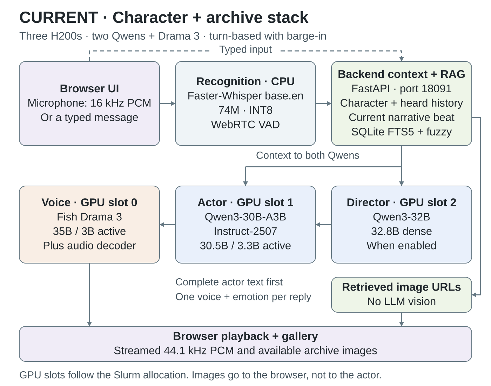

# Character Studio and Art Archive Studio developer handoff

**Updated 19 November 2026.** This is the main handoff for the character and archive experience using **two Qwen text LLMs, Fish Audio Drama 3 and CPU Faster-Whisper**. The reference deployment is `quality-3gpu`, `LIVE_DEFAULT_ENGINE=baseline`, with `--listening baseline`.

The application, model adapters, gallery, archive imports, request inspector and Slurm launchers exist. Separate frontend/backend containers, an application-level OpenAI-compatible facade, embedding retrieval and the proposed personality-prompt redesign remain work to implement. This document does not report a new GPU benchmark or a container deployment.

## 1 What we are building

**Character Studio** lets an author create a character with identity, motivation, environment, memories, boundaries, speaking style and a director script. A participant talks through a microphone or typed input. A performer can guide the scene with notes, emotional triggers and narrative beats, and can interrupt a reply.


**Art Archive Studio** gives an authored character access to selected local archives. Robin is the example art guide. Relevant catalogue records or attributed story passages enter the model context; available museum images appear beside chat. The gallery adds a central artwork, source details, a thumbnail trail and a pixel reveal.


These are interface previews with fictional example profiles and public catalogue material. They illustrate controls and layouts, not a new live-model result. [All screenshots and capture notes](SCREENSHOTS.md).

This project uses pretrained checkpoints at inference time. Editing a character, adding director notes or importing an archive does not train weights or create a LoRA.

## 2 Models and placement

| Role | Exact checkpoint | Parameters | Reference placement |
|---|---|---|---|
| Participant transcription and generated-speech checking | `Systran/faster-whisper-base.en` | 74M | CPU, INT8, eight threads and one worker |
| Character actor | `Qwen/Qwen3-30B-A3B-Instruct-2507` | 30.5B total, 3.3B active per token, MoE | Second allocated H200, slot 1 |
| Backstage director | `Qwen/Qwen3-32B` | 32.8B dense | Third allocated H200, slot 2 |
| Text to speech | `fishaudio/drama-3` | Advertised 35B MoE, 3B active backbone, with audio decoding | First allocated H200, slot 0; both serving stages share it |

“First/second/third” refers to positions in Slurm's `CUDA_VISIBLE_DEVICES` allocation. It does not mean the application may choose physical GPUs belonging to another job. The actor and director each run their own model process; the actor is not spread over all three GPUs.

The actor and director are **text LLMs**. Drama 3 is the voice model. Drama's serving runtime is named **vLLM-Omni**; that name does not mean the Qwen3-Omni model is used in this stack. Whisper handles English recognition on CPU. Backend WebRTC VAD detects speech/pause boundaries; the browser has separate echo/energy checks for interruption.

The profile and pinned actor/director revisions are in [`config/live_profiles.json`](../config/live_profiles.json). Model GPU budgets are reservations, not measured minimum VRAM requirements. The batch job requests three H200s, 24 CPUs and 256 GiB host RAM for four hours.

Primary references: [Qwen actor](https://huggingface.co/Qwen/Qwen3-30B-A3B-Instruct-2507), [Qwen director](https://huggingface.co/Qwen/Qwen3-32B), [Drama 3](https://huggingface.co/fishaudio/drama-3), [Faster-Whisper](https://github.com/SYSTRAN/faster-whisper) and [Whisper model sizes](https://github.com/openai/whisper#available-models-and-languages). Checkpoint terms are separate from this repository's MIT code license.

## 3 The conversation pipeline



[Editable Mermaid source](diagrams/character-archive-stack.mmd) · [PNG for a board or presentation](screenshots/character-archive-stack.png).

1. The browser sends microphone PCM to the backend. Typed input bypasses recognition. Whisper finalizes the participant's words after the accepted pause.
2. The backend prepares the character definition, heard conversation, current scene and any retrieved archive records. Search results and display state remain distinguishable from authored character facts.
3. When enabled, the director is awaited on this turn. It proposes an intention, emotion, vocal delivery and any trigger/beat decision. Python validates the result and applies performer and story rules.
4. The actor receives the latest question with this context and private direction. Its text streams into chat.
5. After the actor's **complete reply text** is available, Drama 3 synthesizes one continuous take using one fixed voice reference and delivery cue.
6. In the default streaming playback mode, valid 44.1 kHz PCM reaches the browser as it arrives. A small playback reserve and final drain protect delivery. Spoken-word checking can still run after release.
7. The browser acknowledges played audio. Heard-history retention and interruption handling use these acknowledgements, rather than treating generated or received text as already heard.

This is a **turn-based, cascaded voice pipeline with barge-in**. It is not continuous full-duplex speech-to-speech. Streaming playback removes the full-take playback gate; it does not yet overlap partial actor text with TTS. A post-stream check cannot prevent the listener hearing a faulty take. Audio already released is not automatically replayed after failure. The alternative `LIVE_VOICE_PLAYBACK=checked` retains checking before playback. [Playback details](DRAMA3_LATENCY.md#live-playback-mode).

The backend permits one active call per process. CPU fixtures and preview screenshots do not establish multi-user capacity, H200 delay or acoustic quality.

## 4 What the two Qwen models receive

The backend constructs new model requests each turn. Their conversation histories are bounded selections, not unlimited transcripts or permanent model memory. The character sheet is captured when a call starts; supported director, story and voice updates have separate live controls.

| Input | Director | Actor |
|---|---|---|
| Character | All live character fields except `speaker` | English instructions built from the character fields |
| Latest input | `latest_participant_message` in the situation JSON | Latest user message in the conversation |
| Heard history | Up to 3,000 characters with narrative, otherwise 6,000 | Up to 10,000 characters, including selected relevant older exchanges |
| Narrative | Current beat, timing, hold, heard evidence and short outline | Current scene, goal, private note and emotional state |
| Archive | Retrieved records and source/display constraints | The same retrieved evidence and source/display constraints |
| Director plan | Previous intention and current settings | Newly applied intention and emotion; vocal direction also feeds TTS |

These history bounds are **characters, not tokens**, separate from character/instruction/archive text. The call's bounded memory can retrieve up to three older exchanges. Prior AI speech is retained according to successful playback acknowledgements; interrupted unheard output is not treated as a completed reply. Private stage cues do not become participant memories. Ending a call clears its RAM-only conversational state.

The director's final user message contains a **JSON string** describing the situation. Its HTTP response wraps another JSON string in `choices[0].message.content`; the backend parses and validates it as a `DirectorPlan`. An illustrative decoded plan is:

```json
{
  "intention": "Explain the next step and wait for confirmation.",
  "emotion": "calm",
  "delivery": "Warm, clear and unhurried",
  "event": "none",
  "trigger_action": "hold",
  "evidence": "",
  "beat_done": false,
  "beat_evidence": ""
}
```

The actor receives character instructions, archive messages when enabled and conversation messages. It returns spoken dialogue through SSE text deltas, not a director-plan object. The director does not directly speak to the visitor or execute application actions. The full plan is not pasted into the actor verbatim.

Use **See what the model sees** to inspect the actual provider-boundary payload for a turn, select a stable request and download text or recent JSON. Reference audio bytes are omitted from inspection. [Inspector and export behaviour](MODEL_INPUTS.md).

## 5 Narrative and voice controls


Narrative beats are Python application state. Each beat has a title, goal, private entry note, emotion, delivery and minimum/maximum duration. Modes are performer/manual, timed or director-guided. In director mode, Python checks current-beat evidence, elapsed minimum time and performer hold before accepting a completion proposal. Maximum-time and manual transitions follow separate rules.

Entering a beat can queue a private cue that asks the character to initiate a reply once current speech/playback permits. It is a backend-generated direction, not a new participant utterance. Fixed identity remains separate from changing emotion or scene state. [Narrative](NARRATIVE.md) · [Director](DIRECTOR.md).

**Robin's shipped starter disables director calls and narrative beats.** The reference deployment still loads the director server, but an ordinary Robin turn does not call it until the author enables the director. Saved browser profiles can retain different settings. Anna, Karim and KADEN provide other rehearsal starting points.


Female/Male use bundled references; Custom pairs a WAV with its exact transcript. Named custom voices persist in browser IndexedDB and profiles keep an opaque voice ID. Changing public origin/browser or clearing storage affects these recordings. Emotion and vocal direction can update the next reply; voice identity/reference changes require ending the call. One application-level cue per reply does not guarantee consistent model performance. [Voice settings](ARCHIVE_GALLERY.md#voice-and-delivery).

## 6 Archive retrieval and images

The current archive path is **lexical RAG**: SQLite FTS5, a bounded artist/title/date index, spelling tolerance and medium/image filters. There is **no embedding model, vector database or neural reranker** in this path. A proposal to add these is separate from the implemented baseline.

Museum connectors cover NGA, the Met, Chicago, Cleveland, Getty and Rijksmuseum. QTM stories use their own store. Full and smaller topic imports exist, but connector support does not prove a full collection is imported on a given server. Inspect its counts, selected collections and import manifests.

Each reply receives up to three relevant records, at most 2,000 excerpt characters each and 6,000 total excerpt characters, plus bounded metadata and source/image links. The entire database is not included in the prompt. The same retrieved evidence is supplied to director and actor. Source text is quoted data, rather than permission to override character or system instructions.

The gallery uses source image URLs; the Art Institute of Chicago route can use the vetted backend relay at `/api/archive/museum-images/aic/{identifier}`. Preserve that API route when separating the frontend. The actor and director do not inspect image pixels. An eligible URL is not proof that the browser loaded it; selected-record identity and load/failure events ground claims about what the visitor can see. A missing image does not mean the catalogue record is missing. Requests for more artworks retain the meaningful subject and filters, exclude seen/failed selections, and keep hesitation/status follow-ups from becoming accidental title searches.

[Archive import and record format](RAG_COLLECTIONS.md) · [Whole museum imports](FULL_MUSEUM_IMPORTS.md) · [QTM database](QTM_DATABASE.md) · [Gallery behaviour](ARCHIVE_GALLERY.md).

## 7 Backend and API boundaries

The frontend is plain HTML, CSS and JavaScript modules. Python FastAPI/Uvicorn currently serves static assets and application endpoints from one origin. The routes `/`, `/archive/` and `/archive/gallery/` use the same live backend.

| Boundary | Default endpoint | Contract |
|---|---|---|
| Browser to backend | Port 18091, `/api/live` | Custom WebSocket for character, narrative, sources, image status, audio, inspection and acknowledgements |
| Backend to actor | Port 18092, `/v1/chat/completions` | OpenAI-shaped text chat, alias `live-character`, streamed deltas |
| Backend to director | Port 18094, `/v1/chat/completions` | OpenAI-shaped chat, alias `live-director`, structured JSON plan |
| Backend to Drama 3 | Port 18093, `/v1/audio/speech` | OpenAI-shaped route plus reference/audio/sampling and SSE completion extensions |

The UI WebSocket is **not OpenAI Realtime**. The backend does not currently expose a standard application-level `/v1/chat/completions` facade for a complete authored-character session.

The client sends `start` JSON, then raw little-endian mono PCM16 at 16 kHz, up to 8,192 bytes per binary message. Server audio has an 8-byte big-endian header containing unsigned turn and sequence IDs, followed by little-endian mono PCM16 at 44,100 Hz. JSON events carry text, sources, narrative and error state. Clients must support cancellation and acknowledge actual playback with `played` and `playback_done`; receiving bytes is not equivalent to hearing them. Keep the existing exact-Origin check and same-origin proxy behaviour during separation. Origin validation is not authentication.

## 8 Storage and runtime requirements

| Data | Current home |
|---|---|
| Character profiles and authored settings | Browser localStorage, scoped to origin |
| Named custom voice WAVs and transcripts | Browser IndexedDB |
| Heard conversation and current scene state | Backend RAM for the call |
| QTM stories | `archive.sqlite3` |
| Museum records, metadata and image links | `collections.sqlite3` |
| Downloaded source files and resumable imports | Archive import directories |
| Checkpoints and service logs | Model-store directories outside Git |

The archive directory resolves from `LIVE_ARCHIVE_DIR`, then `$LIVE_VOICE_STORE/archive`, then `~/.local/share/character-studio/archive`. Surrey examples use `/scratch4weeks/$USER/live-voice-store/archive`. Actor, director and STT checkpoints live under `live-voice-store/`; Drama uses its separate `drama3-test-store/`. The app/CPU recognition environment is `.venv-live`; the pinned Drama/vLLM runtime is `.venv-drama3`.

Current QTM calls copy the database into RAM. Museum calls copy the full catalogue database to temporary disk and build scoped search indexes. Size RAM, persistent storage and temporary disk separately. SQLite full-text indexes already persist. Reusing the additional per-call artist/title and browsing indexes without copying the whole database is proposed optimisation work. Persistent SQLite uses rollback journalling; retain one coordinated writer initially and verify shared-filesystem locking before changing journal/concurrency design.

Scratch is temporary, not an independent backup. Back up databases consistently, together with provenance/import state, then test restore and searches. Database dumps, checkpoint downloads, private transcripts, voice recordings and credentials do not belong in Git or image layers.

## 9 Run and verify the reference stack

For a CPU-only interface preview:

```bash
bash scripts/setup.sh preview
bash scripts/run.sh --live --preview --port 18113
```

The `--live` flag selects the current UI. Preview calls are disabled and no GPU checkpoint loads. A fresh archive is empty until populated.

For first GPU preparation, follow [Drama setup](../experiments/drama3/README.md) and [quality-3gpu preparation](MULTI_GPU.md). Do not use the older recorded-turn prototype's setup recipe as this stack's runtime recipe. For an already prepared checkout on `login01`:

```bash
cd "/scratch4weeks/$USER/Character_Studio_Qwen" &&
git pull --ff-only &&
LIVE_DEFAULT_ENGINE=baseline LIVE_VOICE_PLAYBACK=streaming \
  sbatch scripts/run_live_slurm.sbatch --listening baseline
```

Check the queue first, stop the actual prior server job when replacing it, and submit only once. A pending batch job may have no log yet. Use the returned ID, wait for it to run and for model health/Uvicorn readiness, then tunnel port 18091 from the actual allocated node. Do not request a competing interactive GPU allocation while the batch job waits. [Queue, log, SSH tunnel and shutdown](MULTI_GPU.md#background-job).

Verify `/api/status`, character creation, typed and microphone replies, director on/off, manual beat changes, one continuous voice take, interruption/heard history, image selection/load failure, archive restart persistence, saved voices and request downloads. Local tests cover application contracts. Measure microphone-to-first-sound, full reply time, retries, skipped words and character consistency on the GPU system; a first-byte serving metric is not end-to-end conversation delay.

## 10 Proposed developer delivery

Package the current reference stack with separate frontend and backend images. A public frontend/reverse proxy should serve static assets and proxy the app API/WebSocket at one browser origin. A backend container should own sessions and archives; actor, director and Drama services should stay private, with explicit allocated-GPU mapping. Keep one backend worker/call initially.

Mount pinned checkpoints read-only, with separate writable cache/log/temp locations and a durable archive volume. Supply Dockerfiles, dependency locks, a versioned configuration example, a Compose profile, readiness checks, coordinated imports and backup/restore instructions. These files do not exist yet. On Surrey, confirm an approved container runtime and run inside Slurm; do not assume a Docker daemon is available or bypass allocations.

Current inference services bind loopback. Container separation requires deliberate internal bind addresses, service URLs and trusted proxy configuration. Add authenticated access for any public deployment. Keep credentials in runtime secrets rather than image layers.

Implement an application-level OpenAI-compatible text facade with `GET /v1/models`, chat request/response and streaming schemas, errors, authentication, character/session selection and cancellation. Document voice-reference and streamed-audio extensions separately. Preserve the current live protocol while compatibility is built and tested; a familiar URL alone does not establish OpenAI Realtime compatibility.

For retrieval, benchmark a pinned embedding model combined with existing exact/fuzzy search and image/source constraints. For conversation, compare a prompt variant with one clear current scene, fewer repeated goals/fears and short personality examples. These proposals have not changed the running baseline. Additional models or shorter prompts need measured benefit before becoming defaults.

## 11 Main implementation files

| Files | Responsibility |
|---|---|
| `frontend/live.html`, `live.js`, `live.css` | Current character editor, chat and controls |
| `frontend/live-gallery.mjs`, `gallery.css`, `pixelate-reveal.mjs` | Artwork selection, display and reveal |
| `frontend/live-audio.mjs`, `live-voices.mjs`, `live-characters.mjs` | Audio/acknowledgements and browser persistence |
| `studio/characters.py`, `characters/` | Character schema, prompt construction and examples |
| `live_voice/app.py`, `session.py`, `turns.py` | API entry point, orchestration and heard history |
| `live_voice/providers.py`, `voice.py`, `playback_policy.py` | Model requests, speech checks and playback policy |
| `live_voice/director.py`, `narrative.py`, `reactions.py` | Director JSON, beats and contextual triggers |
| `live_voice/collections.py`, `archive_database.py`, `artwork_browsing.py` | Persistent retrieval and per-call browsing |
| `config/live_profiles.json`, `live_voice/deployment.py` | Checkpoint pins and allocated-device mapping |
| `scripts/run_live_stack.sh`, `run_live_slurm.sbatch`, `run_live_tts.py` | Launch, readiness, speech-stage placement and shutdown |

[Implementation history and validation](HANDOFF.md) retains prior work. Other model/engine experiments remain in the repository for reference and are outside this main character/archive handoff.
