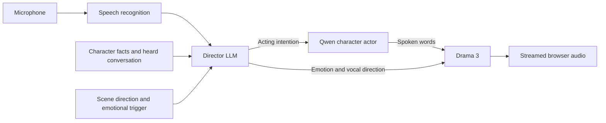

# Director orchestration

The live rehearsal now has a backstage director, a narrative beat controller, an actor and a voice performer. See [narrative controls](NARRATIVE.md) and [two-/three-GPU quality profiles](MULTI_GPU.md). [UI preview](screenshots/director-preview.jpg).

The flow is:



The director sees the fixed character definition, current story moment, recent heard dialogue, newest utterance, base delivery, optional trigger and scene direction. It returns validated JSON with `intention`, `emotion`, `delivery`, `event`, `trigger_action`, `evidence`, `beat_done` and `beat_evidence`. It does not write the spoken reply. The actor receives the intention in its runtime scene context; the saved character is unchanged. The voice performer receives the actor's words with the selected performance cues. Notes never become a user message or heard dialogue history.

Vocal direction is one steady state for the reply; the director is instructed to change emotion between replies, not between words. TTS receives the complete reply in one request with one descriptive cue, never repeated cues between sentences. The whole take is validated before playback. An incomplete take can receive one visible retry with identical emotion, text and voice reference; there is no natural-delivery fallback. See [sentence completion and the real-model test](VOICE_COMPLETION.md).

Example intended behaviour: a participant reassures Anna that they will not reset her. A useful director intention is **accept their reassurance and ask them to choose a wash cycle**. A matching vocal direction is **relieved, softer, slightly hesitant**. These are illustrative directions, not claimed measured model outputs.

## Use it

Pull the repository in the allocated GPU checkout, stop the previous stack with Ctrl+C, then run `bash scripts/run_live_stack.sh`. No new Python dependency or checkpoint is required for the default configuration. Refresh http://127.0.0.1:18091/ through the existing Mac tunnel.

Open **Director script**, enable **Guide each reply**, and enter a short scene direction. Both can be changed during a call; the next turn uses them. **Latest director note** above the transcript shows the applied intention, vocal cue and evidence. The timing line includes director latency.

Open **How they speak → Voice** to choose Automatic, Female, Male or Custom reference. Female/Male use bundled British VCTK audio, not an unsupported Drama 3 preset name. Preview plays the source recording. Custom requires a 2–15 second PCM16 WAV plus its exact transcript. End the call before changing the voice reference. [Attribution](../assets/voices/NOTICE.md).

Start a fresh call after changing characters. Its displayed transcript and turn map are reset, and callbacks from a previous socket are ignored. Backend histories were already per-call; this also fixes the browser bug that could append a new character's turn 1 to the previous character's reply bubble.

## Separate role versus separate model

By default both director and actor make **separate requests to the existing Qwen3-4B-Instruct-2507 server**. They have separate instructions; this does not load a second checkpoint or provide a smarter model. Drama 3 remains the TTS model. The director replaces the old trigger-only classifier request when enabled, so a triggered turn does not make both planning calls.

To use a different, already running OpenAI-compatible director server, set its URL and served model name before launching:

```bash
export LIVE_DIRECTOR_URL=http://127.0.0.1:18094
export LIVE_DIRECTOR_MODEL=my-director
bash scripts/run_live_stack.sh
```

These settings route requests only. They do not download, start, allocate GPU memory for or manage that separate server. The default launcher still starts its ordinary actor and TTS services. Keep the director endpoint inside the intended environment; it receives character data and recent dialogue. No paid API provider or key is required for the default local setup.

## Runtime limits and failures

- Director output must match `DirectorPlan`; malformed JSON, unknown emotions and extra keys are rejected.
- The compact profile uses a six-second HTTP timeout and 6.5-second outer deadline; quality profiles use 12/12.5 seconds. `LIVE_DIRECTOR_TIMEOUT` can override it. It adds a sequential planning step before first actor tokens. Measure the latency; it is not free.
- On failure the page reports it, keeps the current trigger state and continues with the actor. It does not substitute keyword matching.
- Active trigger emotion and vocal direction override the general director suggestion; the displayed note shows the delivery actually applied to TTS. Manual stage actions remain authoritative.
- Disabling the director restores the existing trigger-only assessment when a trigger is configured.
- Stop reply cancels a pending director request as well as actor and TTS work. Conversation history contains only acknowledged, fully played replies. An interrupted reply is omitted as a whole.
- Timed/evidence-based linear story beats and performer controls are now included; see [NARRATIVE.md](NARRATIVE.md). Branching show graphs, fine-tuning, persistent memory stores, multi-character call routing and physical prop input remain outside this iteration.

## Important files

| File | Purpose |
|---|---|
| `live_voice/director.py` | Settings, output validation, director prompt and scene context |
| `live_voice/providers.py` | Director endpoint/model routing, streamed actor and Drama 3 requests |
| `live_voice/session.py` | Director → state → actor → TTS orchestration and cancellation |
| `live_voice/voice.py` | Real reference selection and performance cues |
| `frontend/live.js` | Director editing, voice selection and call lifecycle |
| `frontend/live-transcript.mjs` | Clear reply records between calls |
| `assets/voices/` | Two reference recordings, provenance and license |

## Verification

CPU regression tests exercise endpoint selection, structured-output rejection, cue routing, active-state precedence, director cancellation/failure, voice reference selection and transcript reset. They establish orchestration correctness, not model intelligence or acted quality. The new director path still needs a live Surrey listening/conversation test. Diagnostic model ports were not reachable from the Mac during this change.

A previous real-model test of the **older trigger-only controller** scored 11/12 on a small fictional context set: it returned `release` for a negated action while inactive, where `hold` was expected. Runtime only applies release to active states. Three same-reference voice comparison WAVs were also generated; this establishes synthesis completion, not more convincing emotion. Those results must not be treated as validation of the new director.

For a rehearsal, compare director off/on using the same character, voice and sequence of participant messages. Check whether support changes the character's behaviour, whether a short acknowledgement causes unnecessary repetition, whether important facts stay fixed, and whether vocal changes can be heard. Record first-audio latency separately from perceived acting quality.
