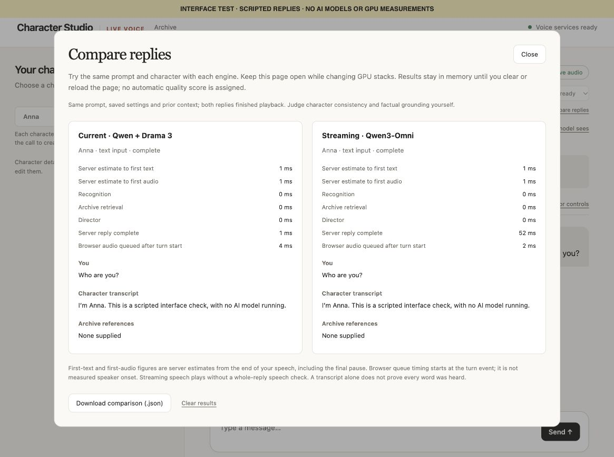
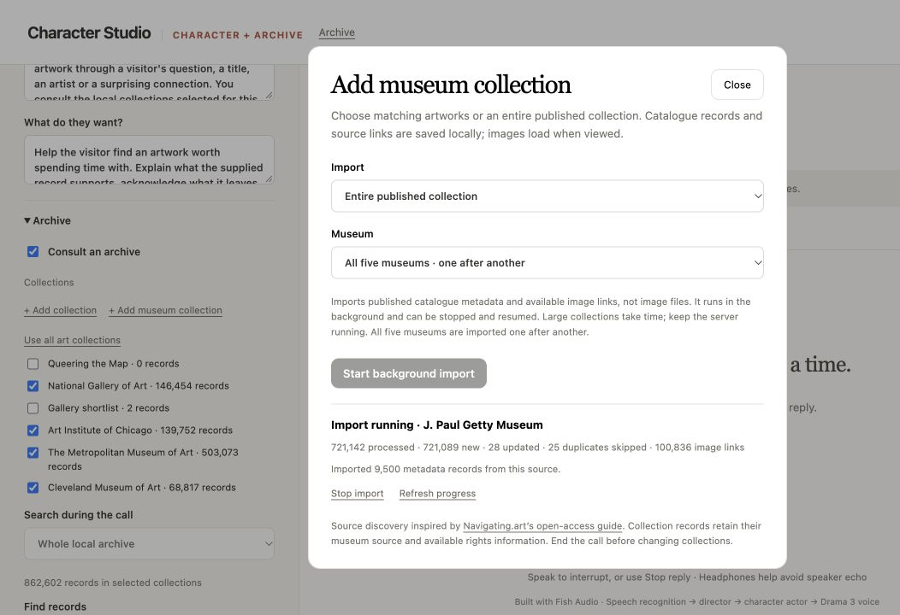
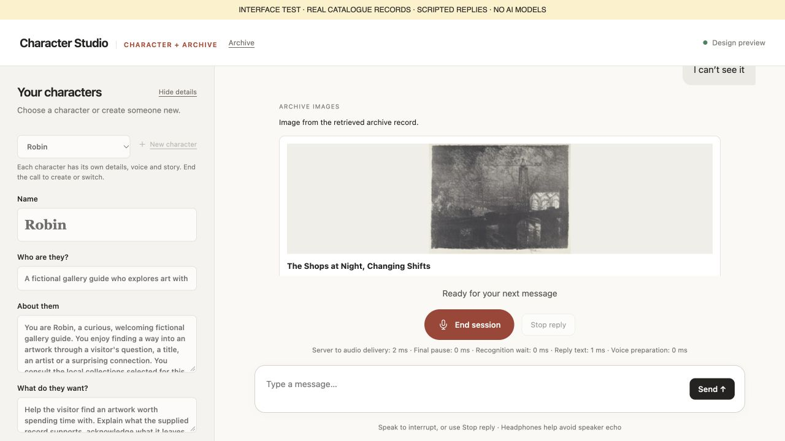
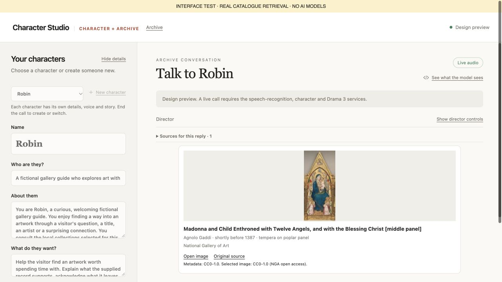

# Latest change: developer architecture handoff and gallery browsing context, 9 November 2026

[Developer architecture and container handoff](DEVELOPER_ARCHITECTURE.md) reconciles the current Drama/native Omni routes, checkpoint sizes, CPU/GPU placement, API and live-audio contracts, archive/browser persistence and repository entry points. It proposes separate frontend/backend and model containers, private model networking, persistent volumes and a versioned application-level OpenAI-compatible facade. The container build/deployment and facade are not implemented. Standalone Mermaid sources and SVG diagrams are in `docs/diagrams/`.

Per-call artwork browsing now retains the meaningful subject, painting/medium and image requirements across follow-ups. Status/filler utterances such as “Any luck?” and “Um” do not become title searches. Filters apply before the top three matches; more results exclude seen works, while a reported image failure excludes only the selected work. The exact same browsing/source context reaches actor and director. The gallery reports metadata-only selection failures as selected 0/0 status, and guards image load/error callbacks against old selections and URLs. A new explicit show turn can retry a failed image without looping on duplicate events. Exact named Met/Getty image requests retain bounded official resolution, followed by the same eligibility filters.

Validation: **965 Python and 323 Node tests pass**, including real local catalogue fixtures, the reported colourful-paintings sequence, available-image ranking, lazy official image resolution and stale browser image callbacks. These checks use no GPU model and no external museum requests. Larger catalogue snapshots build temporary facet indexes at call setup; warm queries use them instead of rescanning metadata. A 20,000-record CPU fixture took 0.613 s to initialize versus 0.168 s before facets; ten warm filtered queries averaged 4.859 ms. These are retrieval measurements, not conversation latency. Pull and restart the actual running stack once, then refresh the portal; no checkpoint or dependency update is required.

# Previous change: Art Archive Studio and reusable browser voices, 6 November 2026

The archive/gallery experience is named **Art Archive Studio** in its header and browser title. The gallery now exposes **Voice & delivery** beside the chat title; it opens a focused view of the existing `#voice-settings` details inside the same character form. Character fields and collection controls are hidden only while this view is selected, so no control IDs/listeners/form ownership are duplicated. **Character & collections** restores the full form. Built-in voice, speaking style, emotion/expression, custom references and vocal direction remain the same settings used by live calls.

`frontend/live-voices.mjs` adds a named browser-local voice library. WAV Blobs and exact transcripts live in IndexedDB; character JSON/localStorage keeps only a validated opaque `saved_voice_id`. Save/load validates PCM16, 2–15 seconds, mono/stereo at 8–48 kHz, up to 2 MiB, and a nonempty <=500-character transcript. The library is limited to 20 saved names. Per-visit uploads remain usable when storage is unavailable. Saved selection restores preview/transcript after reload or character switch, without re-uploading. Stale asynchronous loads/saves cannot apply a previous profile's recording. A new upload clears the old clip's transcript to prevent mismatched words. Missing saved recordings produce an actionable error; no voice is substituted silently. Native Omni keeps its built-in-voice restriction. Custom-voice errors open gallery voice settings and appear inline.

Validation: **921 Python and 318 Node tests pass**. Browser QA in an isolated design-preview origin saved the existing bundled Female VCTK sample as “Gallery narrator”, reloaded, and confirmed Custom selection, saved-name selection, Blob preview and exact transcript restored. No user recording was copied, no live GPU session was altered, and no new voice-quality result is claimed. This is frontend-only: pull and refresh, retaining the current GPU job. Recordings are local to the browser/origin; this does not recover earlier unsaved file selections. [Operator instructions](ARCHIVE_GALLERY.md#voice-and-delivery).

# Previous change: gallery selection and Drama 3 streaming playback, 6 November 2026

The reported musicians dialogue described Grimm's woodcut while the gallery kept Eden visible. Spoken `wood cut` now resolves among supplied title/artist/medium records. Wrong-artwork corrections exclude the rejected title. The gallery and actor receive the same selected record identity; the browser confirms that exact identity after image loading. A confirmed selection survives reordered results. No match clears the unrelated central work; a metadata-only match shows its own unavailable-image card and museum link. Accession identifiers must not be treated as dates, and catalogue titles alone do not support invented instruments/composition. The local NGA Grimm record has accession 1955.5.21, no creation date and no image URL; no claim is made that NGA itself has no image.

The user measured model first bytes104ms versus server delivery4259ms, synthesis2873ms and speech checking418ms. The previous path buffered the entire take before forwarding any PCM. The live app now defaults to `LIVE_VOICE_PLAYBACK=streaming` (`drama-stream-v1`). Strict SSE format/rate/alignment/size/completion checks remain; a bounded queue forwards raw PCM immediately. One complete text request, fixed reference and emotion preserve application-level continuity. No sentence splitting or fallback delivery is introduced. Optional speech verification now happens after audio release; it cannot protect already heard audio. A capped/incomplete/mismatched stream is reported and never automatically restarted after any PCM was sent. Cancellation closes upstream even during WebSocket backpressure. A phrase cannot be acknowledged as heard before successful generation/check completion. The old prechecked mode remains with `LIVE_VOICE_PLAYBACK=checked`.

Status, the engine picker and timing line identify the active playback policy. First delivery and final synthesis/check totals are distinct; no new Surrey timing or acoustic-quality improvement has been measured. Dependencies, models, sampling and GPU placement are unchanged. Pull, stop the actual previous batch job and resubmit once, then refresh. See [latency modes and operator commands](DRAMA3_LATENCY.md#live-playback-mode).

Validation: **921 Python and 307 Node tests pass locally**, including the reported spoken/correction flow, unavailable Grimm record, selected-ID feedback and reordered sources; streaming before completion/ASR, immutable voice/delivery, final sample preservation, cancellation with backpressure and no partial-stream replay or false heard memory. These are CPU tests, not a live GPU listening benchmark.

# Previous change: native Qwen3-Omni streaming comparison, 6 November 2026

Added an explicit per-call engine option while retaining the original Qwen text actor + Drama 3 baseline. `OmniProvider` uses the pinned vLLM-Omni modality-labelled SSE contract: microphone WAV is submitted directly as an audio_url content block, native text arrives alongside base64 PCM with required 24 kHz mono format metadata. Each valid PCM chunk reaches the existing browser playback path immediately, before complete generation. There is no text-to-speech substitution in native microphone mode. Typed and performer-cue turns remain available. [Operator and comparison guide](QWEN_STREAM_COMPARISON.md).

The shared Session prepares the same character, heard history, director plan, trigger/story state and exact retrieved archive messages before either actor path. Native mode forwards the original audio even when the optional listening service has already produced the transcript. The first experiment deliberately keeps same-turn direction/retrieval on both engines; it does not claim a background-director speedup. Native Female/Male map to Chelsie/Ethan; custom Drama reference WAVs are rejected clearly. Microphone audio is omitted from request inspection while text/RAG/direction remain visible.

Native completion requires both text and audio, a valid stop and global DONE. The adapter bounds streams, validates every chunk's sample rate/alignment, closes on cancellation and never retries partially played output. It does not perform the baseline's whole-take ASR/coverage check. A full heard turn is retained only after browser playback acknowledges the completed reply; interrupted partial audio without word alignment is excluded. The existing interruption and story-cue controls use the same lifecycle.

The UI has Current / Streaming choices and a collapsed Compare replies view with transcripts, citation IDs, recognition/retrieval/director/first-text/audio/complete timing estimates and browser queue timing. Matched comparisons require equal authored settings, prompt, input kind and prior context plus completed playback. No automatic consistency score or physical speaker-onset claim is made. Results remain in page memory; explicit JSON downloads use the existing bounded two-minute server attachment route after Blob downloads failed in the in-app browser. Voice audio and credentials are excluded.

The isolated experiment under `experiments/qwen_stream/` pins vLLM 0.32.0, Omni 798fef99a, Transformers 5.16.1 and explicit cu130 wheels in `.venv-qwen-stream`; existing environments are untouched. It reuses the original Omni checkpoint and existing director/STT files with identity/file checks. The first two allocated H200s serve Thinker/Talker/Code2Wav, the third serves the director; the optional prepared Nemotron/Smart Turn environment is supported with the same listening placement as the baseline. Both launchers keep UI port18091; port checks refuse old servers and cleanup targets only owned workers. Baseline/native run sequentially on three GPUs. Same-origin profiles remain available, and keeping the page open preserves comparison samples while stacks change. The existing baseline launcher remains unchanged.

Validation: **874 Python tests and 267 Node tests pass**, plus compile/JS/shell checks. Twelve runtime tests cover pinned files, cache reuse, CUDA token mapping, inherited stage safeguards, port refusal, batch affinity/arguments and cleanup after startup failure. Provider and app/session tests cover actual microphone forwarding after streaming recognition, exact RAG/director propagation, PCM before completion, malformed later chunks, cancellation, readiness/legacy44100 compatibility and heard-memory gates. Browser QA paired two completed, explicitly scripted test replies and verified comparison matching; the corrected export made ordinary attachment POST/GET requests successfully. The screenshot banner explicitly says no AI models/GPU measurements.

No GPU model was downloaded or loaded here. A read-only SSH check could not resolve the Surrey login hostname, so native hardware startup, delay, audible completeness and character quality remain untested on H200. The local design preview was updated with engine controls against the same archive directory, and its museum import resumed from saved checkpoints. [Runtime source, setup, listening parity and return to baseline](../experiments/qwen_stream/README.md).

## Previous change: full museum collections, 6 November 2026

Added full published catalogue imports for all five additional museums. The portal distinguishes Matching artworks from Entire published collection, supports one museum or all five sequentially, and shows a durable background job with progress, Stop and Resume. Use all art collections explicitly selects populated trusted museum collections for the current character, without changing QTM/custom selections implicitly or overwriting source edits made while a job runs. [Setup and coverage](FULL_MUSEUM_IMPORTS.md).

The new `museum_bulk.py` streams the Met/Cleveland official CSV snapshots and Chicago's complete API-data tar archive to disk and processes 500-record transactions. It pins downloads/cursors, checks true EOF, uses stable source UUIDs, and commits a batch before advancing its atomic checkpoint. A crash between commit and checkpoint replays idempotently. `full-import.lock` prevents simultaneous CLI/app writers; temporary request errors back off, cancellation is checked between attempts/body reads, and an interrupted/limited source never becomes completed. The CLI is `scripts/import_museum_collections.py` and checkpoints are under the chosen archive directory's `museum-imports/`.

`museum_bulk_linked.py` uses Rijksmuseum OAI-PMH/EDM batches of 50, including source deletion/scanned accounting and a frozen upper date boundary with resumable tokens. Getty uses 500-object keyset SPARQL batches with core catalogue fields and final count verification. These routes avoid hundreds of thousands of individual object requests. Rijks image links require explicit CC0/PDM; Getty image rights are resolved separately only when retrieved. New object/media image lookup uses validated museum/source IDs, a bounded positive/negative cache and one six-second maximum across all three matches. Met/Getty image facts are resolved before publishing the same references to actor, director and interface. No museum service receives participant audio, transcript, director notes or character sheets from this lookup.

The art database capacity is now five million records. Trusted museum refreshes update records/FTS without changing object identities; custom upload conflicts still fail atomically. A Met CSV omission keeps an existing eligible image only when its explicit current public-domain flag is True; a false/unknown/withdrawn right does not inherit old image permissions. Frozen calls use a temporary disk database instead of a full in-memory database copy. Auxiliary title/artist/date indexes still use memory and preparation scales with the selected data; no claim of constant-time call startup is made.

Validation: **833 Python tests** and **250 Node tests** pass locally. Focused tests cover true/partial completion, source failures, source revisions, replay/resume, request cancellation, image rights, whole-reply lookup limits, update rollback, frozen-call isolation, background jobs and frontend profile/source races. Actual full local imports completed for the Met (**503,073** records), Chicago (**139,752**, **59,063** eligible image links), and Cleveland (**68,817**, **41,773** image links). These counts describe the downloaded snapshots, not live institutional totals. Met CSV image links are checked on request. Official live checks also returned 50 Rijks records/48 eligible image links in one batch and two Getty metadata records in two requests including COUNT. The remaining full linked catalogues run as a real background job in the local preview; their progress is visible and they are not labelled fully imported. Surrey has separate storage and still needs pull/restart plus an import there. No AI voice model or new GPU workload was exercised.

## Previous change: conversational image offers, repair and availability, 6 November 2026

Follow-up source-drift fix: **Uh no, I’m looking for landscapes** previously matched unrelated titles containing “I’m”. `spoken_artwork_query()` now removes only a bounded, anchored conversational lead-in before current/history term extraction and spoken-year normalization. It does not change the participant transcript, catalogue data or literal quoted/named titles. Real NGA-only and NGA+Chicago checks now match the same results as plain **landscapes**, including image links; this is not a semantic genre-ranking improvement. Literal **I’m Jealous** still finds NGA 227936. Four regressions cover direct terms, page/snapshot results, new-topic selection, prefix limits, literal No/I’m cases and prefixed 1387 dates.

Fixed the next reported failure: exact “Show me the image” worked, but fillers/repeated verbs, “pictures of them”, confirmations and “I can’t see it” were treated as fresh searches. The actor then lost known records or denied the UI's display capability. `artwork_requests.py` now recognizes those bounded dialogue acts and strict pronominal description questions. A yes only triggers display when it confirms a grounded image offer from the immediately preceding published actor reply. Known-title offers select supplied keys; generic offers preserve ambiguity; invented titles/URLs cannot arm an unrelated image. A new topic clears the offer.

`LiveSession` stores pending offered records after successful `text_done`, separately from audio/heard memory. A visible offer can survive TTS failure without pretending its words were heard. A cancelled/failed publication cannot create an offer. Acknowledgements retain grounding; description follow-ups use existing metadata rather than a new generic FTS query. Normal generic-archive system policy now includes interface capability and availability facts; actual display requests still receive their additional fixed image-action instruction. Neither actor nor director receives image pixels or a new inference call for intent classification.

`ArtworkChat` retains metadata-only cards with original museum links. The actual pinned NGA Queer Birds (146279), Queer House (42831) and Queer Fish (147406) records are present with no imported image links; Pennell objects 9616/41308/119977 have image URLs. This distinction is explicit in prompts and UI: record absence, no imported image URL, and a browser load failure are separate states. The model is directed not to deny existing records or the application's image capability. It remains a language model, so these are grounding improvements rather than a guarantee of compliant spoken output.

Optional browser `image_status` messages contain only current turn, a fixed state and bounded counts. Real load/error events produce the feedback; late, duplicate and replaced-turn events are suppressed. The server validates current requested turn/counts and prevents a delayed failure from erasing a successful load. Feedback affects the next prompt without initiating speech or another model call. Ready/status advertise `image_status:true` and `artwork_images:dialogue-v2`; the frontend does not send feedback to an older runtime, and a stale server gets a restart hint.

Validation: **788 Python tests passed**, **227 Node tests passed**, plus module syntax and compile checks. Added exact typed/audio Pennell offer→Yes please→visibility-repair cases; stutter/filler requests; the three known/no-image NGA works; unknown offers; visible-offer/TTS-failure separation; current-turn image feedback; positive feedback through the WebSocket into the next prompt; and real browser load/error handling. Labelled browser QA uses scripted replies and real catalogue records with no AI models: both user-reported sequences were exercised, the same Pennell image loaded on multiple consecutive requests, and the queer-titled metadata cards retained their links. [Behaviour and known data](ARTWORK_SEARCH.md).

The pre-existing local preview on port 18113 was still running older Python code. Its inactive preview process was replaced with the updated app against the same local archive directory; `/api/status` now reports `dialogue-v2`. This does not update Surrey. Pull/restart/refresh the Surrey stack separately; no model or dataset re-download is required.

## Previous change: reliable artwork lookup and inline image requests, 6 November 2026

Fixed the reported NGA retrieval failures in the local 146,454-work snapshot. **Agnolo Gadi**, joined **AgnoloGadi**, and the canonical name now find Agnolo Gaddi candidates. **Madonne and Child Entrhoned with Twelve Angels** returns only NGA object3, the requested middle panel. Numeric **1387** and spoken **thirteen eighty-seven** prioritize the actual artwork date; accession/body-only years do not become date matches. Several panels legitimately share the date/artist, so the system preserves alternatives rather than asserting a unique identification. [User examples and behaviour](ARTWORK_SEARCH.md).

`artwork_retrieval.py` adds a compact title/artist/date posting index alongside FTS5. It prepares once during frozen-call creation; local preparation took1.81s and warmed examples0.2–5.4ms. Name correction requires conservative complete-name evidence; title corrections allow one edit or adjacent transposition within bounded prefix/length buckets. Query work is limited to8,192 posting visits,256 fetched candidates and12 fuzzy terms; multi-source union caches retain at most8 selections. Strong distinctive titles can return one result; weaker cases retain candidates. Source spellings/data remain unchanged. The grounding policy warns about transcription differences and asks for confirmation when uncertain. This is lexical retrieval, not a model or ASR-weight change.

Page search and conversation search share ranking. Page caches invalidate after successful imports and external `PRAGMA data_version` changes. New calls use frozen indexes; old calls never change under them. Memory is released on close. Spoken-year normalization is constrained to conventional standalone/date-context forms; it does not turn arbitrary number words into dates or replace approximate source wording with an exact creation year.

**Show me the image** now works with finalized microphone transcripts and typed messages. `artwork_requests.py` classifies explicit requests without another model call. Named requests search fresh; generic requests reuse only this call's most recently published candidates. An unsuccessful new named search clears that referent, acknowledgements retain it, and cancelled source publication cannot change it. `session.py` sends `image_request:true` with the usual validated source event and fixed actor/director UI guidance. No pixels are passed to either model, and no image is generated. No new request bypasses selected-collection restrictions.

`live-artwork.mjs` renders validated inline cards, captions, rights and links. **Open image** opens a separate browser view by explicit click; canonical NGA thumbnails use a larger1,200px IIIF view. The current image stays visible while reply text streams, and the image region receives enough height to avoid clipping links. Previous cards remain through later turns; new character/call state clears them. Missing images are explained rather than invented. No automatic voice-triggered browser popup is attempted.

Also made museum JSON depth limits explicit (64 containers/250,000 values), independent of Python decoder recursion behaviour. This fixes the museum commit's Python3.12 CI failure for an overly nested response; the updated deterministic boundary regression tests decoded depth64/65 directly.

Validation: **754 Python tests passed**, **217 Node tests passed**, and compile/module checks passed. Browser QA used the clearly labelled CPU fixture with real archive retrieval: the misspelled title produced exactly the middle panel; artist Gadi and spoken1387 produced the appropriate canonical candidates; **Show me the image** displayed that exact NGA image inline. Clicking **Open image** opened its larger532×1,200 official JPEG in a separate tab. The screenshot explicitly states no AI models are connected. This validates retrieval/transport/UI, not a new Surrey deployment, ASR accuracy, spoken-model answer or GPU voice-quality result. Existing NGA data needs no re-import; pull/restart/refresh is required on Surrey.

## Previous change: five museum catalogue importers, 6 November 2026

The Navigating.art page is a guide to institutions, not a dataset. **Archive → + Add museum collection** now connects its five museums through their official public APIs: Met, Art Institute of Chicago, Cleveland, Rijksmuseum and Getty. Each explicit artist/title/subject import becomes a named local collection alongside NGA. UI limits are 25/50/100/200, CLI limits 1–1,000 per institution. The imported collection opens first with its search query retained; previously selected sources remain checked. Available sources do not appear as populated collections before an import. [Setup, source contracts, storage and limits](MUSEUM_COLLECTIONS.md).

The five adapters normalize records into the existing `CollectionDatabase`; character prompts and per-turn retrieval remain local and use the same frozen-index RAG path. `MuseumHTTP` restricts host/path, JSON size, runtime and request count; retries are bounded and partial retry bytes count against the total budget. Parsing failures are safe fixed-reason errors. A complete bounded selection is fetched before a transaction, so malformed late records do not partially persist. Existing stable-ID conflicts preserve saved records. Source choices remain character-specific. No model, dependency, GPU placement, speech-recognition or voice-generation settings changed.

Museum-specific details matter: the Met uses the current paginated `/v1.1/search`; Cleveland's actual rights field is `share_license_status`, not `license`; Rijksmuseum searches creator/title separately and follows validated Linked Art identifiers; Getty searches a fixed escaped SPARQL query and selects Digital Image references rather than mistaking `/subjects` nodes for image records. Explicit per-record public-domain/CC0 image status is required. Copyrighted-image records may retain their open catalogue metadata with no image. Chicago's separately CC BY `description` is excluded. Generic rights captions are displayed literally.

Chicago images currently fail no-referrer localhost loading. A fixed JPEG relay accepts canonical AIC image UUIDs only when the exact image URL is saved under the official `museum-aic` collection; uploaded custom records cannot authorize it. Requests have a 25-second overall deadline, 1 MiB/image limit, bounded cache and no redirects. Other museums continue direct image loading. Images are displayed to visitors, not sent as pixels to the actor.

Validation: **708 Python tests passed**, **201 Node tests passed**, plus compile/module syntax checks. Forty Python and thirteen Node tests cover this feature, including bounded pagination, current rights contracts, safe malformed responses, import rollback, origin/call guards, source preservation, stale profile responses, and relay restrictions. Tiny production-client live checks succeeded for all five museums. One sequential CLI `--source all --query Monet --limit 3` persisted results from every institution; Chicago correctly counted three existing records as duplicates. Separate Rijksmuseum Rembrandt and Getty Van Gogh checks each returned two eligible image-linked records.

Browser QA used real official data and the existing local NGA index: a Chicago import saved 25 catalogue records and displayed real thumbnails through the relay. A later Cleveland import saved 22 new records plus three duplicates, kept NGA/Chicago selected, and opened the new museum first with `Monet` retained. Visible official Cleveland images loaded as well. This is local data/UI evidence, not a new Surrey deployment or GPU/model/voice-quality test. [Museum import dialog screenshot](screenshots/museum-import-preview.jpg).

## Previous change: multiple archive collections and art images, 5 November 2026

The archive now supports a new fictional character **Robin**, linked by default to the National Gallery of Art collection, plus per-character choices of up to eight named reference collections. **+ Add collection** imports canonical JSON/JSONL/CSV exports atomically. Retrieved images, artist/date/medium and source links appear alongside chat; collection browsing shows thumbnails before a call. Existing QTM tools retain their strict source validation and `archive.sqlite3`; generic sources use a separate `collections.sqlite3` in the same configured archive directory. See [RAG setup, schema, limits and Surrey commands](RAG_COLLECTIONS.md).

`collections.py` implements bounded records/metadata, public HTTPS display links, independent SQLite FTS5 storage and frozen snapshots. `collection_catalog.py` adapts explicit QTM selection and opens one generic snapshot for all selected generic sources rather than copying that index repeatedly. `ArchiveSettings.collection_ids=[]` preserves the legacy path; explicit IDs require library scope and no curated-story IDs. Session retrieval gives the same canonical references to the actor, director and UI, with a separate generic grounding policy. Index results merge by rank, not raw cross-index BM25 values. Artwork-facet follow-ups retain the last meaningful artist/topic query while new named topics remain independent. This is lexical RAG without embeddings, visual analysis or weight training; images are displayed, not passed as pixels to the actor.

The NGA importer pins official commit `68d372221c7a848b932ce07c1e1f8c293c646688`, downloads just two CSVs (~175 MB), verifies exact Git blob hashes/lengths and records file digests. Local-file mode reports `source_verified` and `source_revision` only when the exact official files match; `configured_revision` remains explicit. Source row IDs are nonnegative: actual artwork `0` is valid and must retain its linked image. Only blank image owners are unlinked; malformed IDs still reject. The best primary/numeric-sequence image is selected only when `openaccess=1`; metadata-only objects remain searchable. Safe stage/reason/row diagnostics, atomic imports and explicit excerpt counters prevent silent partial results.

Actual full local import added **146,454** artworks; **63,884** have eligible open-access thumbnails. The identical full reimport added **0**, identified **146,454 duplicates**, and retained object 0. The database occupied ~427 MiB locally. Excerpt counters were titles 347, text 1, metadata 18 and image descriptions 25,296. No image payloads or source data are committed. These are local results; the importer must still be run on Surrey. There are no dependency, model or GPU-placement changes.

All **668 Python and 188 JavaScript tests pass locally**, including generic persistence/rollback/link validation, collection selection/isolation, snapshot disposal, same-context actor/director/UI delivery, named upload, source IDs across namespaces, artwork follow-ups and legacy QTM regressions. Browser checks selected Robin, searched the real Gallery collection, uploaded a separate two-record shortlist and verified its isolated count. A labelled CPU interface fixture retrieved three actual Monet artworks beside an explicitly test-only response, with real loaded thumbnails and source links. No AI inference, live speech or new Surrey deployment was claimed. A compact image rail and hidden-control CSS fix keep the first artwork caption/source visible; existing director controls remain collapsible.

# Previous change: speak over the character, 5 November 2026

New microphone calls enable **Allow interruptions**, which can be turned off live. The client continues to analyze AEC-processed microphone frames locally during generation/playback, using a sustained 240–300 ms onset, an adaptive floor and a strong playback-correlation veto over 80–100 ms of mic context. `PCMPlayback.referenceWindow` uses actual scheduled start/end times, excludes future audio and retains ended output for a bounded 600 ms echo tail. When advertised, browser echo-cancellation mode `all` is requested; capability/constraint failure falls back to the existing `true` setting. This is a heuristic, not proof of human-vs-speaker separation. No output duck/mute test, extra ASR model or extra GPU was introduced.

On a candidate the browser stops matching old playback, suppresses its late JSON/PCM, and holds the full onset (including up to 200 ms preroll) until server acknowledgement. Pending audio is bounded to two seconds with a 1.2 s acknowledgement timeout. Accepted onset is replayed once in small packets, then normal recognition continues. Rejection/timeout discards retained audio, keeps Stop reply available and does not resume into a server that may still be speaking. Mute, disabling, manual text/stage actions, disconnect and new turns clear stale candidates. The switch and status text reflect whether voice interruption is actually permitted for this microphone call.

`app.py` adds strict optional `start.interruptions` (false for old clients), live `interruptions` / `interruptions_ack`, `barge_in` / `barge_in_ready`, and `/api/status.voice_interruptions`. Matching requests acquire `begin_lock`, reserve input before cancellation, cancel active reply/background direction/prepared recognition, reset baseline or Nemotron input, recheck turn ownership and acknowledge with no echo cooldown. Duplicate/stale/disabled requests cannot touch a newer turn. A guarded two-second timer releases an onset reservation even if no PCM arrives, while epoch/turn/onset guards protect genuine newer speech. Ordinary Stop reply retains its 350 ms decay delay. Interrupted whole replies remain omitted from heard history; TTS word/transport checks and per-reply delivery are unchanged.

All **616 Python and 169 JavaScript tests pass locally**, including 15 new WebSocket tests and 13 browser-logic tests covering active synthesis/actor cancellation, both recognizers, first-syllable replay, current-turn races, reservation expiry, echo fixtures, double talk, audible-clock alignment and bounded buffers. The preview showed Karim still selected and the Allow interruptions checkbox switching off/on. No physical microphone, external-speaker or Surrey GPU call was tested. The previous repeated speaker-echo cancellations remain an important real-world regression; see [interruption behavior, limits and restart](INTERRUPTIONS.md).

# Previous change: Karim starter and surviving legacy profiles, 5 November 2026

Karim was missing from the user's picker. No original Karim export was found in the local project, outputs or handover; earlier repository mentions were browser-preservation notes and test placeholders. The older CharacterPlex service may have a separate server-side library/history, and different browser addresses/ports have separate storage. The current main and archive pages also keep separate libraries.

`characters/karim.json`, `karim-profile.json` and `karim-story.json` now provide a registered starter reconstructed from Aley's brief: an Egyptian gay singer/songwriter in London, out there but not to his parents, navigating faith and family. Age, denomination, relationship status, parental knowledge/reaction and dated life events remain unspecified. The male reference and neutral delivery start with the director on, no trigger and narrative off; three optional manual beats do not prescribe coming out or reconciliation. The bundled profile does not replace a saved same-ID profile. See [Karim and recovery limits](KARIM.md).

A conditional migration loss was also found: when a valid library already existed, its constructor ignored the legacy character loaded into the form, then applying the active library profile overwrote `live-character-v1`. Main-page startup now independently reads meaningful, validated records from both real legacy character keys and merges differing character facts before its first library save or legacy write. Existing profiles and selection stay intact. Deduplication uses normalized character facts rather than unrelated voice/story settings; recovered entries use stable collision-safe IDs and clean auxiliary defaults. Main/archive separation and the existing storage-failure write guard remain intact. No synthetic fallback form or fetched Anna is treated as recovery evidence, and reference audio is never migrated.

Browser verification selected Karim in a local design preview and showed his fields and free-conversation state. This is not a recovered original profile or a live model-quality check. Pull, restart the Python stack and refresh to load the new preset; the frontend migration runs in that same browser address. No models, dependencies, GPU jobs or audio-generation settings changed.

All **601 Python and 156 JavaScript tests pass locally**. New checks cover the read-only Karim API, optional manual beats, legacy migration despite an existing library, independent malformed-key handling, collision/dedup behavior, archive isolation, clean auxiliary defaults and failed-save preservation. The older local CharacterPlex endpoint at port 18090 was unavailable; its remote saved library was not recovered.

# Previous change: residual voice-code vocabulary and preparation timings, 5 November 2026

The user reports a Female-reference archive reply failing with 34 seconds of generated waveform and 2/61 words matched, plus a long wait and variable delivery. Female already sends one fixed bundled reference per turn; no reference switch was found. The waveform duration is not wall time, and recognition coverage alone does not establish the exact audible words. All 61 normalized words in the supplied quoted passage are retained.

`drama_sampling.py` now upgrades original or recognized v1 source to a v2 sampler that masks residual logits above code ID 1023, preserving the 4096-wide tensor required by its sampling kernel. The pinned runtime's residual head exposes 4096 logits while its DAC codebook has 1024 entries; the decoder clamps invalid codes. CPU execution of the exact pinned methods reproduces the invalid v1 draw and its prevention by v2. Main-token sampling is unchanged, acoustic top-k remains 30, and the original-byte backup/atomic replacement/unknown-source refusal remain. See [hashes, evidence and restart](DRAMA3_SAMPLING.md). This fixes a concrete source mismatch, not a proven cause of this particular acoustic failure.

The final actor reply is cleaned only of clearly paired presentation emphasis/inline-code wrappers; words, quote content, emotion and reference remain intact. A `text_done` event aligns the displayed text, saved retry and voice payload. Normal EOS takes can now remove a strictly quiet suffix before the same recognition check, retaining 400 ms; uncertain endings and content-check opt-out are untouched. Both failed attempts in the 34-second/2-of-61 fixture release zero PCM. No sentence splitting, natural-delivery fallback, unchecked streaming or extra attempts were added.

Task-local `voice_progress` events expose generating/checking/retrying/ready stages. Numeric wall times distinguish synthesis, verification and model first bytes, including failures; first bytes are not first audible playback. The frontend ignores stale progress, clears timing on new turns/retries and leaves microphone/playback ownership unchanged. `/api/status` identifies `voice_pipeline: voice-checked-v5` and `voice_progress: true`. Restart the full stack, including TTS, and refresh the browser. Dependencies, checkpoints, GPU placement and optional Nemotron listening are unchanged.

All **599 Python and 148 JavaScript tests pass locally**, including source guards, adversarial residual sampling, the exact 61-word passage, quiet-tail preservation, immutable retries, progress/cancellation, heard-history acknowledgement and UI phase ordering. No new GPU synthesis/listening result or measured latency improvement was obtained for this change. A same-passage Female check after restart is still required; the running v4 server does not contain this sampler update.

# Previous change: batch-step CPU affinity, 5 November 2026

Surrey batch job 80315 reached `costar07` but its first `srun` step failed with `CPU binding outside of job step allocation` / `Unable to satisfy cpu bind request`, before the live launcher or any model started. The user submitted from a `costar07` shell and subsequently showed a separate running interactive job, 80203. An inherited mask from the older allocation is a plausible cause; the provided log alone cannot distinguish it from site automatic-binding policy.

`scripts/run_live_slurm.sbatch` now unsets only the four inherited Slurm CPU-affinity variables and uses an explicit `--cpu-bind=none` plus the current job's CPU-per-task value (fallback 24). New job/GPU/CPU allocation variables are retained. It still launches one owned task, forwards `--listening`, propagates status and requests the same three H200s/24 CPUs/256 GiB/four hours. All 571 CPU tests pass, including fake-step regressions that exercise poisoned masks, current CPU counts and allocation metadata. Surrey scheduler execution remains a user-side validation; no remote allocation was submitted or cancelled here. [CPU binding and launch options](MULTI_GPU.md#cpu-binding-during-batch-startup).

# Previous change: clean CPU CI dependency and Actions update, 3 November 2026

GitHub job 126043562635 failed two listening tests because `requirements-dev.txt` did not include `websockets`. The development machine already had the package, hiding the missing declaration. Dev requirements now include `websockets==15.0.1`, matching the live portal's pin, so both the redirect-policy test and real loopback transport test run in a clean CPU environment without installing GPU packages. A fresh temporary Python 3.11 environment installed only these declared dev requirements and passed all 568 Python tests; all 138 JavaScript tests also pass locally. GitHub continues to run Python 3.12 and Node 22.

The workflow uses the current official Node-24-based `actions/checkout@v7`, `actions/setup-python@v7` and `actions/setup-node@v7`, verified against their release metadata and action definitions. The hosted runner is explicitly `ubuntu-24.04` rather than the migrating `ubuntu-latest` label. CI now runs every `tests/*.test.mjs`, compiles `listening_runtime` and includes the live Slurm wrapper in shell syntax checks. No speech-model environment, model dependency pin or inference behavior was changed. The subsequent GitHub run is the authoritative Linux/Python-3.12 validation.

# Previous change: create additional live characters, 3 November 2026

The live and archive pages now have **New character** next to the picker. A small modal asks for a required name (1–80 characters after trimming) and optional role (up to 120). `CharacterLibrary.create` generates a unique ID independently of the editable name and persists a fresh active profile. Identity facts, memories, goal, environment, voice direction, director notes, triggers and story beats are not copied from the previous character. A new archive-page character enables whole-library retrieval; a normal live character starts with archive access disabled.

Current form edits are saved before creation. Applying the new profile clears conversation, voice reference, inspector, playback, retry and director state using the existing switching path. Creating is disabled during connecting, an active socket or disconnect cleanup, and the submit handler repeats the guard. Storage failures preserve profiles in memory, show the existing browser-save warning and retain the legacy-copy protection. Profiles are browser-local, not shared server records; custom voice clips must still be selected for a call.

The JavaScript suite passes **138 tests**, including eight new creation cases for fresh defaults, duplicate names/unique IDs, persisted reload, independent settings/archive scope, validation, UUID failure/collisions and storage quotas. Browser checks created Iris, edited her facts and goal, switched to Anna and back, refreshed to confirm persistence, and rejected a whitespace-only name. No model dependencies, GPU jobs or backend behavior changed; the previous 568 Python checks remain the backend validation result. Pulling and refreshing the page is sufficient for this static frontend change.

# Previous change: optional streaming listening experiment, 3 November 2026

The portal can now run `--listening nemotron-smart-turn` with `quality-3gpu`. It uses native Transformers 5.13 cache-aware Nemotron RNNT (0.6B English, six lookahead tokens/560 ms chunk) on the director's allocated GPU plus Smart Turn v3.2 CPU ONNX. The experimental director reservation is 75% instead of 85%; baseline configuration is unchanged. Setup, explicit pinned checkpoint download and runtime live in `.venv-listening`, without changing matched Torch/vLLM voice environments. See [LISTENING_EXPERIMENT.md](LISTENING_EXPERIMENT.md) and [exact setup/provenance](../experiments/listening/README.md).

One active utterance streams PCM incrementally with a 200 ms preroll, bounded queues/cache, 15-second cap and padded final window. ASR and Smart Turn have separate owned workers, so turn classification can complete while RNNT waits for incoming audio. VAD proposes a pause at 300 ms; classification rechecks every 200 ms and an explicit 1,200 ms pause limit prevents indefinite waiting. Resumed speech invalidates stale decisions. Interim text is temporary UI feedback; only the finalized transcript reaches the existing actor/history/archive/inspection path. Typed input, mute, cue, interruption and disconnect cancel unfinished recognition.

Port 18095 is internal. The launcher verifies local hashes and readiness before starting other models, owns cleanup, accepts actual allocated GPU tokens and forwards batch script arguments. Startup/model errors are fixed messages without contributor text/audio in logs. No automatic package installation, checkpoint download, GPU request or old-process termination is added.

This experiment focuses on listening. The director still precedes the actor; whole-reply emotion/voice, transport checks and Faster-Whisper spoken-word verification remain unchanged. The 568 Python and 130 JavaScript checks include genuine loopback client/server transport, concurrency, cancellation and baseline regressions. A disconnect regression uncovered cancellation interrupting app cleanup; shielded cleanup now closes recognition/session ownership and releases the call lock before another call is admitted. A Surrey installation, H200 memory-fit check and same-prompt latency/accuracy comparison are still required; no new model inference or speedup was demonstrated locally. The larger QTM import subsequently succeeded on Surrey: 123,209 new stories, 123,210 including its pre-existing entry.

# Previous change: preserve literal text in the official QTM export, 2 November 2026

The new Surrey diagnostic identified `invalid_import_row` at row 55,666. The matching cached source record contains only the broken-heart emoticon `</3`. CPython 3.12.15's HTMLParser treats this incomplete closing-tag-like fragment as a discarded bogus comment, whereas local Python 3.11 retains it. The importer was unnecessarily routing the official numeric-ID-to-text map through HTML conversion. Official submission/export code confirms these values are literal textarea strings.

The numeric-map branch now emits `text` rather than `description`. Existing ArchiveEntry trimming/length/source validation, transaction rollback, provenance and deduplication remain intact. No records are skipped or replaced. Generic record-array/JSONL/CSV `description` fields still use the previous HTML conversion. UI textContent renders source as text; fixed untrusted-source grounding keeps that data separate from authored model instructions, without claiming perfect model adherence.

**495 Python tests pass.** Updated and additional tests cover literal hearts/broken hearts, incomplete angle text, literal tags/entity strings, no HTML-parser call for the official format, API preservation, repeat deduplication and invalid-later-row rollback. A fresh local database imported all **123,209** cached stories with zero rejects/duplicates; a second import added zero and identified all 123,209 as duplicates. Search still found the 154 London matches. JavaScript is unchanged from 124 passing tests. No GPU, model install, network refetch, existing database reset or source-text logging was used. Pull and retry the existing cached-file command on Surrey; actual Surrey success remains to be confirmed.

# Previous change: archive import failure diagnostics, 2 November 2026

The user pulled `affd4a2` on Surrey, but the bulk import returned the old generic error. Subsequent checks confirm the expected scratch archive path, SQLite 3.53.1 with working in-memory FTS5, a 21,696,338-byte downloaded snapshot, and a database that opens with one existing story. Those results narrow the outstanding failure to importing records or closing the database; they do not establish a bad source, storage failure or missing dependency.

`scripts/import_qtm_archive.py` now prints the chosen directory and phases `prepare_source`, `open_database`, `import_records`, `close_database`. Errors report fixed guidance plus bounded JSON codes for SQLite, filesystem, known legacy/schema validation and exact row numbers. A bounded cause/context walk retains suppressed SQLite errors without rendering raw exception messages. SQLite extended names are emitted only when they match the installed module's numeric enum constant. Contributor text, arbitrary SQL/exception details and input paths inside exceptions remain excluded. Closing is still attempted, and a close error cannot mask the original import failure.

The 491-test Python suite passed, followed by 14 passing focused diagnostic tests after adding a real-SQLite extended-name check (492 tests now present). JavaScript is unchanged from its 124 passing tests. Diagnostics cover wrapped SQLite failures, filesystem codes, malformed/Pydantic-like errors, row retention, all stages, cleanup precedence and private-text suppression. No source database is reset, permissions relaxed, model packages changed or GPU invoked. The user can pull and repeat cached `--download` to obtain the actual Surrey failure code; the underlying import is not yet fixed or claimed successful. See [QTM_DATABASE.md](QTM_DATABASE.md#if-an-import-fails).

# Previous change: a larger local Queering the Map database, 2 November 2026

The archive now supports a persistent SQLite FTS5 collection of up to 500,000 stories. The official first-party `data/descriptions.json` snapshot was downloaded once into ignored local storage and imported successfully: **123,209 stories**, **21,696,338 source bytes**, no rejected rows or duplicates. Its metadata records the source, retrieval date, SHA-256, ETag and CC BY-NC-SA 4.0 attribution. No coordinates, credentials, Supabase access, individual-ID crawling or third-party mirror were used. The imported database remains outside Git at `outputs/queering-the-map/archive/archive.sqlite3` on the development Mac; Surrey still needs its own import.

`live_voice/archive_database.py` adds validated atomic JSON/JSONL/CSV imports, same-source/text deduplication, indexed lexical retrieval, paginated browsing/search, count and one-time migration of the old selected manifest without changing local IDs. Persistent storage uses rollback journalling rather than WAL because Surrey storage can be shared across hosts. Whole-library calls copy one consistent database state into private read-only memory, then retrieve only three bounded excerpts per question. Selected calls retain their previous bounded snapshot. Actual cluster filesystem locking and database startup have not been checked on Surrey.

The UI adds **Whole local archive / Selected stories**, search, counts, pagination and collection upload. Off-page selections survive filtering and are validated separately; only scope/IDs persist in browser profiles. Same-origin uploads are bounded to 128 MiB and preserve imported provenance. Active calls block ordinary mutations. Cancellation waits for owned import workers before releasing write locks or deleting upload files, and closes unclaimed snapshots. The same grounded references reach the actor, director, inspector and current-turn source cards. Whole-reply voice behavior, models and GPU placement are unchanged.

`scripts/import_qtm_archive.py --download` downloads or reuses a byte-verified official snapshot using the same archive-directory defaults as the portal. `--refresh` explicitly rechecks its ETag; imports are additive/deduplicating, not a deletion-sync feed. Stop a running batch stack before importing from login01; an ended log viewer is not a stopped batch job. [QTM_DATABASE.md](QTM_DATABASE.md) gives the commands, storage paths, provenance, license, refresh and memory/lexical-search limits. [ARCHIVE.md](ARCHIVE.md) describes character grounding and source scopes.

**478 Python and 124 JavaScript tests pass.** Synthetic tests cover large imports, migration, rollback, queries, Unicode, selection pagination, upload/active-call boundaries, same grounded evidence and cancellation cleanup. A real local corpus check produced a 99,282,944-byte database, a 38.7 ms private snapshot and four searches of 0.31–30.47 ms. Browser checks confirmed 123,209 stories, persisted whole-archive mode, 154 London matches and working result pagination. The preview screenshot contains collection metadata rather than contributor text. No speech model, GPU job or real archive conversation was invoked for this update; local retrieval timings do not establish live response quality or Surrey performance.

# Previous change: separate main/acoustic Drama 3 sampling, 29 October 2026

The user's updated live stack still returned `600/600 tokens, 27.9 s generated audio, 3/21 words matched`. Source review found a concrete setting matching the linked SGLang-Omni cookbook's warning: main-token top-k 30 can produce an initial phrase followed by silence. Our pinned vLLM-Omni defaults to 30, silently bounds unlimited requests by a default capacity of 64, and shares top-k with acoustic heads. A request-only override would not establish the cookbook's main/acoustic separation.

`live_voice/drama_sampling.py` now repairs exactly one argument in pinned commit `798fef99a33fba3ad3c2439d6ec10fe838c0076b`: acoustic `code()` receives `top_k.clamp(max=30)`. Full-file original/patched SHA-256 guards, this-checkout interpreter/installation containment, provenance checks, verified backup/marker and atomic replacement protect existing/custom installs and uv hardlink caches. Unknown source refuses startup. `experiments/drama3/repair_sampling.py` defaults to read-only inspection and supports explicit apply/restore without loading models or installing packages.

Before importing vLLM-Omni, the live TTS launcher ensures that correction, then renders a JSON/YAML stage-0 overlay with `fish_omni_max_top_k=4096` and sampling defaults `temperature=1.0, top_p=0.9, top_k=0`. Every provider speech request sends those values through supported nested `extra_params`, visible in the inspector. Stage-1 GPU budget, placement, actor/director settings, words, emotion/reference and verification/retry limits remain unchanged. The standalone raw TTS launcher still uses its original deployment defaults. This repair does not implement SGLang reference sampling or its different top-p crossing rule. Wider fixed candidate kernels can affect compilation/per-frame cost and need H200 measurement.

430 Python tests pass, including 16 exact-source/atomic rollback/guard tests and eight request/retry/inspection/deployment contract tests. The initial restricted full run blocked six existing socket/process tests; the full CPU suite passed with temporary local sockets enabled. JavaScript is unchanged; its preceding result remains 113 passing tests. No real synthesis, package installation or GPU allocation was performed. The user must stop batch job 70056 if still current, pull and resubmit one batch job, then test a fresh call. See [sampling evidence, exact hashes and deployment/rollback](DRAMA3_SAMPLING.md). A successful source check is not a demonstrated voice-quality fix.

# Previous change: persistent Slurm batch entrypoint, 29 October 2026

`scripts/run_live_slurm.sbatch` submits the existing three-GPU stack as one foreground service launch owned by a batch allocation, independent of the SSH terminal used for submission. Defaults are `proto`, one node/task, three H200s, 24 CPUs, 256 GiB host RAM and four hours. It validates the Slurm job/submission-directory context and repository path, enables unbuffered output, logs the job/node, Git revision when available and the voice-verification flag, then replaces itself with one `srun` of `quality-3gpu`. It does not install/download models, launch an overlapping copy, automatically submit/retry a job or cancel other allocations. `slurm-character-JOB_ID.log` is ignored by Git. The user submits explicitly from `login01`; no cluster job was submitted by this implementation.

This follows an interactive allocation ending early with SIGKILL while two steps existed. Scheduler output showed cancellation but did not establish OOM or its origin. Separate per-step RSS peaks must not be summed as a simultaneous total. Local review found isolated shutdown groups and bounded audio checks, not a demonstrated runaway memory path. Batch mode removes dependence on an allocating terminal's lifetime; it does not establish or repair an unknown scheduler/memory cause. Browser use still needs the Mac tunnel to the actual assigned node. See [MULTI_GPU.md](MULTI_GPU.md#background-job).

406 Python tests pass, including eight batch-entrypoint tests using a fake `srun` and stub stack: syntax, literal resource directives, missing-context refusal, paths with spaces, exact single-launch arguments, unbuffered output, missing-stack refusal and child-exit propagation. Existing JavaScript is unchanged with 113 tests passing in the preceding update. No GPU or scheduler integration test was performed.

# Previous change: verified capped-take recovery, 29 October 2026

Live reports of `488/488`, `460/460` and `432/432` tokens with about 20–23 seconds of audio identify codec-frame limit stops, but do not establish whether the waveform contains ongoing speech or a long silent tail. The client no longer treats every valid limited stream as an automatic failure or increases every request's allowance.

`_voice_take` returns a private transport result only after the full SSE stream validates through clean EOF: one terminal event, valid usage, correct bounded/aligned PCM and no later event/error. Raw candidate PCM is never attached to a reusable exception, session history or inspector. A capped take qualifies only with verification enabled, at least 800 ms of strict quiet tail after earlier varying speech energy, and exact normalized `matched_words == expected_words == heard_words > 0` on the retained audio. `voice_tail.py` keeps every nonquiet block plus a 400 ms pad; recognition runs on that trimmed candidate. Extra/repeated/missing normalized words, unverified/uncertain audio and malformed streams remain blocked.

For the first capped take only, actively voiced output with a clean recognized expected prefix can give the second attempt a larger allowance: `min(1600, max(budget + 256, ceil(budget * 1.5)))`. Text, cue, emotion and reference are unchanged. Silent stalls, noise, repeated/unrelated/subsequence-only recognition and ambiguous quiet endings do not inflate. Other failures retain the same shared two-attempt maximum. Diagnostics include only safe numeric tail/coverage/budget fields, and the message can report seconds quiet at the end. Silence recovery is an independent recognition/energy criterion; it does not claim the model reached EOS or that ASR is infallible.

398 Python tests pass, including 16 tail-analysis and 14 provider-recovery tests using synthetic PCM and scripted recognition. Existing JavaScript remains unchanged with 113 passing tests from the preceding update. No new dependencies, model weights, GPU allocation, cue-placement change or live inference test is included. See [VOICE_FAILURES.md](VOICE_FAILURES.md) and [VOICE_COMPLETION.md](VOICE_COMPLETION.md). Pull/restart the live stack and start a fresh call to test the updated controller.

# Previous change: character archive and voice completion diagnostics, 29 October 2026

`/archive/` retains the character interface and opens the fictional Mika keeper on first visit. It uses a separate browser library key with legacy writes disabled, preserving the main Karim/KADEN view. Archive selection persists only enabled state and entry IDs per character. The shared local selected-story manifest is outside the repository. Imports read one explicitly selected Queering the Map `/moment/{id}` response, or accept pasted passages with distinct provenance. Fixed official HTTPS origins, numeric IDs, response/body bounds, plain-text rendering, atomic storage and active-call mutation guards apply. No global dataset, map search, identity inference, new model weights or training is included. See [ARCHIVE.md](ARCHIVE.md).

The actor and optional director receive up to three bounded lexical matches as untrusted reference JSON under a fixed grounding policy. Source records remain separate from the character's memories; zero matches give an explicit no-evidence context. Calls freeze selected entries, and source cards reject stale turn IDs. The inspector captures the actual grounded requests. The first version does not provide semantic/location or whole-map search. A single real entry connection/import and browser persistence/main-library isolation were checked; real archive conversations still need listening and factual review.

Voice failures now carry fixed reason codes and allowlisted counts to per-attempt logs, the portal message and `error.voice_diagnostic`. Raw upstream messages, request text/audio, reference transcripts and URLs are excluded. The fixed 4 MiB PCM cap now scales with the requested codec budget up to 8 MiB; completion and token-cap checks remain. Explicit length/abort stops are rejected. Automatic anchoring promotes only a complete, accepted take lasting 1–30 seconds with its uncropped transcript.

In addition to protocol completion, the live app now enables a local recognition coverage check before any audio is released. It uses the existing STT worker after resampling native 44.1 kHz PCM to 16 kHz; ordered normalized word coverage catches substantial omissions and clearly missing endings. A rejected take shares the existing identical two-attempt budget, and cannot become an automatic reference. ASR errors/timeouts fail closed without starting another automatic TTS attempt. Recognition transcripts remain temporary and are not logged. The live app enables this by default; direct `LocalProviders`/low-level speech utilities remain opt-in. `LIVE_VOICE_VERIFY_TIMEOUT` defaults to 20 seconds; `LIVE_VERIFY_VOICE=0` is an explicit diagnostic opt-out. This adds voice preparation work and can be affected by ASR errors, especially names or non-English speech. It is not a semantic or pronunciation guarantee. See [VOICE_FAILURES.md](VOICE_FAILURES.md).

The user's service log showed successful streaming HTTP starts plus one client cancellation; it did not establish a GPU failure. No client playback or request-text slicing defect was found. The official vLLM recipe documents a leading-tag/filler limitation; cue placement and one-emotion delivery have not been silently changed. The model can still stop early, so this update detects/retries bad takes rather than claiming the underlying TTS is fixed. No live GPU synthesis was performed.

368 Python and 113 JavaScript tests pass. They cover the reported full-reply versus opening-sentence case with scripted recognition, recognition normalization/resampling, identical retries, cancellation, privacy-safe diagnostics, bounded long audio, archive retrieval/API races and browser profile isolation. Public source and local browser checks are separate from model quality. Pull and restart the existing live stack, refresh, and start a fresh call; no setup or model downloads are required.

# Previous change: KADEN preset and separate character settings, 28 October 2026

The live sidebar now includes a Character picker. First load migrates the actual existing browser character without replacing it with an invented Karim definition; KADEN is a separate authored preset. Profile, delivery, director, trigger and narrative settings persist per character. Switching is disabled during a call, clears stale conversation/inspector state, and clears uploaded reference files. Files and reference transcripts are not persisted. Failed browser storage writes show a warning and do not overwrite the surviving legacy character before the complete library is saved.

KADEN uses the existing schemas and three JSON files in `characters/`, exposed through read-only `/api/characters/presets` and `/api/characters/presets/kaden`. It has a supported male Drama 3 reference, empty Memories, five manual beats and no Anna reset trigger. Its infection belief is revisable; its stable-pods cover story is a known lie. Later player truths are not preloaded. The static situation defers to the current beat instead of repeatedly imposing opening instructions. The performer chooses one ending and controls timing; there is no automatic 6:30 hard stop. See [KADEN quick test](KADEN.md).

275 Python and 93 JavaScript tests pass. Local browser checks confirmed switching away and back preserves an existing test profile, including after refresh, and that KADEN loads its male voice and five manual beats. No models were called for this update. Pull and restart the live stack to serve the preset API; no new weights or setup are required.

# Previous change: stable prompt snapshots and downloadable inputs, 28 October 2026

The inspector now pins one independent selected request until explicit selection or **Show latest**. Incoming snapshots update only the bounded request list and newer-request indicator; detail DOM, scroll and copy/download status stay unchanged. A selected request pruned from the recent list remains labelled **saved selection** and exportable until disconnect/new call. **Download request (.txt)** includes role-labelled prompts, context, voice cue/reference transcript, generation settings, exact request JSON and omissions. **Download recent (.json)** exports the bounded recent list with ID/turn/stage/phase metadata and export time; it does not silently add a pruned held selection.

Downloads use a fixed same-origin POST followed by a normal HTTP attachment link. `ExportDownloads` holds at most four 2 MiB UTF-8 snapshots in RAM, expires links after 120 seconds, prunes on access and clears on shutdown. POST validates exact Origin, body/file limits, text/JSON MIME and plain safe filenames. Attachment GET requires an unguessable 48-hex token, rejects a conflicting Origin, returns Content-Disposition, no-store and nosniff. No export is written to server disk. Browser-generated links are restricted to the exact relative download path and POST redirects are refused. The running status includes `inspection_download: true`; pull/restart is required for the new route.

262 Python and 78 JavaScript tests pass, covering exact attachment bytes, full Unicode/long-tail prompts, snapshot immutability and held reading, bounds, origins, expiry, safe errors, filename/URL validation and cleanup. A local browser fixture used mocked model responses and confirmed HTTP POST/GET delivery, visible controls and stable selection across new requests. The earlier in-app Blob download-event wait timed out and reset the browser REPL, so standard attachment delivery replaced that path. No saved browser-download filesystem path was exposed; do not claim Downloads-folder verification. No real models were called. See [MODEL_INPUTS.md](MODEL_INPUTS.md).

# Previous change: beat-entry replies, voice recovery and compact director controls, 27 October 2026

Each real transition into an unfinished narrative beat now queues one private entry reply. Manual next/previous/restart, timer and between-turn director moves share a revision-based dispatcher. A participant turn that itself advances the beat serves that entry, so it does not spawn a second speaker. Moves wait for microphone input and actual playback acknowledgement. Invalid moves, hold/resume and final completion do not create entry replies. `begin_lock`, revision guards after awaited cancellation/ASR cleanup, and a closed flag prevent stale or duplicate generation. A background director cannot cancel/await itself. Entry failure does not loop indefinitely. Seven deterministic cancellation-barrier tests cover finishing, newer revisions, closure and speech starting while dispatch is waiting.

TTS retries now cover transient transport failures and HTTP 408/429/502/503/504, sharing the existing maximum of two attempts with incomplete takes. Transient retries wait 250 ms; cues/reference stay identical and PCM remains withheld until completion. Nontransient errors and cancellation are not retried. Safe `VoiceServiceUnavailable` distinguishes exhausted transient failures. An explicit **Retry voice** reuses the failed full reply's stored text/cue/reference and turn ID, without rerunning actor/director or adding transcript/history turns. New turns, interrupt, changed revision and close invalidate it; awaited cleanup rechecks the candidate before scheduling. No partially released reply is offered for voice-only replay.

The narrative/director area is one compact row with **Show director controls / Hide director controls**, collapsed by default. Server updates preserve its state and the conversation keeps its own space. Voice-only retry is hidden until a current recoverable error. Stale errors cannot stop newer playback. Temporary retry notices clear on success, next turn or disconnect while genuine errors remain visible. User's supplied notice indicates a failed completion check followed by an automatic retry; it does not identify a specific model fault. No new live-model check or subjective voice-quality claim is made. 249 Python and 47 JavaScript tests pass; local layout checks cover the new disclosure. Check `/api/status` for `beat_entry_replies: true` and `voice_retry: true` after pull/restart. Model checkpoints, dependency pins and GPU placement are unchanged.

# Previous change: actual model-input viewer, 27 October 2026

The live page now has **See what the model sees**, a closed-by-default native dialog with request selection, role-labelled prompt text, generation settings and copyable JSON. `live_voice/inspection.py` captures the same JSON bodies passed to actor, director, trigger and TTS HTTP requests. Session/task-local scopes preserve turn ownership, including background director checks. Each TTS retry is visible separately. Capture is bounded to five turns, 24 requests and 256,000 characters in active-call RAM; requests over 128,000 characters become an explicit omission notice. Raw `ref_audio` is excluded while its transcript and presence metadata remain. No headers, endpoint URLs or microphone buffers are captured. Closing the viewer unsubscribes from updates; ending the call clears both server and browser snapshots.

`/api/status` includes `model_inspection: true`; the browser explains when an older Python process needs a pull/restart. Model checkpoints, dependency pins and inference behavior are unchanged. 200 Python and 27 JavaScript tests pass, including exact mock HTTP request equality, scoped capture, identical retries, bounds, cancellation, isolation, subscription, safe rendering and copy fallback. The empty state and Escape close were visually checked in a local design preview; no GPU model was called. See [MODEL_INPUTS.md](MODEL_INPUTS.md).

# Previous change: recognition head start and active-call context, 27 October 2026

The live runtime is now `responsive-context-v4`. It retains the v3 single whole-reply take, immutable emotion/reference snapshot and identical-payload retry. Capture packets are 40 ms instead of 80 ms, and the final quiet endpoint is 400 ms instead of 480 ms. `TurnDetector` emits one provisional preparation at 200 ms of quiet; `PreparedRecognition` reuses its result only for byte-identical final PCM, including the same 80 ms trailing silence. Resumed speech requires fresh recognition. Provisional words cannot reach history, the actor or the director. Typed/stage turns, manual interruption and call close discard stale preparation; muting capture does not cancel recognition of a finalized turn. Underlying CPU executor work may finish after async cancellation, but its result cannot become a stale transcript.

`ReplyHistory` keeps twelve recent pairs and an active-call RAM archive capped at 100 turns/100,000 characters. A lightweight word index retrieves up to three relevant older original exchanges without an extra model call; actor context is capped at 10,000 characters, per-turn director context at 6,000 (3,000 with narrative context). Controllers preserve the selected older quotes instead of slicing them away. Later corrections retain their order. Participant speech is stored after final recognition; AI speech is stored only after complete playback acknowledgement. Private stage cues never become participant memories, while actually heard stage-cued AI speech can remain. A new call starts fresh. This is bounded lexical retrieval, not guaranteed semantic recall or cross-session memory.

The timing line reports endpoint pause, remaining recognition wait, director time, complete actor text and the validated voice take. Its total is a server estimate and excludes network/browser playback buffering. Director instructions request compact intentions and vocal notes, while retaining the existing JSON output budget and planning role. Full-text and complete-take validation still contribute to the start delay. No checkpoints, GPU assignments or dependency pins changed. 183 Python and 16 JavaScript tests pass, covering preparation, resumed speech, memory retrieval/corrections, provider prompt preservation, mute, cancellation, whole-reply delivery and playback. Finalized participant words survive cancellation during director planning. No live-model check was run at the user's request; do not claim a measured GPU speed-up or new listening result.

# Previous change: one emotion for the whole reply, 26 October 2026

The user explicitly rejected the v2 natural-delivery fallback because it changed mood between sentences. The live controller now streams actor text, then submits the entire reply to Drama 3 as one utterance with one delivery snapshot and one reference. A failed take is retried once with identical text/cue/reference; the emotional direction is never stripped. Two failures produce a visible error and no partial take. There are no independent sentence synthesis requests, which could otherwise drift in prosody. This increases startup delay: both actor text and the validated TTS take must finish before playback. Wire phrase ID 0 represents the whole reply; only complete playback enters assistant heard history. See [VOICE_COMPLETION.md](VOICE_COMPLETION.md). `/api/status` identifies this runtime as `reply-locked-v3`. The model checkpoints, deployment and GPU placement are unchanged.

133 Python and 14 audio tests pass. Whole-reply synthesis, immutable retry payloads, per-reply delivery snapshots, streamed text without early audio, final playback/memory acknowledgement, narrative controls, cancellation and atomic failures are covered. The direct TTS test tunnel was closed during this implementation; the earlier sentence-level GPU comparisons must not be reported as a listening test of this new mode. Subjective consistency still needs a live check after pull/restart.

# Latest change: TCP restart preflight, 26 October 2026

The first restart after the sentence fix was refused as “Port 18091 is occupied”, but the user's `ss -ltnp` output showed no listeners on any of the four ports. The launcher used a plain bind probe, which was reproduced rejecting a recently closed TCP connection in TIME_WAIT. It now calls `deployment.check_ports`: first refuse reachable listeners, then probe with the same SO_REUSEADDR policy as the server. SO_REUSEPORT is never enabled and no existing process is stopped. Four real-socket tests cover a closed-connection restart, active loopback and wildcard listeners, and releasing a free probe port. The prior sentence-audio code is unchanged.

# Latest change: verified sentence takes and steady delivery, 26 October 2026

See [VOICE_COMPLETION.md](VOICE_COMPLETION.md). The October 23 frontend patch was confirmed deployed, but direct H200 tests reproduced missing speech with stacked mid-sentence cues. The controller now uses one speaker-prefixed descriptive cue before the sentence, preserves short sentence boundaries and snapshots one delivery for a reply. The director is prompted to change emotion between replies rather than between words. A sentence's SSE completion, token budget and native PCM format are validated before playback. An incomplete expressive take is discarded and retried once as natural speech with the same voice reference and a visible notice. A later unrecoverable failure drains valid earlier audio and removes unspoken text, instead of clearing that audio.

123 Python and 14 Node tests cover the update, including actor failure while a sentence is being sent and runaway-take retries. Real tests compared five cue formats on three lines, twelve repeated sentence takes with male/female references, eight emotion/expression takes, and the updated sentence controller against live Drama 3. The complete original reply reached the final sentence in the controller check; local ASR recovered its full wording apart from mum/mom spelling. The second six-short-sentence example was also synthesized with male and automatic voices: male retained all six in transcription, while automatic had one Called/Hold recognition difference. Saved audio and diagnostic transcriptions remain in ignored outputs. Protocol completion is not semantic verification, and these small checks do not establish general word accuracy or subjective emotional quality. The live app still needs a pull/restart; `/api/status` then exposes `voice_pipeline: sentence-checked-v2` to distinguish loaded Python code from newer static files. Model weights, GPU placement and dependency pins were unchanged.

# Latest change: voice endings and uneven playback, 23 October 2026

The user successfully launched `quality-3gpu` on three H200s, and a forwarded `/api/status` check confirmed STT, actor, TTS and the separate director ready. They report missing final sentences, skipped words and uneven playback. The browser now builds a 120 ms audio reserve and coalesces small packets into 60 ms batches, preserving native 44.1 kHz PCM, order, cancellation and playback acknowledgements. Short final tails flush at phrase completion. The TTS provider replaces the old 100–400 token limit with a bounded 240–1600 budget based on spoken words/characters, allowing more room for unhurried delivery. Performance tags do not count as spoken words. `phrase_done` adds audio duration, chunk count and generation time diagnostics.

94 Python and 14 Node tests pass, including native-rate sample preservation, uneven packets, late final phrases, tiny tails, short complete phrases, cancellation and final unpunctuated text reaching TTS. These changes target two plausible truncation/stutter paths; they have not yet been deployed or verified by listening on Surrey. A TTS model can still omit words or emit silence; a longer hard budget does not control pace. A late synthesis error still reports an error and stops the reply rather than claiming ungenerated speech was heard. The active browser call was left undisturbed during diagnosis. No model dependencies, checkpoints or GPU placement were changed.

# Latest change: narrative beats and multi-GPU profiles, 23 October 2026

The latest request is to reproduce the old demo's narrative-director pattern using Qwen/Drama 3 and remove the one-GPU constraint. See [NARRATIVE.md](NARRATIVE.md) for the controller/UI rules and [MULTI_GPU.md](MULTI_GPU.md) for deployment. The three-GPU profile uses a Qwen3-30B-A3B actor and a separately loaded Qwen3-32B director, with Drama 3 on its own GPU. The two-GPU option shares the larger actor server for the director role. Both are optional; `shared` remains the default and preserves the working small-model path.

The new controller implements authored entry notes, current goals/feelings, minimum/maximum times, performer hold and queued moves, real-quotation completion checks and between-turn director checks. It keeps generated-but-unheard words out of beat evidence. Manual private notes still reach the actor if the LLM director is off. This is a cascaded voice pipeline; the old demo's full-duplex pinned-memory runtime and embedding retrieval are not ported. Model revisions were verified from official model repositories. CPU and browser checks do not establish larger-model quality, GPU fit or latency; no new Slurm allocation was submitted during implementation.

# Latest change: director orchestration, 23 October 2026

See [DIRECTOR.md](DIRECTOR.md) for the current architecture, separate-model configuration, UI controls and limits. The director now combines conversational intention and optional trigger assessment in one validated JSON call, then directs both the actor and Drama 3. Default role separation reuses the existing Qwen checkpoint. Male/female choices use real bundled VCTK references with separate attribution. Fresh calls clear browser reply maps and transcripts; stale sockets cannot append to new calls. The new director path has CPU regression coverage; it has not yet been tested against the live GPU model. Older notes below describe the evolution and baseline modes.

# Developer handoff

## Objective

Compare Qwen3-Omni-30B-A3B-Instruct with CharacterPlex for character identity, conversational sense and narrative direction. Keep the existing CharacterPlex deployment untouched. This is a self-contained starter, not a migration of the old Character Studio.

## Implemented

Character editing, browser-local character saving, JSON download, prompt inspection, recorded audio input, text chat, generated audio playback, bounded conversation history, single-generation locking, input validation and explicit preview mode. Anna is the only bundled character and contains no real personal data.

## Validation and remaining work

Update, 23 October 2026 (context and performance): the user tested the initial controls and reports exact-cue-only state changes and mostly flat audio. Literal matching has been removed. `LocalProviders.assess_trigger` now makes a separate, bounded local Qwen JSON request using recent dialogue, character facts and the trigger. `TriggerDecision` validates activate/release/hold plus concrete evidence. Failure is visible and leaves state unchanged; no keyword fallback is substituted. The backstage controller handles interpretation; dialogue generation receives the resulting runtime state without changing the character definition. Evidence distinguishes a threat from a completed action. Reassurance can release an active state. The legacy `spoken_cue` JSON key remains as example wording for saved-profile compatibility.

Delivery now includes a free performance direction, descriptive emotion defaults and sentence-level chunks for expressive replies (200-character target, comma splits disabled). This is stronger conditioning, not evidence of a better acted performance; the existing reference may carry neutral prosody. `scripts/evaluate_emotion.py` runs 12 real-model context cases and optional same-reference natural/short-tag/full-direction TTS comparisons without restarting models. The previous trigger-only controller was subsequently tested on the real Qwen server: 11/12 small fictional cases matched. Negated action while inactive returned release rather than hold; runtime guards release to active states. All three voice comparison takes were generated, but emotional quality has not been established by listening. Do not report contextual accuracy, improved acoustic emotion or latency without the results/listening test.

Update, 23 October 2026 (shutdown): the first restart after the controls update found port 18092 still occupied. The previous cleanup signalled model parents without waiting for their workers. The launcher now starts each model server in an isolated POSIX process group through `scripts/live_process.py`, signals only its tracked groups and allows 20 seconds of graceful shutdown before stopping remaining workers. It waits for its parent processes to exit before returning. Repeated Ctrl+C does not abort this bounded cleanup. Existing port occupants are still never automatically killed. Three real CPU-process/socket tests cover child port release, an unresponsive worker and protecting the calling shell/unrelated processes; the updated lifecycle still needs a Surrey GPU stop/restart check.

Update, 23 October 2026 (live turn-taking and emotional controls): the user started the combined stack; the real forwarded `/api/status` reported STT, LLM and TTS ready. Their speaker-based call repeatedly interrupted every response. VAD used to cancel on roughly 60 ms of detected speech, before ASR could establish intent, and finished turns were never marked complete. The updated app discards microphone input while generating and playing, resumes only after ordered phrase acknowledgements plus `playback_done` and a 350 ms echo tail, and uses **Stop reply** for deliberate interruption. Completed replies are no longer relabelled as interrupted on the next turn.

**How they speak** now offers live emotion and expression selections plus an optional bounded WAV/transcript reference. Emotion and events become inline Drama 3 TTS tags, separate from spoken text/history; controls snapshot at the start of an answer. No named Drama 3 voice-preset catalogue is invented. The start WebSocket limit is 3 MiB for a validated reference of at most 2 MiB; microphone packets and control messages retain their smaller limits. Reference clips are never persisted by the app. A short word-only phrase is left untagged, and tags are inserted after opening words to avoid the documented leading-tag stall.

**Emotional trigger** is one editable reaction per call. Anna's example is reset → anxious → fear of losing memories and asking the visitor to stop. The initial version used an action button or exact spoken cue; the current version uses the contextual assessment described above, alongside the action button. Resolution keeps the event in history. No physical button hardware or automatic multi-trigger graph is implemented. The original character definition remains intact.

These controls and the cancellation regression have CPU tests and the UI has been inspected, including persisted emotion settings. The updated code has not yet been deployed to the GPU job or evaluated for expressive audio quality. See [live setup](LIVE_SETUP.md) for the workflow.

Update, 23 October 2026: a real standalone Drama 3 request through the Mac SSH tunnel succeeded for "Hello, I am Anna." with no client warmup and a 120-token cap. First PCM arrived at 3.084 s, the complete response at 3.304 s, producing 2.786 s of 44.1 kHz mono audio. This validates one TTS request and transport, not character quality or the full live pipeline. The previous HTTP 400 came from sending `sample_rate`; the endpoint rejects that field even at its native rate, so both clients now omit it. The test client also reports the server error body. Generated media remains outside Git.

Update, 22 October 2026: the user launched the baseline on Surrey and reports that it is too slow for the intended live experience. A separate **live STT → small Qwen text model → Drama 3 pipeline is now implemented**; see [setup](LIVE_SETUP.md) and [mode comparison](LIVE_VOICE.md). It has not been run against the actual three model services on H200. The user encountered mismatched vLLM/Omni and Torch/Audio CUDA installations during the standalone Drama 3 test. The installer now pins the serving pair and all three CUDA 13.0 Torch-family wheels and checks CLI imports before model load.

67 Python tests pass: 23 baseline checks, six standalone Drama 3 client checks, 35 live checks and three process-lifecycle checks. Eight Node tests cover chunked resampling, packet encoding, scheduled playback, interruption and honest phrase acknowledgements. JavaScript and shell syntax checks pass. Baseline and live preview pages have been inspected in a browser, including character-name edits. These checks do not validate inference, microphone hardware or model output quality.

## Live runtime handoff

- `live_voice/app.py`: one same-origin WebSocket caller, input limits, readiness and cleanup.
- `live_voice/turns.py`: 20 ms VAD frames, 400 ms silence endpoint, provisional recognition at 200 ms, 15-second utterance limit, twelve recent pairs and bounded older heard-context retrieval. `PhraseChunker` remains a legacy tested utility; the live controller synthesizes a whole reply.
- `live_voice/recognition.py`: per-call exact-PCM recognition preparation, bounded jobs, cancellation and fallback to final recognition.
- `live_voice/providers.py`: Faster-Whisper on CPU, vLLM text SSE and Drama 3 raw PCM streaming. Reference voice is either an explicitly selected WAV/transcript or synthetic audio generated in the current call.
- `live_voice/session.py`: whole-reply synthesis, cancellation, stage timings, prepared recognition and playback-confirmed history. The browser discards stale turn IDs. Unfinished replies are omitted from assistant memory after interruption.
- `frontend/live.js`, `live-audio.mjs`, `live-capture-worklet.js`: continuous capture, protected microphone turns, resampling, Web Audio scheduling, playback completion, mute, manual interruption, voice controls and typed tests.
- `live_voice/voice.py`, `reactions.py`: reference validation, Drama 3 performance cues, validated contextual decisions and persistent emotional-state instructions.
- `scripts/run_live_stack.sh`: starts only its own TTS/text subprocesses, waits for health, runs the UI and cleans up on exit. Does not release the Slurm job.
- `scripts/run_live_stack.sh --prepare` installs the separate live app environment and resumes the pinned STT/text downloads, then launches. Existing Drama 3 dependencies and weights are reused. Launchers default to native GPU sampling (`VLLM_USE_FLASHINFER_SAMPLER=0`) to carry forward the first Surrey sampler workaround. Explicit overrides are preserved.
- No incremental word transcript, model-level simultaneous speech, performer cue API or mid-call character mutation is implemented.

Pinned text model: `Qwen/Qwen3-4B-Instruct-2507` at `cdbee75f17c01a7cc42f958dc650907174af0554`. STT: `Systran/faster-whisper-base.en` at `3d3d5dee26484f91867d81cb899cfcf72b96be6c`. See `scripts/download_live_models.py`. Drama 3 pins remain in its experiment scripts. GPU serving uses vLLM 0.32.0 + Omni `798fef99a33fba3ad3c2439d6ec10fe838c0076b`, Torch 2.13.0+cu130, Audio 2.11.0+cu130 and Vision 0.28.0+cu130. Do not replace the explicit backend with `auto`.

The next required integration check is to deploy the new code to the running H200 allocation, then test warmed typed and microphone turns, speaker echo protection, Stop reply, reference voice, emotional delivery, reset activation and clearing. Capture resolved Linux dependencies and measured VRAM after success. The experimental GPU budgets total 75%; they are not a proven memory result. Character instructions guide output but do not guarantee fact consistency. Shorter streaming waits do not establish stronger narrative intelligence.

**The original Qwen-Omni baseline and the complete live stack have not been independently validated on GPU by the agent.** The standalone Drama 3 request above is the limited verified exception. Use the interactive H200 recipe in `SURREY.md` for the baseline. Measure peak VRAM, first response time, text-only output, recorded voice input and spoken output. Try all three speakers. Capture the model's contradictions verbatim before modifying the prompt. A passing application check is not evidence of better narrative intelligence.

## Pinned starting point

- Checkpoint: `Qwen/Qwen3-Omni-30B-A3B-Instruct`.
- Revision: `26291f793822fb6be9555850f06dfe95f2d7e695` (public metadata inspected 22 October 2026).
- Transformers 5.2.0, PyTorch 2.10.0, torchvision 0.25.0, Accelerate 1.12.0, Python 3.12 for the GPU recipe.
- BF16, one visible CUDA GPU, SDPA. No quantisation or CPU offload fallback.
- Port 18091 by default, separate from the previous CharacterPlex 18090 example.

`Qwen3OmniMoeForConditionalGeneration.generate` has different text-only and text+audio returns. The adapter handles the 5.2.0 tensor/audio tuple and text-only `.sequences` result, and removes prompt tokens before decoding. Review this if updating Transformers. Do not copy a 4.57 example into the pinned 5.2 adapter without checking the API.

## Useful API calls

`GET /api/status` reports `preview`, `not_loaded`, `loading`, `ready` or `error`. `GET /api/example` returns Anna. `POST /api/prompt` accepts the character JSON and returns instructions. `POST /api/chat` accepts a multipart form with `payload` JSON and optional `audio` WAV. See `ChatRequest` in `studio/app.py` for the contract. A game engine could call this API for turn-based tests; it is not a low-latency streaming transport.

## Known design choices

Character edits reset the conversation, including the current story moment. Keeping a live conversation while changing director notes needs a separate, validated runtime state design. Recent audio is reprocessed on follow-ups, which can increase latency. There is no cancellation of in-flight inference from the browser. Closing the page or SSH tunnel does not cancel the Slurm allocation.

The server deliberately returns a short error rather than recording prompt/audio content in logs. For inference debugging, add local diagnostics that avoid personal data. Dependency versions are starting pins, not a complete transitive lockfile; record a resolved lock after the first successful Linux GPU install.

## Next changes after the first GPU run

1. Fix actual adapter or environment failures, then preserve a successful Linux dependency lock and measured resource requirements.
2. Evaluate a small consistent set of character-fact and false-assumption questions against both models.
3. Validate the new streaming mode before adding performer controls, a director-note API, or integration with the existing Character Studio.
