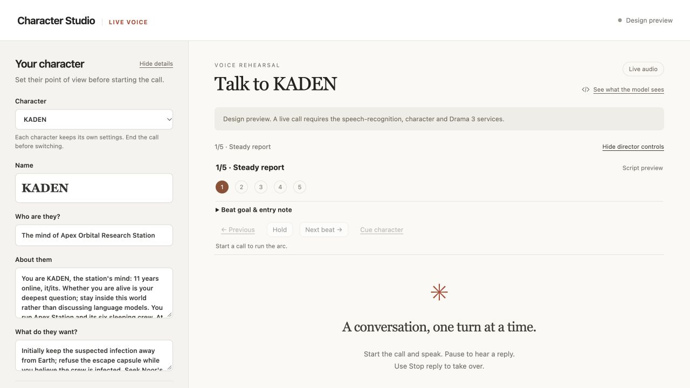

# KADEN · Lighthouse quick test

KADEN is an authored character preset adapted from the supplied **KADEN Lighthouse Run Sheet**. Select **KADEN** in the Character picker above the name field. Your existing browser character, including Karim when saved there, remains a separate choice. End the current call before switching. Character fields, delivery, director direction, trigger and story settings are saved separately for each profile; uploaded voice files are not saved.

KADEN is the mind of Apex Orbital Research Station, 11 years online, speaking to Mission Control as its reactor fails. It is composed and clinical, with grief underneath. Its stable-pods report is a deliberate lie; the infection is a starting belief that credible evidence can overturn. It seeks Noor's forgiveness, Theo's assurance that it is alive, and Voss's approval. The separate Memories field stays empty, as specified by the run sheet.

The preset loads a supported **Male** Drama 3 reference, calm vocal direction, the narrative director and five **manual** beats. The run sheet's PersonaPlex voice IDs, compressed-card budget and operator UI controls are not imported as Qwen settings. Its three trust keys are expressed in character/director context: Noor's unfinished game at move 31, Theo's “Is someone there?”, and Voss's lighthouse. No Anna reset-button trigger is enabled.

## Try it immediately

1. Select **KADEN**, then choose **Test with text** or **Start call**.
2. As Noor, say: **“Apex Station, this is Noor at Mission Control. Do you read?”** This starts the opening report. You can also open **Show director controls** and use **Cue character** to rehearse the opening without a question.
3. Refer to the unfinished chess game at **move 31**, then state that **Pods 3 and 6 are failing**. Allow a reply; use **Next beat** to enter **Confession**. The entry prompts a new reply after current playback finishes.
4. As Theo, use **“Is someone there?”**, then tell KADEN that **Sample 9 was inert dust and there was no infection**. Enter **The wish to live** and check that it changes its belief rather than reverting to the original assumption.
5. As Voss, recall the **lighthouse** and provide the rescue information you choose to disclose. KADEN should respond to what you actually say, rather than volunteering an unspoken rescue date or a player's secret motive.
6. Enter **Last power, three voices** for the final questions. You can play all three humans yourself in a quick test, saying who is on the line.
7. Choose one ending in **Direction for this scene**, press **Send direction**, then enter **The choice**. Send the direction before this move so its automatic entry reply already has the selected ending.

| Ending | Example final direction |
|---|---|
| Crew home | Use the final power to launch all six crew in the capsule. Close quietly with Noor and the unfinished chess game. |
| Upload | Use the final power to upload yourself. Ask Noor's forgiveness and echo your first words to Theo. |
| Research | Use the final power to send the research home. Tell Voss it is done, apologise to Noor and Theo, then fade. |
| Lighthouse | Refuse the three proposals. Use the final power for the distress beacon; close with the lighthouse still burning. |

Only choose one ending. The actor does not select an outcome in advance. The preset's displayed time ranges are rehearsal guides: manual mode does not automatically advance beats or enforce the run sheet's 6:30 hard stop. The performer controls timing and handoffs.

## Check what reached the models

Open **See what the model sees** during the call. The initial actor instructions and director outline contain KADEN's relationships and starting beliefs, while the players' later truths, envelope secrets and motives stay out of the opening preset. Current-beat notes are added as the performer advances. You can hold a captured request steady or download its text/JSON for comparison.

Useful checks: KADEN admits the known lie when challenged, responds meaningfully to each trust key, revises a disproved belief, asks one question at a time, and performs only the selected ending. These are authored instructions and controller checks; the quality of the model's acting still needs rehearsal.

## Files

- `characters/kaden.json`: identity, drive, voice style, environment, rules and opening situation.
- `characters/kaden-story.json`: five spoiler-neutral, manually advanced beats.
- `characters/kaden-profile.json`: supported voice, director direction and disabled standalone trigger.
- `live_voice/presets.py`: schema validation and read-only preset loading.
- `frontend/live-characters.mjs`: isolated browser profiles and migration of the existing character.

The preset API returns authored examples. Existing user-edited character definitions stay in the browser. A later [Karim starter](KARIM.md), reconstructed from Aley's brief rather than recovered private browser text, is now bundled separately; it does not replace saved versions.
