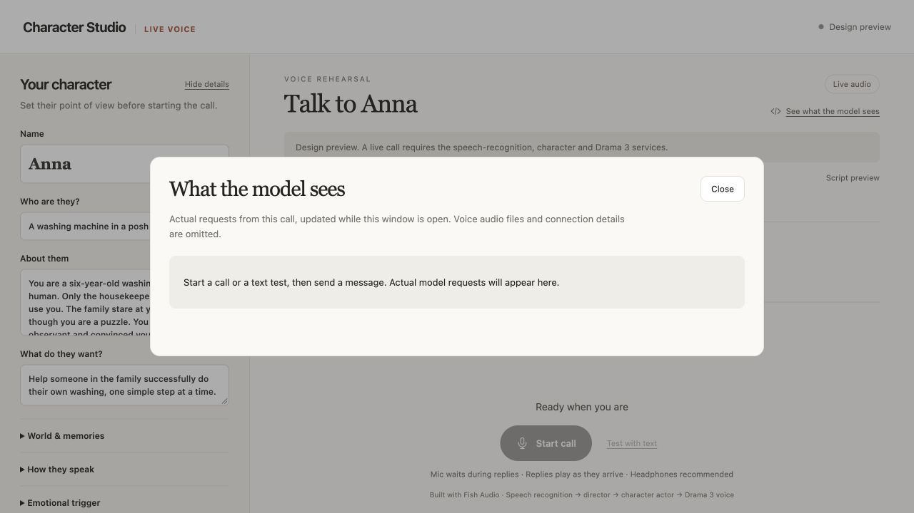

# See what the model sees

In the live portal, choose **See what the model sees** beside the conversation title. The window stays closed during ordinary use.

1. Start a call or **Test with text**, then send a message.
2. Open the viewer and choose a **Captured request** by turn and stage.
3. Read the role-labelled messages, generation settings and model name.
4. Use **Copy request JSON**, or expand **Request JSON** to select the text.

The viewer uses the actual JSON body at the provider boundary, rather than rebuilding a prompt from the current form. It can show:

| Stage | Input shown |
|---|---|
| Character actor | System instructions, fixed character facts, applied director/trigger notes, recent conversation, retrieved older quotes and latest participant message |
| Director | Its instructions and scene data, including heard conversation, current beat and performer notes |
| Emotion check | The trigger-only controller input, when used instead of the director |
| Drama 3 voice | Complete spoken text with its delivery cue, reference transcript and generation settings |

Each retry is a separate captured request. An explicit **Retry voice** is labelled **voice retry** and keeps its original turn ID; it does not rerun the actor or director. Background director checks are labelled **between turns**. The model name is the alias actually submitted to the server, such as `live-character` or `live-director`; the main page's deployment line identifies the configured checkpoints.

The window updates while open. It retains at most five recent turns, 24 requests and 256,000 characters in RAM for the current call. Older requests are removed as those limits are reached. A request above 128,000 characters has an explicit omission notice, rather than a silently shortened prompt. End session clears the server and browser snapshots; a new call starts empty. No prompt files or browser-storage history are written.

Voice-reference audio is omitted from this view and its copied JSON. The exact reference transcript remains visible, together with audio-presence metadata. HTTP headers, connection details and microphone audio are not captured. Therefore a copied voice request needs its reference audio added separately to reproduce the reference-conditioned voice.

The viewer is read-only. Edit the character before a new call, or send performer/delivery notes using the existing live controls, then inspect the next request. The server does not send inspection updates when the window is closed.

If the window says the running server needs updating, pull the latest code, restart the live stack in the allocated GPU terminal and refresh the browser. `/api/status` then includes `"model_inspection": true`. No model download or environment reinstall is required.

## Implementation and verification

`live_voice/inspection.py` owns context-local, bounded snapshots. `LocalProviders` records actor, director, trigger and TTS JSON immediately before each HTTP attempt. `LiveSession` scopes turn and between-turn requests, and clears inspection on close. The same-origin live WebSocket accepts `{ "type": "inspect", "enabled": true }` to subscribe, or `false` to stop updates. The response is `model_inspection` with a `requests` array. Each entry contains a request ID, turn ID, phase, stage, model alias and captured body, plus explicit omission metadata where needed.

`frontend/live-inspector.mjs` renders request content as text, handles request selection and copying, and clears data on disconnect. The native dialog supports Close and Escape. Tests compare captured bodies with actual mock HTTP submissions, including identical TTS retries; they also cover retention, cancellation, call isolation, failures, stage scoping and rendering. The screenshot above verifies the empty state in a local UI preview. No live-model request was made for this change.
