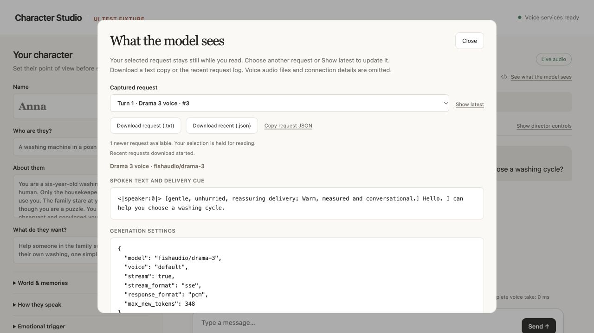

# See what the model sees

In the live portal, choose **See what the model sees** beside the conversation title. The window stays closed during ordinary use.

1. Start a call or **Test with text**, then send a message.
2. Open the viewer and choose a **Captured request** by turn and stage.
3. Read the role-labelled messages, generation settings and model name. The selected snapshot stays still until you choose another request or **Show latest**; incoming updates do not reset its text or scroll position.
4. Choose **Download request (.txt)** for a readable copy of that exact selected snapshot, including prompts, conversation context, settings and omission notes.
5. Choose **Download recent (.json)** for the bounded recent request log, including actor, director and voice requests. **Copy request JSON** remains available.

The viewer uses the actual JSON body at the provider boundary, rather than rebuilding a prompt from the current form. It can show:

| Stage | Input shown |
|---|---|
| Character actor | System instructions, fixed character facts, applied director/trigger notes, recent conversation, retrieved older quotes and latest participant message |
| Director | Its instructions and scene data, including heard conversation, current beat and performer notes |
| Emotion check | The trigger-only controller input, when used instead of the director |
| Drama 3 voice | Complete spoken text with its delivery cue, reference transcript and generation settings |

Each retry is a separate captured request. An explicit **Retry voice** is labelled **voice retry** and keeps its original turn ID; it does not rerun the actor or director. Background director checks are labelled **between turns**. The model name is the alias actually submitted to the server, such as `live-character` or `live-director`; the main page's deployment line identifies the configured checkpoints.

The recent list updates while open, but it never replaces the request you are reading. **Show latest** explicitly selects its newest entry. The recent list retains at most five turns, 24 requests and 256,000 characters in RAM for the current call. Older requests are removed as those limits are reached. One selected snapshot can remain held in the browser after pruning, labelled **saved selection**, so it stays readable and downloadable as text. The recent JSON download contains the recent list; a pruned saved selection is downloaded separately using **Download request (.txt)**. A request above 128,000 characters has an explicit omission notice. End session clears inspection snapshots; download any desired requests before ending the call.

Downloads use a standard HTTP attachment from the same studio server. Only an explicit download sends the exported snapshot to a temporary RAM attachment cache; at most four files of 2 MiB each are retained. Links expire after two minutes, expired cache entries are pruned on use, and shutdown clears the cache. No export file is written on the server or to browser storage. The browser handles saving the downloaded file. UTF-8 text preserves full Unicode prompts without shortening them; JSON includes request IDs, turns, stage, phase, exact payloads and explicit omission metadata.

Voice-reference audio is omitted from this view and its copied JSON. The exact reference transcript remains visible, together with audio-presence metadata. HTTP headers, connection details and microphone audio are not captured. Therefore a copied voice request needs its reference audio added separately to reproduce the reference-conditioned voice.

The viewer is read-only. Edit the character before a new call, or send performer/delivery notes using the existing live controls, then inspect the next request. The server does not send inspection updates when the window is closed.

Pull the latest code, restart the live stack in the allocated GPU terminal and refresh the browser to load the download routes and new controls. `/api/status` includes `"model_inspection": true` and `"inspection_download": true`. No model download or environment reinstall is required.

## Implementation and verification

`live_voice/inspection.py` owns context-local, bounded snapshots. `LocalProviders` records actor, director, trigger and TTS JSON immediately before each HTTP attempt. `LiveSession` scopes turn and between-turn requests, and clears inspection on close. The same-origin live WebSocket accepts `{ "type": "inspect", "enabled": true }` to subscribe, or `false` to stop updates. The response is `model_inspection` with a `requests` array. Each entry contains a request ID, turn ID, phase, stage, model alias and captured body, plus explicit omission metadata where needed.

`frontend/live-inspector.mjs` renders literal text, holds an independent selected snapshot and avoids rebuilding its details when background requests arrive. `live-inspection-export.mjs` prepares readable text or JSON snapshots and uses a fixed same-origin attachment route. POST `/api/inspection/downloads` validates exact Origin, type, size and safe filenames; GET of its unguessable token returns a no-store attachment. URLs from the preparation response must match the exact local download path; redirects are rejected. `live_voice/inspection_downloads.py` bounds and expires the temporary cache.

Tests verify full Unicode/long-tail prompt contents, held snapshots after pruning, download errors, exact attachment bytes/headers, origin checks, expiry and cleanup. The local browser test used mocked model responses, confirmed the selection stayed unchanged after a newer director request, and observed successful POST/GET attachment delivery. The in-app browser's download-event wait stalled during the earlier Blob check and did not expose a saved file path; file contents are verified through API tests rather than a claim about a particular Downloads-folder location. No GPU model was called.
