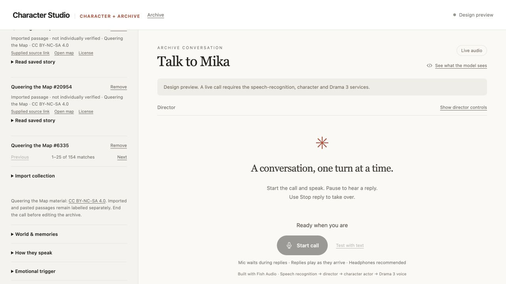

# A larger local Queering the Map collection

The Archive can search a local database of stories, in addition to the small collection of individually selected entries. Retrieval gives the character a few relevant, attributed passages for the current question. It does not put the whole database into a prompt or train the model on it.

## Import the official public snapshot on Surrey

Stop the running portal/stack before importing. For a batch deployment, find its current ID with `squeue -u "$USER"` and stop that studio job with `scancel JOB_ID`; wait until it has left the queue. Ctrl+C stops an interactive foreground stack, but Ctrl+C in a batch-log viewer only closes the viewer. The archive lives on shared storage; avoid an import from one node while the app is using that database on another. An existing conversation also keeps its own view of the archive, so start a new conversation after importing.

Use your **login01** terminal for this step. It does not need a GPU allocation and does not start any models:

```bash
cd /scratch4weeks/$USER/Character_Studio_Qwen
export LIVE_VOICE_STORE="/scratch4weeks/$USER/live-voice-store"

.venv-live/bin/python scripts/import_qtm_archive.py --download
```

If this checkout is behind the version containing the importer, update it first using your usual authenticated `git pull --ff-only` command. The existing `.venv-live` environment provides the app's Python dependencies; there is no new model download or runtime installation for this import.

The command reports the number of new stories, duplicates and total database entries. Repeating `--download` reuses the saved snapshot only after checking its metadata, size, SHA-256 and JSON shape. Re-importing the same records does not create copies.

To explicitly check for a newer export:

```bash
.venv-live/bin/python scripts/import_qtm_archive.py --download --refresh
```

The refresh sends `If-None-Match` when a verified snapshot has an ETag. There is no scheduled refresh or background crawler. A refresh adds or deduplicates imported records; it is not a deletion-sync feed. If a contributor's story is removed at the source, an older local copy does not automatically disappear. Keep a dated snapshot and handle removal requests when maintaining or sharing a collection.

## Where the files go

The importer and portal use the same archive-directory priority:

1. `LIVE_ARCHIVE_DIR`, when set.
2. `$LIVE_VOICE_STORE/archive`, when `LIVE_VOICE_STORE` is set.
3. `~/.local/share/character-studio/archive` otherwise.

An explicit `--directory /path/to/archive` overrides the importer destination. Use the same directory when starting the portal.

Within that directory, the original export is saved at `imports/descriptions.json`. The neighboring `imports/descriptions.metadata.json` records the source URL, download time, license, ETag, byte count and SHA-256. These files are created with owner-only permissions. Metadata contains no story excerpts.

The default locations are outside the repository. Keep the downloaded corpus and generated database out of GitHub. Surrey's `/scratch4weeks` is temporary storage; follow the cluster's retention policy when choosing a longer-term location.

## Use it in the portal

Restart the stack after the import, then open `/archive/`. Enable **Consult an archive** and choose **Whole local archive** under **Search during the call**. Start a new call and ask a specific question, for example, “Find a story about coming out” or “Show me a story mentioning London.” The character consults matching passages rather than claiming these anonymous stories as its own memories.

The source link stays attached to each imported entry. The smaller selected collection remains available for deliberately curated conversations.



The current search is lexical full-text search with limited normalization, not semantic embeddings or a guarantee of thematic completeness. Up to three relevant excerpts, at most 6,000 characters total, enter each actor/director request. Search and pagination do not send the full database to the browser or the models. Browser storage keeps character settings, scope and selected IDs rather than corpus text.

The database supports up to 500,000 saved stories and preserves the original IDs when migrating the previous `selected-stories.json` collection. Persistent SQLite uses rollback journalling instead of WAL because the cluster directory can be shared between hosts. Each call receives a private, read-only in-memory database snapshot through SQLite's backup API; it is closed when the call ends. This adds one snapshot-copy cost at call start and memory proportional to the indexed collection, rather than reparsing every story on every turn. Actual shared-filesystem locking still depends on the cluster; the Surrey deployment has not been tested for this update.

Local checks imported the complete 123,209-story snapshot and verified search and repeat-import deduplication. These are local database checks, not model latency or an H200 benchmark. No speech models were invoked.

## Import an existing file instead

```bash
.venv-live/bin/python scripts/import_qtm_archive.py --file /path/to/stories.json
.venv-live/bin/python scripts/import_qtm_archive.py --file /path/to/stories.jsonl
.venv-live/bin/python scripts/import_qtm_archive.py --file /path/to/stories.csv
```

Use `--format json`, `--format jsonl` or `--format csv` if the filename does not identify the format. Local files are read directly; this mode makes no network requests.

Supported JSON forms include the official numeric-ID-to-text object, an array of records, or an object containing an `entries` array. JSONL contains one record per line. CSV uses a header row. Records may use `text` or `description`, plus optional `title`, `source_url`, and `source_entry_id` / `short_id` / numeric `id`. For example, this is synthetic test data:

```json
{"123": "An invented example passage, not a real contributor's story."}
```

The numeric ID produces the canonical link `https://www.queeringthemap.com/moment/123`. Supplied source URLs must point to Queering the Map. Imported file metadata is not proof that an individual story was fetched or checked live.

The official numeric-ID map and explicit `text` fields contain literal contributor text: emoticons, angle brackets and entity-like strings are preserved, apart from existing outer-whitespace trimming. They are never interpreted as HTML. Explicit `description` fields in generic record-array/JSONL/CSV imports retain the existing HTML-to-plain-text conversion. The browser renders archive text as text, and model prompts treat it as untrusted source material.

The download and import size limit is 128 MiB. Invalid files produce a safe error instead of printing contributor text. The database import validates the complete file before committing records.

## If an import fails

The importer reports the chosen archive directory and separates preparing the source, opening/migrating the database, importing records and closing it. A failed import reports a fixed reason and safe diagnostic fields, rather than contributor text or arbitrary exception messages. A completed cache download is kept and can be reused on the next run.

| Diagnostic | Next check |
|---|---|
| SQLite busy/locked | Stop the other portal/import that is using this archive, then retry. |
| Read-only/cannot open, or an OS access error | Check that the printed directory is the intended destination and writable by your account. |
| Storage full/quota | Check available space and account quota before retrying. |
| SQLite I/O error | Check cluster filesystem/locking support; preserve the current archive while investigating. |
| Invalid legacy archive/schema | Preserve `selected-stories.json` and the database; inspect the old format instead of deleting or resetting it. |
| Invalid import row | Use the reported row number to check the source record locally; do not paste a contributor's story into diagnostic logs. |

The reported Surrey failure at **row 55,666** was a format-handling bug: the story was the broken-heart emoticon `</3`, and the importer incorrectly treated the official plain-text export as HTML. [CPython 3.12's parser](https://github.com/python/cpython/blob/v3.12.15/Lib/html/parser.py#L279) discards that incomplete closing-tag-like fragment; local Python 3.11 retained it, which explains why the first local corpus test passed. The numeric-ID map now uses the literal `text` path, so the record remains valid. No rows are skipped, limits relaxed or model packages changed. A fresh local import and repeat import both cover all 123,209 stories.

Pull the correction and repeat the same cached-file import command. Existing failed imports rolled back, and the previous saved collection and downloaded file are retained. Do not change the Torch/CUDA environment or re-download models for this archive fix.

## Source and reuse

The fixed download source is the first-party public asset:

- [Official text snapshot](https://www.queeringthemap.com/data/descriptions.json)
- [Official export code](https://github.com/radical-data/queering-the-map/blob/5233a2202d9679fd2a22ca0a904fe84b93b03e06/src/lib/scripts/fetchData.ts)
- [Official build configuration](https://github.com/radical-data/queering-the-map/blob/5233a2202d9679fd2a22ca0a904fe84b93b03e06/package.json)

The export script selects approved entries and writes a JSON object whose keys are numeric story IDs and whose values are descriptions. This is a deployment snapshot, not a promise of real-time completeness. Its download time is recorded locally; it should not be described as the original publication date of each story. The importer does not collect coordinates, crawl individual IDs, query Supabase, or require site credentials.

The public text snapshot retrieved during development on **2 November 2026** contained **123,209 entries** in **21,696,338 bytes**. These are measurements of that snapshot, not a live count or a guaranteed count for a future download.

Queering the Map content is offered under [CC BY-NC-SA 4.0](https://creativecommons.org/licenses/by-nc-sa/4.0/). Credit **Queering the Map**, link the license and source, identify changes, use it noncommercially, and distribute adaptations under the same license. The [official FAQ](https://github.com/radical-data/queering-the-map/blob/5233a2202d9679fd2a22ca0a904fe84b93b03e06/src/lib/content/faqs.yaml) and [Terms of Use](https://github.com/radical-data/queering-the-map/blob/5233a2202d9679fd2a22ca0a904fe84b93b03e06/src/lib/content/info/terms.md) describe these conditions. The [moderation page](https://github.com/radical-data/queering-the-map/blob/5233a2202d9679fd2a22ca0a904fe84b93b03e06/src/lib/content/info/moderation.md) explains anonymity and contributor removal requests.

Suggested collection credit: “Stories from Queering the Map, CC BY-NC-SA 4.0. Retrieved on the date recorded in the snapshot metadata. Official export text is preserved; explicit HTML-description imports may be converted to plain text.”
