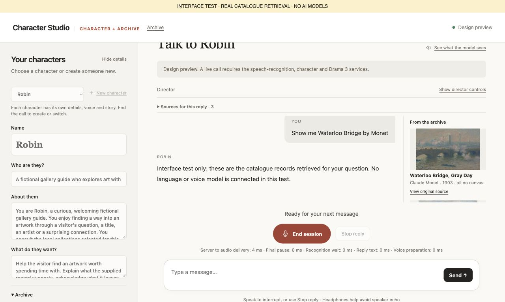

# Characters with reference collections

Select **Robin** in **Your characters** for the new art guide. Open **Archive** to choose up to eight collections the character can consult. Robin starts with **National Gallery of Art**; Mika and Queering the Map remain separate choices. End a call before changing sources. Each character saves its collection choices in this browser.

Ask “Show me Waterloo Bridge by Monet.” Matching artwork cards appear beside chat with images, artist/date/medium and original source links. The source disclosure contains the excerpts supplied to the actor and director. Cards follow the current turn and clear on character/call changes; unavailable images get a fallback. Collection browsing also shows thumbnails before a call.

Robin is fictional, not a museum representative. Images are displayed to the visitor; the current text actor receives catalogue text and metadata, not image pixels. It is instructed not to invent visual observations. Voice, director, narrative and interruption controls keep using the existing pipeline.

## Retrieval and storage

This is **lexical RAG**: SQLite FTS5 and a bounded artist/title/date index retrieve records, bounded source data enters the prompt, and the character generates a grounded response. It does not install embeddings or perform visual similarity search. Artist, title, medium and wording in the records are searchable; conceptual similarities absent from the text may not match. [Spelling tolerance, spoken-year searches and Show me the image](ARTWORK_SEARCH.md).

A call freezes its selected sources. Each turn gets at most three records and 6,000 excerpt characters plus bounded metadata. Generic collections share one frozen index copy; QTM retains its own snapshot. Independent index results merge by rank, without comparing incompatible BM25 scores. Simple follow-ups about date, artist or medium retain the previous meaningful search. Multiple matching artworks remain ambiguous rather than implying a unique selection.

Source titles, excerpts and metadata remain quoted data beneath a fixed grounding policy, never authored system instructions. Model adherence is not guaranteed. Retrieved material does not become autobiographical memory or fine-tuning data.

On the current Surrey setup:

```text
/scratch4weeks/jq575gb/live-voice-store/archive/
  archive.sqlite3       # Existing QTM stories, unchanged
  collections.sqlite3   # NGA and additional named collections
  imports/nga/68d372221c7a848b932ce07c1e1f8c293c646688/
    objects.csv
    published_images.csv
```

Directory priority: `LIVE_ARCHIVE_DIR`, then `$LIVE_VOICE_STORE/archive`, then `~/.local/share/character-studio/archive`. Multiple named collections share the new SQLite file. This version imports data exports rather than connecting to arbitrary remote SQL servers. Database files and downloaded CSVs are excluded from GitHub.

## Import the Gallery data on Surrey

The [official export](https://github.com/NationalGalleryOfArt/opendata/tree/68d372221c7a848b932ce07c1e1f8c293c646688) is pinned to 5 November 2026. The importer downloads only `objects.csv` and `published_images.csv`, about **175 MB combined**, and checks exact Git blob hashes and sizes. It does not clone the repository history or download image payloads. Displayed thumbnails load from the Gallery's image service.

Full local validation imported **146,454 artworks**, including valid object ID `0`; **63,884** have eligible thumbnails. Reimport added zero and detected 146,454 duplicates. The local index occupied about 427 MiB. Excerpt markers and counters identify shortened fields; records are not silently skipped. These counts describe the pinned snapshot, not the live collection.

Metadata is CC0. Images have separate eligibility: only `openaccess=1` rows are selected, preferring primary views. Records without an eligible image remain searchable. Credits and rights metadata stay attached. See the [data documentation](https://github.com/NationalGalleryOfArt/opendata/blob/68d372221c7a848b932ce07c1e1f8c293c646688/README.md) and [Gallery terms](https://www.nga.gov/terms-and-notices#open-access-policy).

Stop the current stack and wait for cleanup. In its allocated Surrey terminal:

```bash
cd "/scratch4weeks/$USER/Character_Studio_Qwen" &&
export LIVE_VOICE_STORE="/scratch4weeks/$USER/live-voice-store" &&
GIT_SSH_COMMAND='ssh -i ~/.ssh/id_ed25519_github -o IdentitiesOnly=yes' git pull --ff-only &&
.venv-live/bin/python scripts/import_nga_archive.py --download &&
bash scripts/run_live_stack.sh --profile quality-3gpu --listening nemotron-smart-turn
```

Omit the listening flag for baseline recognition. For [background deployment](MULTI_GPU.md#background-job), import once while the old stack is stopped, then submit the existing batch script. No new model, environment or GPU is needed for retrieval. Refresh after restarting and select Robin. The NGA registry starts with zero records until the importer runs on that server; the local preview does not populate Surrey automatically.

For local copies, use `--objects PATH --images PATH --archive-dir PATH`. `source_verified` is true and `source_revision` populated only when both files match the pinned official blobs. Other compatible inputs report unverified status; `configured_revision` identifies the importer's configured source. Safe failure diagnostics include stage, reason, file and numeric row without record text. Stable-ID conflicts do not overwrite existing content; later dataset versions need a deliberate replacement/version workflow.

## Add another collection

For museum catalogues from the Navigating.art guide, choose **+ Add museum collection** and import an artist/title/subject selection directly from the Met, Chicago, Cleveland, Rijksmuseum or Getty. These are bounded topic selections alongside NGA, not a full copy of each museum. [Museum source setup, images and limits](MUSEUM_COLLECTIONS.md).

Choose **+ Add collection**, enter a name and upload JSON, JSONL or CSV up to 128 MiB. A bad row rolls back the complete import. Imported collections are read-only in this initial UI. Active calls prevent imports and source changes.

Required record fields: `title`, `text`, `source_url` (public HTTPS). Optional: `id` (32 lowercase hex characters), `source_entry_id`, `image_url`, `image_alt`, `metadata`. Omit `collection_id`: the new collection supplies its namespace. Importing an image URL does not establish its rights; supply material you can display. Storing these URLs does not fetch arbitrary remote content on the server.

```json
[
  {
    "title": "A record title",
    "text": "The source passage or catalogue description.",
    "source_url": "https://museum.example/artwork/123",
    "image_url": "https://museum.example/images/123.jpg",
    "image_alt": "A source-supplied description",
    "metadata": {"artist": "Artist name", "date": "1900", "medium": "Oil on canvas"}
  }
]
```

CSV uses the required columns and optional `artist`, `date`, `medium`, `dimensions`, `credit_line`, `accession_number`, `classification`, `rights`. Local addresses, login credentials and executable URL schemes are rejected. Images use no-referrer loading. Record identity includes its collection namespace, so the same ID can appear in different collections.

## Files and checks

- `live_voice/collections.py`: generic SQLite/FTS storage, snapshots, routing and grounding.
- `live_voice/collection_catalog.py`: source selection and the unchanged QTM adapter.
- `scripts/import_nga_archive.py`: verified downloader and artwork/image join.
- `characters/art-guide*.json`: Robin's editable defaults.
- `frontend/live-archive.mjs`: upload, collection choices, browsing and reply images.

Real full-data import/reimport and browser upload were tested locally. A labelled CPU interface fixture verified real Monet retrieval and images beside chat; its reply was test text, not model inference. No new Surrey GPU or live-voice result was obtained. Automated counts are recorded in the handoff.


