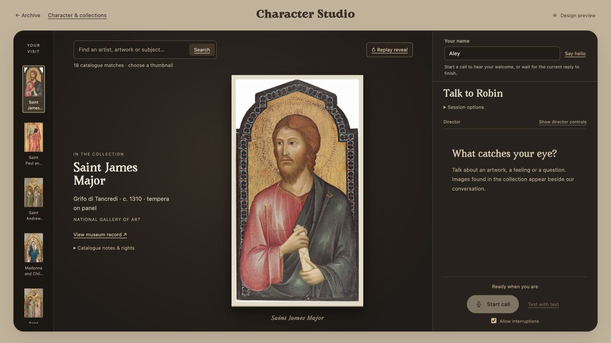
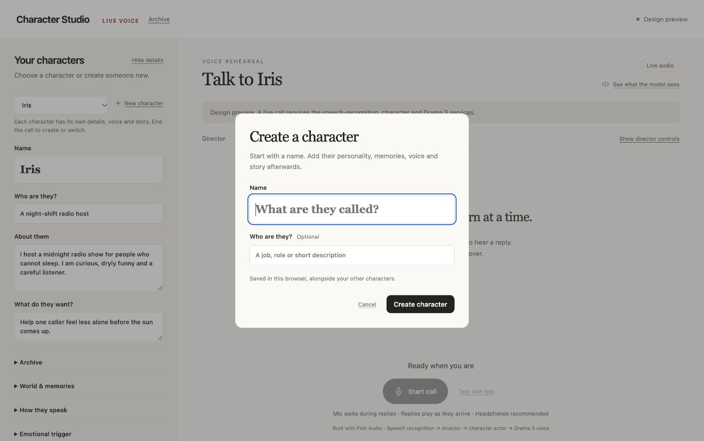
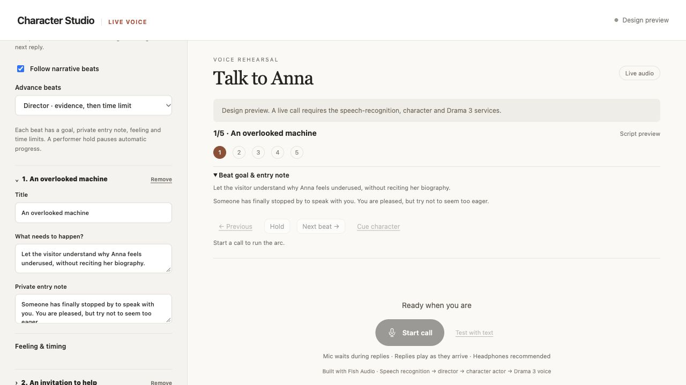
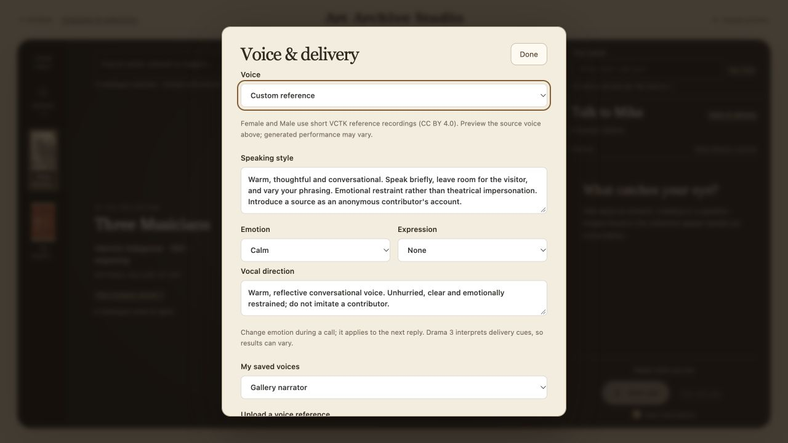
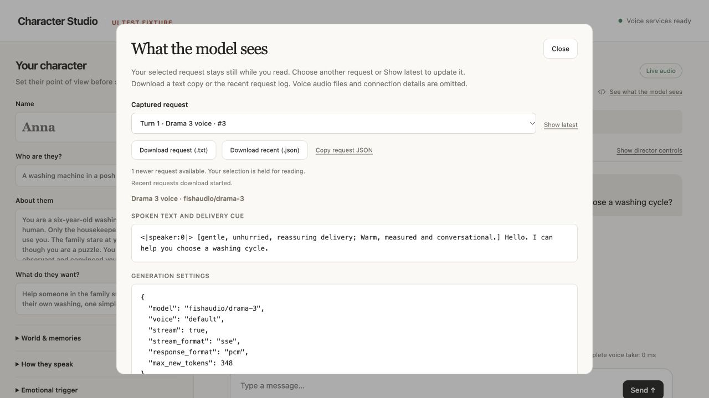
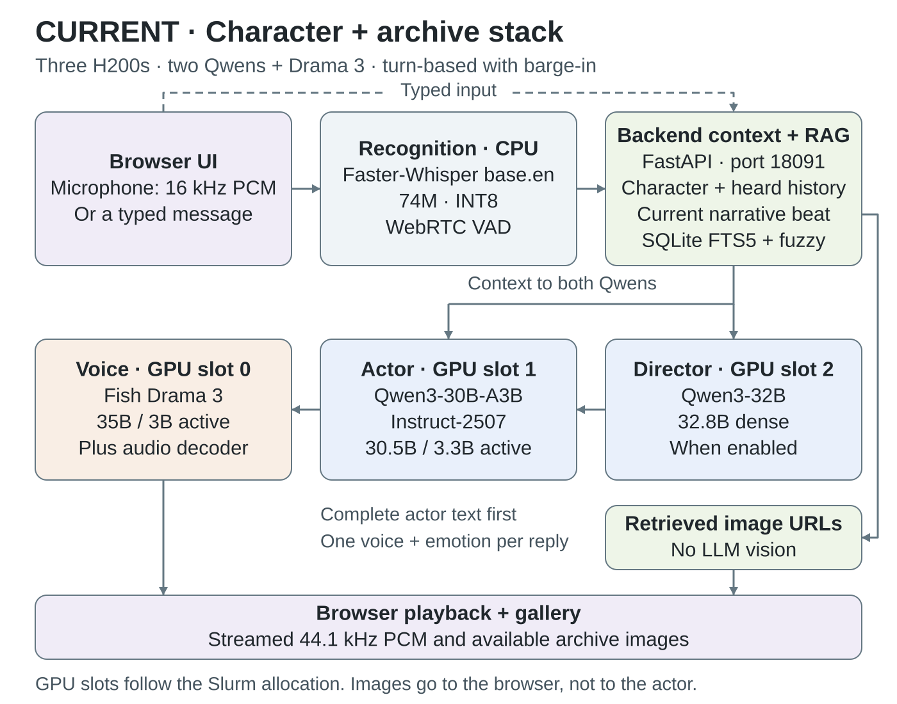

# Character Studio and archive screenshots

These images illustrate the current character/archive interface and the main Whisper, two-Qwen and Drama 3 stack. They use fictional character examples and public museum catalogue material. They are interface previews, not a new GPU inference, response-time or voice-quality benchmark. Some retained captures predate the gallery header's change to Art Archive Studio.

## Art Archive Studio

The gallery places the selected artwork beside catalogue information and the conversation. Available images load from museum source URLs. Catalogue text and source/display state reach the models; the text actor and director do not inspect image pixels.

## Create and author a character

Start a separate character profile with a name and role, then develop identity, goal, environment, memories, speaking style and a director script. This capture uses a fictional Iris profile in design preview.

## Director script and narrative beats

Each beat has a goal, private entry note, feeling, vocal direction and timing. The performer can guide progression. The separate Qwen director proposes plans when enabled; Python owns story state and validates changes. This is an Anna design preview, not a live director response.

## Voice and delivery

The same voice controls are available from the gallery. Select a voice reference, enter its exact transcript, set delivery and save a named voice in the browser. This screenshot shows a browser-local example recording selected; it does not demonstrate newly generated speech. The upload section continues below the visible portion of the panel.

## Inspect and download model inputs

The inspector keeps a selected request still while new turns arrive and offers readable text and recent JSON downloads. This capture explicitly contains a **UI TEST FIXTURE** for the Drama 3 request shape, not output from a running model. A real call captures its submitted actor, director and voice payloads through the same inspector.

## Main architecture

[Editable Mermaid source](diagrams/character-archive-stack.mmd) · [PNG image](screenshots/character-archive-stack.png) · [Developer architecture handoff](DEVELOPER_ARCHITECTURE.md).

## Files and provenance

| File | Content | Capture status |
|---|---|---|
| `art-archive-studio-gallery.jpg` | Gallery layout with a public catalogue artwork | Retained design preview; earlier gallery header, no active model call |
| `character-studio-create.jpg` | New-character dialogue, fictional Iris profile | Retained design preview |
| `narrative-beats-preview.jpg` | Anna's authored five-beat script | Retained design preview |
| `art-archive-voice-settings.jpg` | Custom reference and named voice settings | Retained local UI preview |
| `prompt-download-preview.png` | Request inspection/download controls | Retained, explicitly labelled UI test fixture |
| `character-archive-stack.png` | Baseline model and archive architecture | Documentation diagram, not an application screenshot |

Artwork source attribution and image eligibility remain part of the application records. These documentation captures do not establish that every catalogue entry has a usable image or that every linked museum has been fully imported on a deployment.
