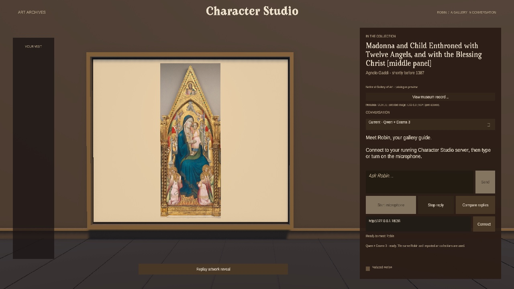

# Robin in Unity

A small desktop Unity demo for talking to Robin, displaying retrieved museum artworks on a framed surface in a 3D room, and comparing **Qwen + Drama 3** with **streaming Qwen3-Omni**.

The source is isolated on the **`unity-demo`** branch. The web portal and GPU services remain the existing Character Studio application.



Scene preview using a public National Gallery of Art catalogue image; the preview is not a recorded model reply.

## Open the demo on this Mac

The local package is installed in **Art Archives**, Unity **6000.0.84f1**. Open:

```text
Assets/RobinDemo/Scenes/RobinArchiveDemo.unity
```

Press Play. The server address defaults to `http://127.0.0.1:18091`, reached through your existing Surrey SSH tunnel. Keep that tunnel open.

1. Select the engine whose server is running.
2. Click **Connect**. End a browser call first: this backend supports one active conversation.
3. Type a question and press **Send**, or click **Start microphone**, speak and pause.
4. Ask for an artwork, such as “Show me a landscape by Monet.” Retrieved images appear on the framed display and as selectable thumbnails.
5. **Stop reply** interrupts playback. The microphone otherwise waits during Robin's reply to reduce speaker echo. Use headphones for a voice rehearsal.
6. **View museum record** opens the selected work's source. Available museum attribution and rights stay attached to it.

The microphone starts only when requested. Stopping the call or leaving Play mode stops capture. This first client uses turn-taking, not automatic speech-over interruption or a full-duplex model.

## Compare the engines

Use the same first question in two fresh calls, with the same authored Robin definition and art collections. The packaged Robin has the director enabled and narrative beats disabled for this initial controlled test.

1. Start the baseline on Surrey:

   ```bash
   LIVE_DEFAULT_ENGINE=baseline sbatch scripts/run_live_slurm.sbatch --listening baseline
   ```

2. In Unity select **Current · Qwen + Drama 3**, connect, ask one question and wait until it finishes playing. End the call.
3. Stop that specific Slurm job, wait for cleanup, then start the streaming stack:

   ```bash
   sbatch experiments/qwen_stream/run.slurm.sbatch --listening baseline
   ```

4. Update the SSH tunnel's compute hostname if Slurm assigned a different node. Keep Unity in Play mode, choose **Streaming · Qwen3-Omni**, reconnect and repeat the same first question.
5. Open **Compare replies** to review the two latest completed, heard replies, their archive record IDs and timing estimates.

The selector does not deploy or move models. The launchers run sequentially on three allocated H200s. Native Qwen uses its own voice; the baseline uses Drama 3. This demo does not transfer Drama 3 reference recordings into Qwen voices. Match the input and listening mode when comparing timing.

Comparison results stay in the current Unity Play session; leaving Play clears them. A new completed reply replaces that engine's earlier sample. Software timings are not measurements of sound reaching a listener, and no automatic quality score is assigned.

## Install in another Unity project

Requirements: a **Unity 6 desktop project**, using URP for the supplied room styling. The package declares uGUI, Input System and Newtonsoft JSON dependencies; there is no model or checkpoint bundled in the Unity package.

1. Download or clone the **`unity-demo`** branch.
2. In Unity's Package Manager choose **Install package from disk** and select:

   ```text
   unity/com.costar.robin-demo/package.json
   ```

3. Under **Project Settings → Player → Other Settings → Active Input Handling**, enable **Input System Package (New)** or **Both**. Accept the Editor restart if requested; the demo uses `InputSystemUIInputModule`.
4. Choose **Tools → CoSTAR → Create Robin Archive Demo**. The builder creates a new scene and keeps other open scenes intact. It imports TMP essentials non-interactively when required; if Unity is still importing, wait and run the menu item again.
5. Open the saved Robin scene by itself before Play to avoid duplicate cameras, EventSystems and audio listeners from another scene.

This client targets the Editor and desktop players. Browser/WebGL builds need a different microphone and networking bridge and are not implemented here. The package uses desktop networking for the local SSH endpoint and leaves the project's global insecure-HTTP setting unchanged.

## What stays on Surrey

- Speech recognition, the director and whichever character/voice engine is running.
- The existing SQLite archive databases, image-link lookups and retrieval rules.
- The `/api/live` WebSocket protocol and archive APIs.

Unity handles microphone capture, input resampling, PCM playback, text, textures, the pixel reveal and scene controls. Input is mono PCM16 at 16 kHz. Playback follows `ready.output_rate`: 44.1 kHz for the baseline and 24 kHz for native streaming. Playback acknowledgements are sent after consumed audio and a conservative output-buffer allowance; receiving the final network packet is not treated as hearing it.

The native client supplies the existing endpoint's exact Origin header for the local connection. It does not remove the server's origin checks or add a public endpoint. Origin gating is not authentication. Public deployment requires authenticated native access to be added/configured on the server, as well as HTTPS/WSS; this demo is intended for the local SSH tunnel.

Browser-edited profiles are currently browser-local. This demo loads a bundled Robin profile and enables the available imported museum collections on its selected server. It does not silently import another browser's private character edits. Replace the `DefaultProfileText` asset on the controller to supply another full character bundle.

## Files

| Path within `com.costar.robin-demo` | Purpose |
|---|---|
| `Runtime/RobinGalleryDemo.cs` | Session controls, Robin settings, image retrieval and comparison |
| `Runtime/RobinConnection.cs` | WebSocket, fragmented messages, Origin and generation-safe callbacks |
| `Runtime/RobinMicrophone.cs` | Device capture, downmixing and 16 kHz PCM packets |
| `Runtime/RobinAudioPlayer.cs` | Bounded streaming playback and heard-audio acknowledgements |
| `Runtime/RobinHttp.cs` | Bounded desktop HTTP requests for server metadata and images |
| `Runtime/RobinDemoView.cs` | Artwork presentation, pixel reveal and comparison panel |
| `Editor/RobinDemoSceneBuilder.cs` | Reproducible scene and UI creation |
| `Resources/robin-profile.json` | Robin's full character/director/archive settings |
| `Resources/Fonts` | Supplied Avara fonts and upstream OFL credits |
| `Tests/Editor` | PCM framing, queue, cancellation and resampling regressions |

## Troubleshooting

- **Server unavailable:** check the SSH tunnel, the allocated node and `/api/status`. The local design preview does not run models.
- **Selected engine offline:** start its corresponding stack on Surrey, then reconnect. Only one stack normally owns port 18091.
- **Call refused:** end the other browser/Unity call before connecting.
- **No artworks:** import museum collections on the server. Catalogue records without image links remain records; the demo does not invent replacement images.
- **No microphone:** grant microphone access to Unity/the built player, or use text. No microphone permission is needed to test typed replies.
- **Cut-off or failed voice:** inspect the existing model logs and compare the same reply in the web portal. A Unity display change does not repair a model-generation failure.

## Validation

Validated in Unity **6000.0.84f1** on macOS: the package and scene compile, frames advance in Play mode, a real NGA image loads into the framed display, and **25 Editor tests pass** for streaming audio, playback completion, cancellation and microphone resampling. Native HTTP and WebSocket fixtures also check fragmented messages, Origin, byte limits and cancellation. A live microphone session and retrieved artwork were observed in Unity; a controlled, completed comparison between both GPU engines has not yet been measured. The comparison panel reports software estimates and keeps only this Play session's results.

Read the existing [streaming setup](../experiments/qwen_stream/README.md), [three-GPU guide](../docs/MULTI_GPU.md) and [archive guide](../docs/RAG_COLLECTIONS.md) for server installation and data import.
